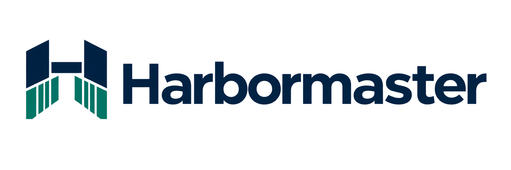

# Harbormaster

Harbormaster is a web control center for AWS ECS. It gives a DevOps team the experience Stackstead gives for a Docker host (one place to see what runs, how it behaves, and to change it safely), but the backend is AWS: ECS clusters, services and tasks, task definitions, ECR images, EFS file systems, VPCs and CloudWatch.



## Screens

- [Overview](docs/design/screens/overview.png): cluster usage and service health at a glance
- [Clusters](docs/design/screens/clusters.png): every cluster in the connected accounts and regions
- [Cluster](docs/design/screens/cluster.png): one cluster with its services and capacity
- [Service overview](docs/design/screens/service-overview.png): a service's status, rollout and summary
- [Service metrics](docs/design/screens/service-metrics.png): CloudWatch and Container Insights charts for a service
- [Service task definition](docs/design/screens/service-task-definition.png): the task definition, its revisions and register or deploy actions
- [Service tasks](docs/design/screens/service-tasks.png): running and stopped tasks of a service
- [Service scaling](docs/design/screens/service-scaling.png): desired count and Application Auto Scaling policies
- [Service logs](docs/design/screens/service-logs.png): CloudWatch log history and live tail
- [Service terminal](docs/design/screens/service-terminal.png): an interactive shell in a running task through ECS Exec
- [Service operations log](docs/design/screens/service-operations-log.png): who changed or opened what, and when
- [Tasks](docs/design/screens/tasks.png): tasks across the estate
- [Network tree](docs/design/screens/network-tree.png): VPCs, subnets and their connections
- [Network account](docs/design/screens/network-account.png): networking for one connected account
- [Network region](docs/design/screens/network-region.png): networking for one region
- [Storage](docs/design/screens/storage.png): EFS file systems, access points and mount targets
- [Users and permissions](docs/design/screens/users-permissions.png): global admin view of users and their access
- [Tags](docs/design/screens/tags.png): the tags that drive permissions
- [AWS accounts](docs/design/screens/aws-accounts.png): connected accounts, their regions and connection status
- [Audit log](docs/design/screens/audit-log.png): sign-ins and changes made in Harbormaster

## How it runs


Harbormaster is one Go binary that serves an embedded React single-page app. Browsers poll `/api` about every 5 seconds, so the view stays current without a push channel. Exactly one task (the poller leader, chosen with a Postgres advisory lock) polls AWS and writes snapshots to Postgres, and any task can answer API reads from them, while logs, metrics, deploys and terminal sessions call AWS directly from whichever task serves the request. What a user can see and do comes from their tags and permissions, and the server checks them on every request, including the WebSocket endpoints for the terminal and live logs.

## Install

### Prerequisites

- Docker, to build and push the image
- AWS CLI v2 with a named profile for the account that runs Harbormaster (examples below use `admin`)
- A Terraform runner that can apply the modules (see below)
- A VPC with two private subnets in different AZs, public subnets unless you run an internal load balancer, and an ACM certificate in the same region. The module README lists the full prerequisites: [`terraform/modules/harbormaster/README.md`](terraform/modules/harbormaster/README.md)

### Build and push the image

```sh
make image VERSION=v1.0.0
aws ecr get-login-password --profile admin --region eu-west-1 | docker login --username AWS --password-stdin <acct>.dkr.ecr.eu-west-1.amazonaws.com
docker tag harbormaster:v1.0.0 <acct>.dkr.ecr.eu-west-1.amazonaws.com/harbormaster:v1.0.0
docker push <acct>.dkr.ecr.eu-west-1.amazonaws.com/harbormaster:v1.0.0
```

Replace `<acct>` with your AWS account ID. The image must be pinned to a tag; the module rejects `:latest`.

`make image` builds `--platform linux/amd64` by default, matching the module's default `cpu_architecture = "X86_64"`, whatever machine you build on (Apple silicon included; the Go and web stages cross-compile natively, so no emulation is needed to build). To run on Graviton, set `cpu_architecture = "ARM64"` in the module and build with `make image VERSION=v1.0.0 ARCH=arm64`. The image architecture must match the module setting, otherwise ECS tasks fail with `exec format error`.

### Terraform and the harbormaster module

Deploy Harbormaster with the `harbormaster` module, pinned to the release tag:

```hcl
module "harbormaster" {
  source = "github.com/rcss-labs/harbormaster//terraform/modules/harbormaster?ref=v1.0.0"

  vpc_id             = "vpc-0123456789abcdef0"
  private_subnet_ids = ["subnet-0123456789abcdef0", "subnet-0123456789abcdef1"]
  certificate_arn    = "arn:aws:acm:eu-west-1:<acct>:certificate/<certificate-id>"
  image              = "<acct>.dkr.ecr.eu-west-1.amazonaws.com/harbormaster:v1.0.0"
  base_url           = "https://harbormaster.example.com"
}
```

These five inputs are required. `public_subnet_ids` is also needed unless you set `internal = true`. The full input list is in [`terraform/modules/harbormaster/README.md`](terraform/modules/harbormaster/README.md), and [`terraform/examples/harbormaster/main.tf`](terraform/examples/harbormaster/main.tf) shows a complete call.

Plans and applies run in your Terraform runner (TerraDuckTel, env0, Terraform Cloud or similar); nothing is applied from a laptop. Apply the module with your Terraform pipeline.

### First run

On the first start, with no users in the database, Harbormaster needs a first global admin. Choose one of these:

- **Setup token.** The server logs a one-time setup token. Read it from the log group `/ecs/harbormaster/harbormaster-server`:

  ```sh
  aws logs tail /ecs/harbormaster/harbormaster-server --follow --profile admin --region eu-west-1
  ```

  Open the app, enter the token, and choose a username and password. The token is regenerated on each start until a user exists.
- **Bootstrap secret.** Set `bootstrap_admin_password_secret_arn` in the module (`HM_BOOTSTRAP_ADMIN_PASSWORD_SECRET_ARN`) to a Secrets Manager secret holding the initial `admin` password. The server then creates the `admin` user from it and prints no setup token. The secret value is never logged.
- **CLI.** `harbormaster create-admin --username <name>` creates an administrator directly. Add `--password-stdin` to pass the password on standard input.

## Connecting AWS accounts

Harbormaster reads and changes resources in other accounts by assuming a role in each one. A global admin connects each account from **AWS accounts** in the UI.

1. Get the `task_role_arn` output of the `harbormaster` module. It is the principal the target role trusts.
2. In Harbormaster, open **AWS accounts > Connect account** and copy the generated external ID (24 characters).
3. In the target account, apply the `harbormaster-access` module with your Terraform pipeline, passing the task role ARN and the external ID:

   ```hcl
   module "harbormaster_access" {
     source = "github.com/rcss-labs/harbormaster//terraform/modules/harbormaster-access?ref=v1.0.0"

     harbormaster_task_role_arn = "arn:aws:iam::<harbormaster-acct>:role/harbormaster-server-task"
     external_id                = "<value copied from Harbormaster>"
   }
   ```

4. Back in Harbormaster, enter the `role_arn` output of that module and press **Test and connect**.

Set `read_only = true` on the access module to create a role that can inspect resources but cannot register task definitions, update services, stop tasks, open exec sessions or pass roles. The module details are in [`terraform/modules/harbormaster-access/README.md`](terraform/modules/harbormaster-access/README.md).

### Same account

The account where Harbormaster runs can also be connected through a role in that same account (design spec §11.1). Use the same flow: apply `harbormaster-access` in that account with the task role ARN and the external ID. If you have tightened `access_role_arns` (below), add that role's ARN to the list.

### Tightening `access_role_arns`

The `harbormaster` module's `access_role_arns` defaults to `["arn:aws:iam::*:role/harbormaster-access"]`, which lets the task role assume a `harbormaster-access` role in any account. Replace it with the explicit role ARNs you connect, for example:

```hcl
access_role_arns = ["arn:aws:iam::111111111111:role/harbormaster-access"]
```

## Terraform and Harbormaster deploys

AWS is the source of truth, and Terraform will see a revision registered here as
drift. The user accepted this. To keep Terraform from reverting a deploy on its
next apply, the recommended Terraform for services managed through
Harbormaster is:

```hcl
resource "aws_ecs_service" "payments_api" {
  # ...
  lifecycle {
    ignore_changes = [task_definition, desired_count]
  }
}
```

Harbormaster does not check or enforce it.

## Configuration

All settings are environment variables, read by `internal/config`. Durations use Go syntax (`5s`, `12h`). Unset or empty variables take the default shown. The module sets the variables it needs; you only override these when running the binary directly.

### Server

| Variable | Default | Meaning |
| --- | --- | --- |
| `HM_LISTEN` | `:8480` | Address the HTTP server listens on |
| `HM_BASE_URL` | `http://127.0.0.1:8480` | Public URL of the app |
| `HM_DATABASE_URL` | | Postgres URL. Either this or `HM_DATABASE_SECRET_ARN` is required |
| `HM_DATABASE_SECRET_ARN` | | Secrets Manager secret holding the database credentials (a postgres URL, or JSON with `username`, `password`, `host`, `port` and `dbname`; RDS-managed master secrets have no `host` and are rejected) |
| `HM_SESSION_KEY` | | Secret key mixed into session id hashes. Set a long random value in production |
| `HM_BOOTSTRAP_ADMIN_PASSWORD_SECRET_ARN` | | Secrets Manager secret with the initial `admin` password (see First run) |
| `HM_METRICS_TOKEN` | | Bearer token for `GET /metrics`. Empty disables the endpoint (it returns 404) |
| `HM_COOKIE_SECURE` | `true` | Set the Secure flag on cookies. Use `false` only for plain-HTTP local runs |
| `HM_FAKE_AWS` | `false` | Local demo only, same as `serve --fake-aws`. Seeds demo users (admin `pavel` with a published password) and refuses to run against a database that already has users or accounts. Never set in production |
| `HM_TRUSTED_PROXY` | `false` | Trust the rightmost `X-Forwarded-For` entry as the client IP. Enable only behind a proxy that appends the real client address (the Terraform module sets it for the ALB) |
| `HM_LOG_LEVEL` | `info` | Log level |
| `HM_SESSION_IDLE` | `12h` | Idle session timeout |
| `HM_SESSION_ABSOLUTE` | `168h` | Maximum session lifetime |
| `HM_LOGIN_MAX_PER_USER` | `5` | Login attempts allowed per user in the window |
| `HM_LOGIN_MAX_PER_IP` | `30` | Login attempts allowed per client IP in the window |
| `HM_LOGIN_WINDOW` | `15m` | Login rate-limit window |

### Polling intervals

| Variable | Default | Meaning |
| --- | --- | --- |
| `HM_POLL_SERVICES` | `5s` | Service poll interval |
| `HM_POLL_RUNNING_TASKS` | `5s` | Running-task poll interval |
| `HM_POLL_FULL_TASKS` | `30s` | Full task poll interval |
| `HM_POLL_STOPPED_TASKS` | `15s` | Stopped-task poll interval |
| `HM_POLL_CLUSTERS` | `60s` | Cluster poll interval |
| `HM_POLL_SERVICE_LIST` | `60s` | Service list poll interval |
| `HM_POLL_COUNTS_HISTORY` | `5m` | Task-count history sampling interval |
| `HM_POLL_TARGET_HEALTH` | `15s` | Load balancer target health poll interval |
| `HM_POLL_SCALING` | `60s` | Application Auto Scaling poll interval |
| `HM_POLL_NETWORK` | `5m` | Networking poll interval (VPCs, subnets, gateways, endpoints, security groups) |
| `HM_POLL_STORAGE` | `5m` | EFS storage poll interval |
| `HM_POLL_JITTER` | `500ms` | Random jitter added to poll schedules |
| `HM_POLL_MAX_INFLIGHT` | `8` | Maximum concurrent AWS calls |

### Retention

| Variable | Default | Meaning |
| --- | --- | --- |
| `HM_RETENTION_STOPPED_TASKS` | `168h` | How long stopped tasks are kept |
| `HM_RETENTION_SERVICE_EVENTS` | `720h` | How long service events are kept |
| `HM_RETENTION_COUNTS_HISTORY` | `168h` | How long task-count history is kept |
| `HM_RETENTION_OPERATION_LOG` | `2160h` | How long the operations log is kept |
| `HM_RETENTION_DEPLOYMENT_HISTORY` | `2160h` | How long deployment history is kept |
| `HM_RETENTION_AUDIT_LOG` | `8760h` | How long the audit log is kept |
| `HM_RETENTION_ORPHAN_TAGS` | `720h` | How long tags whose resource no longer exists are kept |

### Limits

| Variable | Default | Meaning |
| --- | --- | --- |
| `HM_PAGE_SIZE_DEFAULT` | `100` | Default API page size |
| `HM_PAGE_SIZE_MAX` | `500` | Maximum API page size |
| `HM_MAX_DESIRED_COUNT` | `50` | Highest desired count Harbormaster will set on a service (must be at least 1) |
| `HM_METRICS_CACHE_TTL` | `60s` | How long metric query results are reused before AWS is asked again |
| `HM_LOG_TAIL_IDLE` | `30m` | Close a live log tail after this long without activity |
| `HM_LOG_TAILS_PER_USER` | `2` | Concurrent live log tails per user |
| `HM_LOG_HISTORY_LIMIT` | `500` | Maximum log events returned by one history query |
| `HM_EXEC_IDLE_TIMEOUT` | `20m` | Close a terminal session after this long without keystrokes or resizes. Output does not count |
| `HM_EXEC_MAX_DURATION` | `4h` | Close a terminal session this long after it opened |
| `HM_EXEC_MAX_SESSIONS_PER_USER` | `3` | Concurrent terminal sessions per user, enforced per Harbormaster task (see Running more than one task) |

## Operating

### Health and metrics

- `GET /healthz` is the liveness check. The ALB uses it, and the image's `HEALTHCHECK` runs `harbormaster healthcheck`.
- `GET /metrics` serves Prometheus metrics when `HM_METRICS_TOKEN` is set. The module creates the token and injects it when `enable_metrics = true` (the default). Send the token as a bearer token:

  ```sh
  curl -H "Authorization: Bearer $HARBORMASTER_METRICS_TOKEN" https://harbormaster.example.com/metrics
  ```

  Without the header, or with the wrong token, the endpoint returns 401.

### Running more than one task

The service is designed to run with desired count 1 or more (design spec §4.3):

- The **poller** runs on exactly one task. Each task tries to take a Postgres advisory lock every 5 seconds, and the holder polls AWS. If that task dies, its session closes, the lock frees, and another task takes over within one interval.
- All other state (sessions, snapshots, permissions) is in Postgres, so any task can serve any API request.
- Terminal and live-log WebSockets are served by whichever task receives the connection, so the ALB needs no stickiness.

The module runs desired count 1 by default, with deployment settings that allow a short overlap; the lock makes overlap safe. `HM_EXEC_MAX_SESSIONS_PER_USER` is enforced per task, so with more than one task a user can open up to the limit on each.

### Throttling and stale banners

The UI shows two banners per account and region:

- **Slowed by AWS throttling**: AWS is throttling Harbormaster's calls for that account and region, so updates arrive more slowly.
- **Data is N min old**: the last poll for that account and region failed. The banner shows how old the data is and the last error. If it says the data is unavailable, no poll has succeeded yet.

The AWS API limits Harbormaster works within, and how the estate size affects them, are in [`docs/ops/ecs-api-budget.md`](docs/ops/ecs-api-budget.md).

### Terminal

The Terminal tab on a service page opens an interactive shell in a running task through ECS Exec (`ecs:ExecuteCommand` plus the SSM Session Manager data channel). Harbormaster checks the user's Terminal permission before it opens a session.

#### What the target account needs

- **Service:** set `enable_execute_command = true` on the `aws_ecs_service`. The Terminal tab shows a banner when the service has ECS Exec off.
- **Task role:** the task's own role needs `ssmmessages:CreateControlChannel`, `ssmmessages:CreateDataChannel`, `ssmmessages:OpenControlChannel` and `ssmmessages:OpenDataChannel`.
- **`harbormaster-access` role:** needs `ecs:ExecuteCommand` and `ssm:TerminateSession` in addition to the actions in the design spec §11.2. The Terraform module `terraform/modules/harbormaster-access` grants them.

#### Limits and recording

- Idle, maximum-duration and per-user session limits are the `HM_EXEC_*` variables in the Configuration tables.
- Harbormaster calls `ssm:TerminateSession` whenever a session ends, for any reason.
- Harbormaster does not record keystrokes or terminal output. The operations log records who opened a session, the task, container and command, and how long it lasted.
- To keep a full transcript, turn on Session Manager logging to S3 or CloudWatch Logs in Terraform.
- KMS-encrypted Session Manager preferences are not supported in v1.

## Security

- Harbormaster can deploy and exec into production tasks in every connected account; treat its task role, its database and global admin accounts as highly privileged.
- External ID on every assumed role; least-privilege policy (design spec §11.2); `PassRole` restricted by name pattern and service.
- Server-side authorization on every endpoint and every WebSocket; list endpoints filter by visibility; IDs of invisible resources return 404, not 403.
- Secrets (DB password, signing key) only from Secrets Manager; never logged. Environment variable values from task definitions are shown to users with View (they are visible in the ECS console to the same people); values from `secrets` (SSM/Secrets Manager references) are shown as references only, never resolved.
- Security headers: CSP (self + fonts), HSTS, `X-Frame-Options: DENY`.
- Task definition fields that can reach the container host are admin-only. Non-admins may keep or remove them relative to the deployed revision but cannot add or change them: task and execution roles, secrets outside existing prefixes, `environmentFiles`, FSx credentials, the FireLens S3 config, `credentialSpecs`, `privileged`, `linuxParameters.capabilities.add` and `devices`, `dockerSecurityOptions`, `systemControls`, `pidMode`/`ipcMode`/`networkMode` set to `host`, host volumes (`volumes[].host.sourcePath`), `dockerVolumeConfiguration` and `s3filesVolumeConfiguration`. A rejected draft returns 422 and nothing is registered.

## Development

### Prerequisites

- Go 1.27
- Node 26
- Docker (for the local Postgres test container)

### Run it locally

```sh
make test-db                        # start (or reuse) the hm-test-pg container and print its URL
export HM_TEST_DATABASE_URL='postgres://...'   # the URL make test-db prints
make run                            # http://127.0.0.1:8480, in-memory fake AWS estate
```

`make run` starts `serve --fake-aws`: it migrates the database, seeds demo users, tags and permissions, and serves a fake ECS estate, so no AWS credentials are needed. Sign in as `pavel` / `harbormaster-e2e-1` (a global admin). `dana`, `omer` and `oncall` use the same password with narrower access. Never use `--fake-aws` (or `HM_FAKE_AWS`) against a database that holds real users.

For frontend work, run `make run` in one terminal and `npm --prefix web run dev` in another. Vite serves the SPA and proxies `/api` to port 8480.

### Make targets

- `make build`: build the web UI (when `web/package.json` exists) and the `bin/harbormaster` binary
- `make test`: run Go tests, plus web tests (Vitest) when the web app exists. Go tests need `HM_TEST_DATABASE_URL`
- `make lint`: check gofmt, run `go vet`, run web lint and typecheck, and check third-party notices
- `make test-db`: start (or reuse) the local Postgres test container `hm-test-pg`. When it creates the container it prints the `HM_TEST_DATABASE_URL` to export; when it reuses an existing one it prints a `docker port hm-test-pg` hint instead, so build the URL from that
- `make run`: run the server locally against fake AWS data and the test database
- `make e2e`: build, then run the Playwright smoke tests against the real server (`serve --fake-aws` on `127.0.0.1:8481`). Requires `HM_TEST_DATABASE_URL`. Each run recreates a dedicated `hm_e2e` schema in that database, so it never touches your other data. Install the browser once with `cd web && npx playwright install chromium`. Port 8481 must be free
- `make soak`: soak test at target estate scale. Requires `HM_TEST_DATABASE_URL`
- `make tf-check`: validate every Terraform root under `terraform/` locally (fmt, init without a backend, validate, and tflint if installed). It never plans or applies
- `make image VERSION=v1.0.0 [ARCH=amd64|arm64]`: build the image locally as `harbormaster:v1.0.0` with `docker build --platform linux/$(ARCH)`; `ARCH` defaults to `amd64`
- `make check-image`: check the runtime contract of `harbormaster:$(VERSION)` (non-root, healthcheck, read-only root filesystem). If this machine cannot execute the image's architecture (for example an amd64 image on Apple silicon without emulation), it checks the shipped image's static contract and runs the runtime checks on a host-architecture build of the same Dockerfile (`harbormaster:$(VERSION)-check`). Local Docker only; nothing is pushed
- `make release-check`: the tag gate. Fails unless `HEAD` is tagged and `VERSION` is not `-dirty`
- `make release`: run lint, tests, build, image and image check in order. It does not run `release-check`, so to cut a release run `make release-check release`. Afterwards restore the tracked placeholder with `git checkout -- internal/web/dist/index.html`
- `make test-it-exec`: opt-in integration test of the Terminal against a real ECS task. Needs AWS credentials and the `HM_IT_*` variables (see below). `make test` never runs it

### Terminal integration test against real AWS

`internal/execbridge/integration_test.go` runs a real shell round trip and a rejection check when exec is off. It is skipped unless `HM_IT_AWS=1`, so `make test` never calls AWS. Required variables:

- `HM_IT_ROLE_ARN`: the `harbormaster-access` role in the test account
- `HM_IT_EXTERNAL_ID`: that role's external ID
- `HM_IT_REGION`, `HM_IT_ACCOUNT_ID`, `HM_IT_CLUSTER`, `HM_IT_TASK_ARN`: a running task with exec enabled
- `HM_IT_CONTAINER` (optional): the container name. When empty the test uses the task's first container
- `HM_IT_COMMAND` (optional): the shell to start. Defaults to `/bin/sh`
- `HM_IT_TASK_ARN_NOEXEC` (optional): a running task whose service has exec off. Enables the rejection check

Log in first, then run the test with the admin profile:

```sh
aws sso login --profile admin --region us-east-1
export AWS_PROFILE=admin
export HM_IT_ROLE_ARN='arn:aws:iam::<account-id>:role/harbormaster-access'
export HM_IT_EXTERNAL_ID='<external-id>'
export HM_IT_REGION=us-east-1
export HM_IT_ACCOUNT_ID='<account-id>'
export HM_IT_CLUSTER='<cluster>'
export HM_IT_TASK_ARN='arn:aws:ecs:us-east-1:<account-id>:task/<cluster>/<task-id>'
make test-it-exec
```

The test starts a session, runs an `echo` in the shell, runs `exit`, and checks that the session closes as ended by the agent. It makes real ECS and SSM calls, so run it only against an account you intend to exercise.

## Licence

Harbormaster is released under the MIT licence. See [`LICENSE`](LICENSE). Bundled third-party components and their licences are listed in [`THIRD_PARTY_NOTICES.md`](THIRD_PARTY_NOTICES.md).
