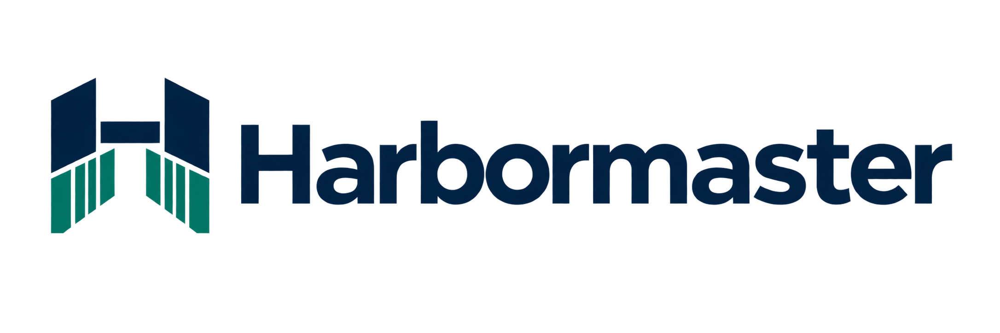

# Harbormaster

Harbormaster is a web control center for AWS ECS. It gives a DevOps team the experience Stackstead gives for a Docker host (one place to see what runs, how it behaves, and to change it safely), but the backend is AWS: ECS clusters, services and tasks, task definitions, ECR images, EFS file systems, VPCs and CloudWatch.



## Screens

- [Overview](screens/overview.png): cluster usage and service health at a glance
- [Clusters](screens/clusters.png): every cluster in the connected accounts and regions
- [Cluster](screens/cluster.png): one cluster with its services and capacity
- [Service overview](screens/service-overview.png): a service's status, rollout and summary
- [Service metrics](screens/service-metrics.png): CloudWatch and Container Insights charts for a service
- [Service task definition](screens/service-task-definition.png): the task definition JSON, its revisions and rollback; deploys open the Deploy tab
- [Service deploy](2026-10-31-harbormaster-design.md#deploy-tab): containers, task size, service settings and auto scaling, reviewed as one change set with a reason and live rollout progress
- [Service tasks](screens/service-tasks.png): running and stopped tasks of a service
- [Service timeline](screens/service-timeline.png): one service's changes, task stops, active alerts, log errors and terminal sessions on one time axis, with the likely trigger of a failure and rollback from it
- [Service scaling](screens/service-scaling.png): desired count and a read-only auto scaling summary; edited on the Deploy tab
- [Service logs](screens/service-logs.png): CloudWatch log history and live tail
- Log search (`/logs`): one CloudWatch Logs Insights query across the logs of several services; see Log search below
- Config search (`/config`): find services by image, base image, environment variable or secret name, port, role or log group; see Config search below
- [Service terminal](screens/service-terminal.png): an interactive shell in a running task through ECS Exec
- [Service operations log](screens/service-operations-log.png): who changed or opened what, and when
- Image security (`/security`): the images someone asked to scan, their open findings by severity, how fresh the vulnerability data is, and risk acceptances; see Image security below
- [Tasks](screens/tasks.png): tasks across the estate
- [Network tree](screens/network-tree.png): VPCs, subnets and their connections
- [Network account](screens/network-account.png): networking for one connected account
- [Network region](screens/network-region.png): networking for one region
- [Storage](screens/storage.png): EFS file systems, access points and mount targets
- [Users and permissions](screens/users-permissions.png): global admin view of users and their access
- [Tags](screens/tags.png): the tags that drive permissions
- [AWS accounts](screens/aws-accounts.png): connected accounts, their regions and connection status
- [Audit log](screens/audit-log.png): sign-ins and changes made in Harbormaster
- Notifications (`/settings/notifications`): routes that send failure alerts to Slack, Telegram, PagerDuty, a webhook or email, and the delivery log; see Alert notifications below

## How it runs

```text
              browsers
                 | HTTPS
                ALB  (targets: web only)
                 |
    +------------+-------------+    +------------------------+    +---------------------------+
    | web                      |    | poller                 |    | coordinator               |
    | API, web app, WebSockets |    | slice loops and alerts |    | one active, the rest wait |
    | deploys, terminal, logs  |    | focus loops            |    | notifications, off-hours, |
    | focus heartbeats         |    | one lease per account  |    | image scans, ARM64 check, |
    | snapshot cache reads     |    | and region             |    | rollups, retention        |
    +---+-----------+----------+    +---+-----------+--------+    +---+-----------+-----------+
        |           |                   |           |                 |           |
        |           +-- Valkey or Redis (optional) -+-----------------+           |
        |        open pages, poll-now and kick signals, shared limits, cache      |
        +------------------------------ Postgres ---------------------------------+
              snapshots, sessions, permissions, audit and the leases (the truth)
```

The default install is one ECS service running every part (`role=all`) and needs no store. With `split_services` the module runs the three roles above as three ECS services of the same image, so polling capacity, API capacity and the background jobs scale separately. Each task reaches AWS by assuming an IAM role per region in each managed account (`sts:AssumeRole` with an external ID): ECS, EC2, EFS, ECR, CloudWatch, Logs, App Auto Scaling, ELBv2 and SSM.

Harbormaster is one Go binary that serves an embedded React single-page app. Browsers poll `/api` about every 5 seconds, so the view stays current without a push channel. Each account and region is polled by exactly one task at a time (the one holding its lease in Postgres), which writes the snapshots to Postgres, and any task can answer API reads from them, while logs, metrics, deploys and terminal sessions call AWS directly from whichever task serves the request. What a user can see and do comes from their tags and permissions, and the server checks them on every request, including the WebSocket endpoints for the terminal and live logs.

One image runs in four roles, chosen with `serve --role=<role>` or `HM_ROLE`. The default, `all`, is the single-task install described above and needs nothing else.

| Role | Serves | Runs |
| --- | --- | --- |
| `all` (default) | the API, the web app and the WebSockets, `/healthz`, `/metrics` | everything below, in one process |
| `web` | the API, the web app and the WebSockets, `/healthz`, `/metrics` | the bootstrap admin step, manual wake and sleep, "Send test", delivery retry. No polling and no background job |
| `poller` | `/healthz` and `/metrics` only (every other path is a 404) | the slice polling loops under leases, and the idle monitor |
| `coordinator` | `/healthz` and `/metrics` only | the jobs under the coordinator lease (notifications, off-hours, image scans, ARM64 check, outcome log, rollups, retention) and an idle monitor |

Every role migrates the schema on start. A web task asks the coordinator to run a job now (a saved schedule, a changed route, a scan request) over the shared store (`HM_KV_URL`); if there is no store, or nobody hears it, the job runs at its own interval. In managed accounts a poller assumes `<role>-poller` and a coordinator `<role>-coordinator`, where `<role>` is the account's stored role name (for example `harbormaster-access-poller`); `all` and `web` use the stored role itself.

## Install

### Prerequisites

- Docker, to build and push the image
- AWS CLI v2 with a named profile for the account that runs Harbormaster (examples below use `admin`)
- A Terraform runner that can apply the modules (see below)
- A VPC with two private subnets in different AZs, public subnets unless you run an internal load balancer, and an ACM certificate in the same region. The module README lists the full prerequisites: [`terraform/modules/harbormaster/README.md`](terraform/modules/harbormaster/README.md)

### Build and push the image

```sh
make image VERSION=v1.0.0
aws ecr get-login-password --profile admin --region eu-west-1 | docker login --username AWS --password-stdin <acct>.dkr.ecr.eu-west-1.amazonaws.com
docker tag harbormaster:v1.0.0 <acct>.dkr.ecr.eu-west-1.amazonaws.com/harbormaster:v1.0.0
docker push <acct>.dkr.ecr.eu-west-1.amazonaws.com/harbormaster:v1.0.0
```

Replace `<acct>` with your AWS account ID. The image must be pinned to a tag; the module rejects `:latest`.

`make image` builds `--platform linux/amd64` by default, matching the module's default `cpu_architecture = "X86_64"`, whatever machine you build on (Apple silicon included; the Go and web stages cross-compile natively, so no emulation is needed to build). To run on Graviton, set `cpu_architecture = "ARM64"` in the module and build with `make image VERSION=v1.0.0 ARCH=arm64`. The image architecture must match the module setting, otherwise ECS tasks fail with `exec format error`.

The image-security feature runs scans in a separate scanner image: `make scanner-image VERSION=v1.0.0` (same `ARCH` rule) builds `harbormaster-scanner:v1.0.0` from `Dockerfile.scanner`, and `make check-scanner-image VERSION=v1.0.0` checks it. The build downloads Syft and Grype, verifies their cosign signatures and checksums (`tools/scanner-verify.sh`, versions and identities pinned as `ARG`s) and fails if anything does not verify. Tag and push it to ECR the same way as the main image.

The MCP gateway runs from its own small image: `make mcp-image VERSION=v1.0.0` (same `ARCH` rule) builds `harbormaster-mcp:v1.0.0` from `Dockerfile.mcp` (the gateway binary alone on distroless nonroot, no credentials), and `make check-mcp-image VERSION=v1.0.0` checks it: non-root, healthcheck, no shell, static binary, and no database, cache, AWS or SAML module linked in (`tools/check-mcp-image.sh`). Tag and push it to ECR the same way as the main image.

### Terraform and the harbormaster module

Deploy Harbormaster with the `harbormaster` module, pinned to the release tag:

```hcl
module "harbormaster" {
  source = "github.com/rcss-labs/harbormaster//terraform/modules/harbormaster?ref=v1.0.0"

  vpc_id             = "vpc-0123456789abcdef0"
  private_subnet_ids = ["subnet-0123456789abcdef0", "subnet-0123456789abcdef1"]
  certificate_arn    = "arn:aws:acm:eu-west-1:<acct>:certificate/<certificate-id>"
  image              = "<acct>.dkr.ecr.eu-west-1.amazonaws.com/harbormaster:v1.0.0"
  base_url           = "https://harbormaster.example.com"
}
```

These five inputs are required. `public_subnet_ids` is also needed unless you set `internal = true`. The full input list is in [`terraform/modules/harbormaster/README.md`](terraform/modules/harbormaster/README.md), and [`terraform/examples/harbormaster/main.tf`](terraform/examples/harbormaster/main.tf) shows a complete call.

Plans and applies run in your Terraform runner (TerraDuckTel, env0, Terraform Cloud or similar); nothing is applied from a laptop. Apply the module with your Terraform pipeline.

To run the web, poller and coordinator roles as three ECS services with a Valkey or Redis store (`split_services`, `cache_mode`, `cache_engine`), follow the ordered runs in [Upgrade: single service to split services](terraform/modules/harbormaster/README.md#upgrade-single-service-to-split-services). Nothing changes for an install that sets none of those variables. Each web, poller and coordinator task holds its own database pool (`HM_DB_MAX_CONNS`), so keep the default `db.t4g.micro` only at the default task counts and set `db_instance_class = "db.t4g.small"` before raising `web_max_count` or `poller_max_count` (the arithmetic is in the module README under Database connections).

### First run

On the first start, with no users in the database, Harbormaster needs a first global admin. Choose one of these:

- **Setup token.** The server logs a one-time setup token. Read it from the log group `/ecs/harbormaster/harbormaster-server`:

  ```sh
  aws logs tail /ecs/harbormaster/harbormaster-server --follow --profile admin --region eu-west-1
  ```

  Open the app, enter the token, and choose a username and password. The token is regenerated on each start until a user exists.
- **Bootstrap secret.** Set `bootstrap_admin_password_secret_arn` in the module (`HM_BOOTSTRAP_ADMIN_PASSWORD_SECRET_ARN`) to a Secrets Manager secret holding the initial `admin` password. The server then creates the `admin` user from it and prints no setup token. The secret value is never logged.
- **CLI.** `harbormaster create-admin --username <name>` creates an administrator directly. Add `--password-stdin` to pass the password on standard input. The account is a break-glass admin, so it can sign in with its password while single sign-on is on (see Single sign-on (SAML)).

## Connecting AWS accounts

Harbormaster reads and changes resources in other accounts by assuming a role in each one. A global admin connects each account from **AWS accounts** in the UI.

1. Get the `task_role_arn` output of the `harbormaster` module. It is the principal the target role trusts.
2. In Harbormaster, open **AWS accounts > Connect account** and copy the generated external ID (24 characters).
3. In the target account, apply the `harbormaster-access` module with your Terraform pipeline, passing the task role ARN and the external ID:

   ```hcl
   module "harbormaster_access" {
     source = "github.com/rcss-labs/harbormaster//terraform/modules/harbormaster-access?ref=v1.0.0"

     harbormaster_task_role_arn = "arn:aws:iam::<harbormaster-acct>:role/harbormaster-server-task"
     external_id                = "<value copied from Harbormaster>"
   }
   ```

4. Back in Harbormaster, enter the `role_arn` output of that module and press **Test and connect**.

With split services each managed account has three roles from the same `role_name`: `harbormaster-access`, `harbormaster-access-poller` (read only) and `harbormaster-access-coordinator` (off-hours, the ARM64 check and the daily rollups). Pass the `web_task_role_arn`, `poller_task_role_arn` and `coordinator_task_role_arn` outputs to the access module as well, after the `harbormaster` module has been applied (IAM rejects a trust policy that names a role that does not exist). Harbormaster derives the suffixed ARNs from the one you enter, so there is nothing more to paste.

Set `read_only = true` on the access module to create a role that can inspect resources but cannot register task definitions, update services, change auto scaling or alarms, stop tasks, open exec sessions or pass roles. The module details are in [`terraform/modules/harbormaster-access/README.md`](terraform/modules/harbormaster-access/README.md).

Roles created before `ecr:BatchGetImage` was added to `harbormaster-access` cannot read image manifests. The ARM64 (Graviton) advisor shows a per-account message for them, and nothing else is affected, until the access module is re-applied in that account.

Roles created before the Logs Insights actions were added to `harbormaster-access` lack `logs:StartQuery`, `logs:GetQueryResults` and `logs:StopQuery`. Log search shows a message for that account until the access module is re-applied in it; the rest of Harbormaster works without the re-apply.

### Same account

The account where Harbormaster runs can also be connected through a role in that same account (design spec §11.1). Use the same flow: apply `harbormaster-access` in that account with the task role ARN and the external ID. If you have tightened `access_role_arns` (below), add that role's ARN to the list.

### Tightening `access_role_arns`

The `harbormaster` module's `access_role_arns` defaults to `["arn:aws:iam::*:role/harbormaster-access"]`, which lets the task role assume a `harbormaster-access` role in any account. Replace it with the explicit role ARNs you connect, for example:

```hcl
access_role_arns = ["arn:aws:iam::111111111111:role/harbormaster-access"]
```

## Image security

Harbormaster scans container images for known vulnerabilities with Syft and Grype, in a separate ECS task that it starts on demand. Nothing is scanned automatically: no discovery, no schedule, no re-matching of old images. A scan happens only when someone asks for one in one of two ways.

1. **The button.** On a service's Deploy tab, `Scan for vulnerabilities` scans the selected container's selected tag, whether or not the setting below is on. It needs Deploy on the service.
2. **The setting.** The Deploy tab's Service panel has a switch, `Scan Image for Vulnerabilities Before Deploy`, off for every service until someone turns it on. With it on, a change that sets a new image on a container is scanned first. Changing the setting needs Deploy on the service (or global admin) and is written to the operations log and the audit log.

Results are on the **Security** page (`/security`), which lists only the images that were requested, filtered by what you may see: an image you cannot see is not listed and its address answers 404.

### What the gate does

When the setting is on, applying a change set or registering a revision whose container has a new or changed image string pauses while the image is checked. Each changed image is resolved to the digest its tag points at in that very call, and only a scan of that digest counts; if the tag has moved since an earlier scan, the new digest is scanned. The resolution has a 15 second deadline; a timeout pauses with `Deploy anyway`. The gate has these outcomes:

- **Pass:** no open critical finding for this service. The change goes ahead.
- **Waiting:** the scan is queued, running or waiting for a vulnerability data refresh. The Review dialog shows the progress.
- **Critical:** the scan found open critical findings, shown with a link to them.
- **Problem:** the image is not on ECR private, the registry account is not connected, the scan failed or timed out, or the vulnerability data is too old.

Whatever the state, the dialog offers `Deploy anyway`, and the gate never blocks outright: an ECR, S3 or scanner failure is a gate state, not an error. `Deploy anyway` applies the change and is written to the operations log and the audit log (`security.deploy_anyway`). The gate is enforced on the server, so the API and the Task definition tab are held to it as well as the Deploy tab.

A deploy by revision (a change set that names an existing revision, `POST /deploy`, or `?revision=` on the Deploy tab) is gated too, when both hold: some container's image string differs from the running deployment's, and Harbormaster has no record of that revision ever running on this service. "Ran" is read from the deployment history (`deployment_history`, plus the deployments in the latest poll), which holds the rollouts Harbormaster started and every ECS deployment the poller saw on the service, Terraform and CI included; a rollout that failed does not count. A revision that is the PRIMARY or an ACTIVE deployment in the latest poll counts as having run even when its history row is older than `HM_RETENTION_DEPLOYMENT_HISTORY` (90 days) and was pruned, so rolling back from a CI rollout to a long-running revision stays instant; a revision whose record is pruned and that is no longer running reads as never run. With no record the deploy pauses, so a revision registered by CI and deployed here for the first time is scanned, and `Deploy anyway` is always offered. The digests are resolved in that call, as for a definition.

What it does not gate: a rollback or redeploy of a revision that ran before (instant), a deploy by revision whose images are the running ones, restart, desired count, scaling-only and settings-only changes. A container whose image string is unchanged is not gated either, even if its tag has moved. A change set that names the same container twice is rejected with 422.

**Residual risk.** ECS registers the tag, not the digest. A push to the tag between the gate and ECS pulling the image, or a later task start, can run a different digest from the one that was scanned. Use immutable ECR tags to close this gap.

### Accepting risk

Accepting a finding hides it for the services it was made for, for up to 30 days, with a reason; it needs the **Accept risk** permission on the service's tag or global admin. An acceptance covers one vulnerability and package version on one exact digest, and only the services it was made for: another service that uses the same digest still counts the finding until someone with Accept risk on that service accepts it there. It returns when it expires or is revoked (by whoever made it, an admin or a holder of Accept risk on that service). Acceptances are audit-logged. Acceptance records outlive their image: with `HM_RETENTION_AUDIT_LOG=0` the rows for deleted digests are kept indefinitely, otherwise they are pruned once they have ended for longer than the audit log retention.

### Where the setting is stored

The per-service setting is stored in Harbormaster's database, keyed by account, region, cluster and service name, not by ARN. It is not an ECS or Terraform setting, so a deploy through Terraform cannot change it, and a service that is deleted and recreated with the same name keeps its setting.

### Enable it

1. Build and push the scanner image (`make scanner-image`) and note its digest.
2. In the `harbormaster` module set `enable_image_scanning = true` and `scanner_image = "...@sha256:<digest>"`. Read the `scanner_task_role_arn` output.
3. In every account you want to scan, apply `harbormaster-access` with `scanner_task_role_arn` set, which creates the `harbormaster-scan` role (and keep the external ID the account already uses).

Terraform details, variables and the full permission tables are in [`terraform/modules/harbormaster/README.md`](terraform/modules/harbormaster/README.md#image-scanning) and [`terraform/modules/harbormaster-access/README.md`](terraform/modules/harbormaster-access/README.md#image-scanning). Configuration variables are under Configuration > Image security.

**Permissions, in short.** In the Harbormaster account, the server task role starts and stops the scanner task, passes its two roles, and reads and writes the scan bucket (it also writes the vulnerability database there). In each connected account, the `harbormaster-scan` role lets only the scanner task role pull images from ECR; resolving a tag to a digest uses the existing `ecr:DescribeImages` of `harbormaster-access`, which `read_only` keeps. `harbormaster-access` now also reads image manifests (`ecr:BatchGetImage`, to see which CPU architectures an image supports); it still cannot pull layers.

**Network.** The scanner reaches ECR, S3 and STS over 443 through NAT. The server reaches `grype.anchore.io` only for an on-demand vulnerability data refresh.

### Limits and retention

- Amazon ECR private images only. Other registries, including ECR Public, are refused with the reason.
- One scanner task at a time by default (`HM_SCAN_MAX_TASKS`), 30 minutes per task, 10 minutes per image, three attempts, images up to `HM_SCAN_MAX_IMAGE_MB`.
- A scan result is kept for `HM_RETENTION_SCAN_IMAGES` after the image was last requested, except that an image with an active acceptance is kept until its acceptances end.
- The vulnerability database is refreshed on demand, before a requested scan when it is older than `HM_SCAN_DB_REFRESH` (24 hours); the Security page says "Updating vulnerability data" meanwhile. Past `HM_SCAN_DB_MAX_AGE` (120 hours) scans wait, and a gate shows the reason with `Deploy anyway`. To use an operator mirror instead, set `HM_SCAN_DB_REFRESH=0` and write the same bucket keys (see the module README).

## Off-hours schedules

An off-hours schedule puts the ECS services that carry an AWS tag to sleep on a weekly grid and wakes them again, so a staging or dev estate does not pay for idle tasks at night. It is under **Settings > Off-hours** (`/settings/offhours`, global admin only). A schedule has a name, an enabled switch, a tag `key=value`, a timezone and a 7 x 24 grid of awake hours with presets. The editor previews the services the tag matches and how many will go to sleep when you save, and warns when a matched service looks like production. The services table shows each service's tasks, state and list-price cost, with `Wake for 2 hours` and `Put back to sleep`. A service on a schedule also gets an `Off-hours` card on its Overview.

### How it works

- **Mechanism.** At sleep, Harbormaster sets the minimum and maximum capacity of the service's Application Auto Scaling scalable target to 0 through scheduled actions in the schedule's timezone; at wake the scheduled action restores the values it saved. Scaling policies are left in place. When the service has no scalable target, Harbormaster registers one (and logs it); if the target goes missing later it is registered again. The saved capacity is stored in Harbormaster's database, and a target that Harbormaster registered itself is deregistered when the schedule is deleted.
- **Which services.** A schedule selects services by their **AWS service tag** (`key=value`), not by cluster tags or Harbormaster permission tags. A tag has one schedule, and a schedule whose services overlap another's is refused (409) when you save it. If a service later comes to match two schedules, after a tag change in AWS, it stays on the one it is enrolled in (otherwise the lowest id) and the other schedule shows it as conflicting ("Also matches ..."). A service whose auto scaling minimum is 0 is not managed ("Not managed: its auto scaling minimum is 0, so it could not wake on its own.").
- **Saving.** Saving a schedule during its sleep hours puts its services to sleep straight away; the editor warns first. Disabling or deleting a schedule gives its services their saved capacity back.
- **Wake for 2 hours.** Anyone with **Operate** on the service's tag can wake an asleep service for two hours, or put a woken one back to sleep, from the table or the Overview card. Wake survives a restart of Harbormaster. Creating, editing and deleting schedules is for global admins. Both are written to the operations log and the audit log.
- **Ownership.** Harbormaster only creates, changes and deletes scheduled actions whose names start with `harbormaster-offhours-`. Other scheduled actions are never touched.
- **Reconciler.** The coordinator task (the one holding the coordinator lease) checks every enrolled service every `HM_OFFHOURS_INTERVAL` (60 seconds) and enforces the state the grid asks for, so a skipped or doubled action (for example around a daylight saving change) is repaired within one interval after the 5-minute grace. The fake AWS does not run scheduled actions, so there the reconciler alone moves the state.
- **Outside changes.** If someone changes the scalable target's range outside Harbormaster, it is adopted as the saved capacity, and then, if the service should be asleep, it is put back to sleep. Changes within 5 minutes of a grid edge or of Harbormaster's own change are left alone (the grace period), for clock skew and AWS latency. A tag-only change in AWS is picked up on the next poll, and the first poll after an upgrade rewrites tagged service rows once.
- **Deploy tab.** A scaling change on the Deploy tab that would delete the schedule's scheduled actions, or set the desired count of a sleeping service, is refused with 409 (`<service> is on the off-hours schedule "<name>". ...`).
- **Disabling an account.** Disable or delete the schedules before you disable a Harbormaster account: enrolled services in a disabled account are left as they are, and their AWS scheduled actions keep running.
- **Read-only accounts.** An account connected with `read_only` cannot be changed, so its services are shown as blocked with the read-only reason and retried hourly.
- **Cost.** The saving is a list-price estimate from `internal/cost` (Fargate vCPU and memory hours); services it cannot price show a dash. It is not your bill.
- **Permissions.** No AWS permission is added. The existing `application-autoscaling` permissions of `harbormaster-access` cover scheduled actions and target registration; `read_only` accounts are simply shown as blocked.

Daylight saving: an action at an hour that does not exist or repeats follows AWS's timezone handling, and the reconciler repairs the result after the grace period.

## Alert notifications

Harbormaster can send the failure alerts it already shows to Slack, Telegram, PagerDuty, a webhook or email. It is under **Settings > Notifications** (`/settings/notifications`, global admin only). Alert derivation is unchanged: notifications read the same alerts as the Overview.

### What is sent and when

- **Opened**: when a failure alert opens.
- **Update**: for a cluster or account entry, when more services fail or the severity rises (see Scope). Nothing is sent when it gets better.
- **Repeat**: while it stays open, at the route's repeat interval (`Do not repeat`, 30 minutes or 2 hours). A repeat lists the current services.
- **Resolved**: when it has been gone for 2 minutes (a flap shorter than that is one incident), if the route has `Notify when resolved` and its opened message was delivered.

A failure is any of the seven alert types a route can choose: service failing, service degraded, restart loop, unhealthy tasks or targets, deployment failed, cannot place tasks and account unreachable. A deployment in progress, a service scaled to zero and scaling in are not failures and raise no alert. `info` alerts are never sent.

### Destinations

One route is one channel. For two Slack channels or two Telegram chats, add two routes.

- **Slack**: paste an incoming webhook URL (`https://hooks.slack.com/...`) from a Slack app. It posts to the channel that webhook belongs to.
- **Telegram**: create a bot with BotFather and paste its token, add the bot to the chat (for a channel, make it an administrator), and enter the chat ID (a number, negative for groups and channels, or `@channelname`). For a group topic, enter its topic ID. To find a chat ID, send the bot a message and open `https://api.telegram.org/bot<token>/getUpdates`, or forward a message to a bot such as `@userinfobot`. Messages use HTML formatting with every alert text escaped.
- **PagerDuty**: paste an Events API v2 integration key and pick the US or EU region. Opened and updates trigger an incident, resolved resolves it, and the dedup key keeps one incident per alert.
- **Webhook**: Harbormaster POSTs one JSON object per notification (`event`, `scope`, `severity`, `title`, `text`, `service`, `cluster`, `account_id`, `region`, `url`, and for a cluster or account entry `threshold`, `failing`, `total` and `services`). An optional signing secret adds `X-Harbormaster-Signature: sha256=<HMAC of the body>`. `X-Harbormaster-Delivery` is a stable id for each delivery.
- **Email**: set `HM_SMTP_HOST` (and `HM_SMTP_FROM`, `HM_SMTP_USERNAME`, `HM_SMTP_PASSWORD`; see Configuration). STARTTLS is required unless `HM_SMTP_TLS=implicit`. Without `HM_SMTP_HOST` the Email option is disabled.

### Scope: services and tags, clusters and accounts

`Send alerts from` is a list of entries; an alert goes to the route when any entry takes it. An empty list is every failure, everywhere.

- **Service and tag entries** (an AWS tag `key=value` or a Harbormaster tag) send **one notification for each failure alert** of those services.
- **Cluster and account entries** (an account for all regions or for one region) carry a number N (default 1) and send **one aggregated notification when N or more of their services are failing**. It lists up to 10 failing services with their most severe alert. Failing services are counted once however many alerts they have, and only alerts that pass the route's severity and alert types count. A third service failing sends one update; a recovery that stays at or above N sends nothing; below N it resolves. An unreachable account opens an account entry whatever N is.

Two routes are independent. With cluster A holding three services and only service 2 failing: a route on cluster A with N=1 plus a route on service 2 send two notifications (one aggregate, one for the alert), and with N=2 on the cluster only the service route sends one, until a second service fails.

A cluster, service or account that no longer exists keeps its entry, marked `No longer exists`; it matches nothing until it is removed or comes back. A route whose every entry is gone shows `Matches nothing`. A cluster or account can appear once per route.

**Catch-all.** `Only when no other route matches` makes a route a safety net: it gets an alert only when no other enabled, non-catch-all route notifies about it (per alert, or inside an open aggregate). A cluster below its threshold covers nothing. A catch-all that already opened an alert keeps repeating it if a specific route starts covering it later, which can send one extra message rather than miss one.

### Scaling is not a failure

A service scaled up from zero is `failing`, and a scale-out is `degraded`, until the new tasks run (the off-hours wake does this every morning). `HM_NOTIFY_SETTLE` (default 3 minutes) makes `service_failing` and `service_degraded` wait that long before they are notified or counted toward a threshold. Restart loops, failed deployments and the other kinds notify at once. The trade-off: a service that is simply down is reported up to 3 minutes late through those two kinds (a crashing service usually also raises a restart loop at once). Set it to `0` to notify immediately.

### Quiet hours, the delivery log and retries

`Hold warnings 22:00-08:00` holds warnings in the route's time zone and sends them at 08:00 if the alert is still open; critical alerts are never held, and a warning that resolves overnight is never sent. Every delivery is recorded in the **Delivery log** (kept 30 days, `HM_RETENTION_NOTIFICATION_LOG`): three attempts (at once, after 30 seconds, after 2 minutes, honouring `Retry-After`), then `Failed`, which you can retry from the log. `Send test` sends one message from the task serving the request. A route whose last three deliveries all failed shows a warning on Settings.

### Security and limits

- **Secrets** (webhook and Slack URLs, routing keys, bot tokens, signing secrets) are sealed in the database under `HM_SESSION_KEY` and are write-only: they are never returned by the API or written to logs, audit rows or delivery notes. Rotating `HM_SESSION_KEY` makes stored route secrets unreadable; the routes show `Enter the destination again.` and their deliveries fail until you do.
- **Outbound policy.** Destinations must be `https` and are checked when connecting, not only when saved: public addresses only. Loopback, link-local (including the metadata endpoint) and other special ranges are never allowed, nothing follows redirects, and no proxy is used. To reach an internal receiver, list its private range in `HM_NOTIFY_ALLOWED_PRIVATE_CIDRS`. The task needs a route to the internet for Slack, Telegram and PagerDuty (`api.telegram.org`).
- Delivery is at-least-once: a crash between sending and recording can send one message twice. PagerDuty dedupes by key and webhook receivers get a stable `X-Harbormaster-Delivery`.
- At most 50 routes, 100 scope entries and 10 email addresses per route.
- **Detection follows the poller.** Alerts are derived on the poller's schedule, so with idle mode (`HM_POLL_IDLE_INTERVAL`, 5 minutes by default) a night-time alert can be up to that late. Set `HM_POLL_IDLE_AFTER=0` to turn idle mode off if that matters more than the polling cost.
- `make run` (fake AWS) seeds demo routes and delivers to an in-process receiver; open `/fake-notify/received` to see what was sent. `HM_FAKE_NOTIFY_DEMO=false` turns the demo routes off.

## Log search

The **Log search** page (`/logs`, under Insights in the navigation; under More on a phone) runs one CloudWatch Logs Insights query over the logs of up to 20 services at once, for a range of 15 minutes, 1 hour, 24 hours or a custom range of up to 7 days. Results show the matching lines, hits over time and hits by service. Selecting a line opens that service's Logs tab at that second (`Showing logs up to`). Times are in your browser's time zone. Saved queries are kept per user. A search URL fills in the form but never runs it.

- **Permissions.** A service is listed and searchable only when you have Logs on it through its tag. A service you cannot see is never listed, and a request that includes one answers 404 for the whole request. A service you can see but lack Logs on answers 403.
- **IAM.** The `harbormaster-access` role needs `logs:StartQuery`, `logs:GetQueryResults`, `logs:StopQuery` and `logs:DescribeLogGroups` (the scan estimate reads log group sizes); the module grants them in its read statement, so they stay with `read_only = true`. For a role created before `logs:StartQuery`, `logs:GetQueryResults` or `logs:StopQuery` were added, the page shows `The harbormaster-access role in {account} cannot run Logs Insights queries. Update the access module to the latest version.` for that account only; see [Connecting AWS accounts](#connecting-aws-accounts).
- **Guardrails.** `HM_LOG_SEARCH_TIMEOUT`, `HM_LOG_SEARCH_MAX_SERVICES`, `HM_LOG_SEARCH_MAX_RANGE` and `HM_LOG_SEARCH_MAX_GB` (see [Limits](#limits)). A user can run 6 searches in a burst, then 1 per 10 seconds (HTTP 429), and one search at a time per user (HTTP 409). Both limits are counted across all tasks when `HM_KV_URL` is set; without a store each task counts its own, so with more than one task the limit applies on each.
- **Supported commands.** `fields`, `filter`, `parse`, `dedup`, `sort` and `limit`. `SOURCE` and aggregates such as `stats` are refused: log groups always come from the selected services, and every result line must carry its log group and stream so Harbormaster can attribute it and hide streams you may not read. Renaming a field to an `@...` name is refused for the same reason. The query checker must agree with AWS on where a string or regular expression ends, so a few ambiguous forms are refused: an escaped quote of the quote type that encloses the string (switch to the other quote type), a backslash inside backticks, and a `/` division followed later by another `/` with a quote, backtick or `|` between them.
- **Cost.** Logs Insights charges $0.005 per GB scanned (GB = 2^30 bytes). A new search starts on a 1 hour range. Before you run, the page shows a rough guide (`store about X GB, about $Y`): the stored size of the selected log groups from `DescribeLogGroups`, counted once per group, for every service you can search and no others. It is not a bound: it covers all the logs the groups retain, not only the time range, but it is the compressed size while Insights bills uncompressed bytes. Log groups whose size cannot be read are listed as not counted. The scan limit below is the hard guard. While a search runs, Harbormaster stops every query with `StopQuery` once the search has scanned more than `HM_LOG_SEARCH_MAX_GB` (default 10 GB, `0` means no limit, shared across all the accounts and regions of one search) and returns the rows found so far, marked as partial; when the estimate is already above the limit the page warns that the search will stop at it. After each run it shows the bytes scanned and the cost; a search stopped at the limit may scan somewhat more than the limit, because CloudWatch reports progress only when polled (about once a second).
- **Audit.** Every run is written to the audit log as `log_search` with the query text. It is not written to the operations log. Query text can contain identifiers, so it is kept for `HM_RETENTION_AUDIT_LOG`.
- **Under `make run`.** The fake AWS supports `filter @message like /regex/`, `like "text"`, `not like` and `limit`. Other allowed commands are accepted and ignored.

## Config search

The **Config search** page (`/config`, under Insights in the navigation; under More on a phone) answers questions such as "which services still run node:18?" by searching the task definition of every service you can see: image and tag, configured base image, environment variable names, secret names, container ports, task and execution roles and log group. It reads the stored task definitions, so it makes no AWS call and adds no polling. The query lives in the URL, so a shared link shows results.

| Term | Matches |
|---|---|
| `image:` | the whole image string (a digest reference is found with `image:sha256:...`) |
| `tag:` | the image tag |
| `base:` | the repository's configured base image |
| `env:` | environment variable names |
| `secret:` (`secrets:`) | secret names |
| `port:` (`ports:`) | a container port, exactly (1 to 65535) |
| `role:` | either role ARN; `taskrole:` (`task-role:`) and `execrole:` (`exec-role:`, `executionrole:`) match one |
| `loggroup:` (`log:`, `log-group:`) | the awslogs log group |
| text with no field | any of the above (a number matches a port exactly); never a service, cluster or container name |

Terms are separated by spaces and must all hold for the same service. Text such as `node:18` is free text, because an unknown prefix is never an error. Values match as a case-insensitive substring; wrap one in double quotes (`env:"PORT"`) to match the whole value. A leading `-` excludes (`-secret:API_KEY`). A query can have up to 500 characters and 10 terms, and free text needs at least 2 characters.

- **Permissions.** A service appears only when you can see it, in rows, counts and exports. The shell's account, region and tag filters narrow the search and never widen it. The page says how many services it searched.
- **Names only.** Environment variable and secret values, and secret references, are never searched, shown, returned or exported: the names are read out of the stored task definition inside Postgres and the values never reach Harbormaster's process on this path.
- **Base image.** It is the base set for the repository on the Security page. It is empty for images outside ECR and for repositories with no base set, and it is not checked against the image here.
- **Rollouts.** A service in the middle of a rollout is also matched on the revision that still has running tasks and is labelled `Previous revision :N is still running`.
- **Limits.** Services only (standalone tasks are not searched). At most 2,000 rows are returned. Services whose task definition is not cached yet are counted and not searched. Names from environment files are not known, since only the task definition is read.
- **CSV.** Export CSV is built in your browser from the rows shown (or the ticked rows), one line per container, with the columns `service, cluster, account_id, account_name, region, permission_tag, family, revision, matched_revision, previous_revision, container, image, image_tag, base_image, ports, env_names, secret_names, task_role, execution_role, log_group, matched, service_id`. Cells that start with `=`, `+`, `-` or `@` get a leading apostrophe so a spreadsheet does not run them.
- **Use with scripts and Bulk changes.** `GET /api/config-search?q=` returns stable service `id`s and is evaluated with the caller's permissions each time. Nothing is stored.

## MCP: AI access

Harbormaster can be read by AI tools such as Claude Code through a small public service, the MCP gateway (`harbormaster-mcp`, an image of its own, see [Build and push the image](#build-and-push-the-image) and the `harbormaster-mcp` Terraform module). Nothing here can change anything.

- **What the gateway is.** A thin, read-only translator: it speaks the Model Context Protocol on `POST /mcp`, and each tool call becomes one read request to Harbormaster's own API, carrying the caller's own access token. It holds no credentials, no database or cache access and no AWS permissions; its task role has no policies. It is the only public piece: Harbormaster stays on an internal load balancer.
- **What it is not.** It cannot restart, scale, deploy, sleep, wake or edit anything, and no tool exists for it. It acts as the token's user, so it sees exactly the tags that user sees, and log lines only where the user has Logs. An admin's token is not more powerful than the admin's own read access. Details and limits of tokens are in [Access tokens](#access-tokens).
- **The tools (39).** `whoami` shows who you are, what you can see and how much log-search budget is left today. Estate: `get_overview`, `list_clusters`, `get_cluster`, `list_services`, `get_service`, `list_service_tasks`, `list_tasks`, `search`, `list_alerts`. Configuration: `get_task_definition`, `list_revisions`, `get_revision`, `get_scaling`, `get_desired_count`, `get_service_offhours`, `get_arm64_readiness`, `search_config` (names only, never values). Troubleshooting: `get_service_timeline`, `get_timeline_task`, `list_service_operations`, `get_target_health`, `get_service_metrics`, `get_service_logs`, `list_log_search_services`, `estimate_log_search`, `search_logs`. Security: `list_security`, `get_service_security`, `get_image_security`. Analytics: `get_cost_analytics`, `get_capacity_analytics`, `get_reliability_analytics`, `get_delivery_analytics`, `get_operations_analytics`. Network and storage: `list_networks`, `list_region_vpcs`, `get_vpc_tree`, `list_storage`.
- **Connecting Claude Code.** Create a token on the My access page, then:

  ```
  claude mcp add --transport http harbormaster https://<host>/mcp --header "Authorization: Bearer hmp_..."
  ```

  This puts the token in your shell history and in plain text in `~/.claude.json`. To keep it out of both, store a reference instead. Read the token without echoing it, export it, and add the server with the variable name in single quotes, so your shell does not expand it:

  ```
  read -rs HARBORMASTER_MCP_TOKEN && export HARBORMASTER_MCP_TOKEN
  claude mcp add --transport http harbormaster https://<host>/mcp --header 'Authorization: Bearer ${HARBORMASTER_MCP_TOKEN}'
  ```

  Claude Code expands `${VAR}` in a server's `headers` when it loads its MCP configuration ([docs](https://code.claude.com/docs/en/mcp)), so the variable must be set in the environment you start Claude Code from (put the export in a file only you can read, not in a committed one). Use your own variable name: Claude Code reads its own credential variables, such as `ANTHROPIC_API_KEY`, as empty in remote headers. The docs do not say whether `claude mcp add --header` stores the `${...}` text or the expanded value, so run `claude mcp get harbormaster` and confirm the header still shows `${HARBORMASTER_MCP_TOKEN}` and not the secret. If it shows the secret, remove the server and add the same entry to your MCP configuration by hand, with `"headers": { "Authorization": "Bearer ${HARBORMASTER_MCP_TOKEN}" }`. To fetch the token at connect time instead (for example from a password manager), use a `headersHelper` command that prints `{"Authorization": "Bearer ..."}` to stdout. 
- **Connecting claude.ai and Claude Desktop.** With OAuth on (`HM_OAUTH=true` on Harbormaster and `HM_MCP_AUTHORIZE_URL` on the gateway; the Terraform module and example set both), add a custom connector with the gateway's `https://<host>/mcp` URL and no client id. Claude sends your browser to Harbormaster's approval page, which shows the app's name and that it gets read-only access as you; approve it, signed in as yourself. The approval page is on Harbormaster's private address, so you need the VPN (or office network) once, at approval time; the connector then refreshes its own access afterwards. Access tokens last `HM_OAUTH_ACCESS_TTL` (1 hour by default) and refresh tokens rotate on every use; a connection lasts up to 90 days for a password user who is not an admin and 7 days for an SSO-linked user or an admin, after which you approve again. Revoke an app on the My access page under Connected apps (an admin can do it per user on the Users screen); the connector's next call fails and Claude asks to reconnect. The same read-only tools and limits apply as for a personal token. Claude Code can also use OAuth instead of a token header.
- **Token lifetimes.** Up to 90 days for a password user who is not an admin. A user linked to single sign-on and every global admin get at most 7 days. Harbormaster does not learn when someone leaves your identity provider, so a token must not outlive the 7-day browser session cap; renewing means signing in through SSO and creating a new token.
- **Log search.** A token-initiated search may scan at most 2 GiB, and each user's tokens share 20 GiB per UTC day (`429 log_search_budget_exhausted` after that, until 00:00 UTC). `whoami` and `estimate_log_search` report what is left. Browser searches are not charged.
- **What is logged.** The gateway writes one line per request: method, tool name, status, duration, client IP and the token's public id (`hmp_<id>`), never the token, a header, a request body or a result. Harbormaster records `token_create` and `token_revoke` in the audit log, tags log searches made with a token with `via: token` and the token id, and adds `token_id` to its request log. The AWS WAF log on the gateway's load balancer redacts the `authorization` and `cookie` headers.
- **Prompt injection.** Log lines, environment names and stopped-task reasons are text written by your applications, and possibly by an attacker. The model reads it. The tools cannot write, so the damage is limited to what the model does with its other tools and to what it reads out. If an agent has this server and also a tool that can change things (a shell, a cloud CLI, a ticket system), treat anything it reads here as untrusted input to that tool.
- **Data leaves your network.** Everything a tool returns is sent to the AI provider, environment variable values included. Set `HM_TOKEN_REDACT_ENV=true` on Harbormaster to replace environment values with `[redacted]` for tokens. A compromised gateway task could also send what passes through it to the internet, because it reaches Harbormaster through a NAT gateway with outbound 443; it holds no credential at rest, and the tokens it sees are read-only, expiring and revocable.
- **A busy agent keeps polling fast.** Token calls count as activity, so an agent that calls at least every `HM_POLL_IDLE_AFTER` holds polling at full pace until its token ends.
- **Rollout and operations.** See `docs/ops/mcp-runbook.md` in the source tree (not published with the repository).

## Access tokens

An access token lets a script or an AI tool read Harbormaster as you, over the API, without a browser session. Tokens are off until `HM_API_TOKENS=true`; with it unset the token routes answer 404 and an `Authorization` header is ignored.

- **What a token is.** An opaque secret that starts with `hmp_`, created on the My access page. The secret is shown once when you create it; Harbormaster stores only a hash, so a lost token is replaced, never recovered. Token names and ids appear in the audit log (`token_create`, `token_revoke`), never the secret.
- **Read-only.** A token sees what its user sees and nothing more: the same tags, and Logs only where the user has Logs. It can call only an explicit list of read routes (overview, clusters, services, tasks, metrics, alerts, analytics, security, timeline, off-hours, networks, storage, log search, config search and whoami). Every other route, writes and every admin screen included, answers `403 token_not_allowed`, an admin's token too. A token cannot create, list or revoke tokens.
- **Lifetimes.** The longest lifetime is `HM_TOKEN_MAX_TTL` (90 days by default). A user who is linked to single sign-on, and any global admin, is capped at `HM_TOKEN_MAX_TTL_SSO` (7 days). Each user holds at most `HM_TOKEN_MAX_PER_USER` tokens (10).
- **Revocation.** Tokens end wherever sessions end: a password change or reset, removing or granting global admin, unlinking single sign-on (SSO tokens only) and turning single sign-on off (every user's SSO tokens). An admin can also revoke any user's token on the Users screen, and you can revoke your own at any time. A locked account does not stop tokens; removing the user or revoking the token does.
- **Log search budget.** Searches made with a token share a daily scan budget per user, `HM_TOKEN_LOG_SEARCH_DAILY_GB` (20 GiB per UTC day; `0` turns token log search off), and one search may scan at most `HM_TOKEN_LOG_SEARCH_MAX_GB` (2 GiB, and never above `HM_LOG_SEARCH_MAX_GB`). A search's cap is also limited to what is left of the day's budget; when it is used up the answer is `429 log_search_budget_exhausted` until 00:00 UTC. What a search scanned is charged even when the caller gave up on it. Searches made in the browser are not charged.
- **Environment values.** Task definition and revision answers show environment values to a token just as the UI shows them to its user. `HM_TOKEN_REDACT_ENV=true` replaces every environment value with `[redacted]` for tokens (names and secret references stay) and marks the answer `environment_redacted`.
- **Polling.** A token call counts as activity like an open browser session: it keeps the poller at full pace (see `HM_POLL_IDLE_AFTER`). An unattended agent that calls at least every `HM_POLL_IDLE_AFTER` therefore holds polling at full pace until its token expires or is revoked. The audit log and `GET /api/tokens/current` show which token it is.
- **Rate limit.** 120 requests in a burst, then 2 per second per user (HTTP 429 with `Retry-After`).
- **Retention.** An expired token is deleted a day after it expires; the daily search ledger is kept 35 days.

### Revoking every access token

Turning `HM_API_TOKENS` or `HM_OAUTH` off stops tokens from working but deletes nothing: turning it back on revives every personal token, OAuth grant and pending authorization code that has not expired (up to 90 days). After an incident, delete them for real with the CLI, run in the same environment as the server (it needs only the database settings and works with both switches on or off):

```sh
harbormaster revoke-tokens --all           # every user's tokens, OAuth grants and pending codes, in one transaction
harbormaster revoke-tokens --user alice    # one user's tokens, grants and codes
```

Without `--all` or `--user` the command prints its usage and exits 2 without deleting anything. It prints how many tokens, grants and codes it removed and writes one audit entry (`tokens_revoke_all`, or `tokens_revoke_user`) by actor `cli` with the counts, never a token value. Users then create new tokens or approve their connectors again.

## Terraform and Harbormaster deploys

AWS is the source of truth, and Terraform will see a revision registered here as
drift. The user accepted this. To keep Terraform from reverting a deploy on its
next apply, the recommended Terraform for services managed through
Harbormaster is:

```hcl
resource "aws_ecs_service" "payments_api" {
  # ...
  lifecycle {
    ignore_changes = [task_definition, desired_count]
  }
}
```

The Deploy tab also changes auto scaling (Operate) and the service's `enable_execute_command`, `deployment_configuration` and `health_check_grace_period_seconds` (Deploy). Terraform reverts those on its next apply unless they are in `ignore_changes` too, so add them to the list if Harbormaster should own them.

For auto scaling, pick one place to manage it. Either keep `aws_appautoscaling_target`, `aws_appautoscaling_policy` and `aws_appautoscaling_scheduled_action` in Terraform and do not edit them in Harbormaster, or remove them from Terraform and let the Deploy tab own them. An edit or delete made in Harbormaster to a policy or scheduled action that Terraform manages is reverted by the next apply.

Off-hours schedules (see Off-hours schedules above) change an `aws_appautoscaling_target`'s minimum and maximum, and create scheduled actions and, for a service without a scalable target, a target that exist outside Terraform. Without `ignore_changes`, a Terraform apply during sleep hours wakes the service until Harbormaster puts it back to sleep, and an apply that changes the range is adopted as the saved capacity. A scheduled action created by Terraform that raises the range at night would be adopted the same way. Keep `desired_count` in the service's `ignore_changes`, as recommended above.

```hcl
resource "aws_appautoscaling_target" "api" {
  # ...
  lifecycle { ignore_changes = [min_capacity, max_capacity] }
}
```

Scheduled actions managed by Terraform (`aws_appautoscaling_scheduled_action`) are never touched by Harbormaster, but they can fight a schedule if they also set the range.

Harbormaster does not check or enforce any of this.

## Configuration

All settings are environment variables, read by `internal/config`. Durations use Go syntax (`5s`, `12h`). Unset or empty variables take the default shown. The module sets the variables it needs; you only override these when running the binary directly.

### Server

| Variable | Default | Meaning |
| --- | --- | --- |
| `HM_LISTEN` | `:8480` | Address the HTTP server listens on |
| `HM_ROLE` | `all` | Which parts this process runs: `all`, `web`, `poller` or `coordinator` (see How it runs). The `serve --role` flag overrides it |
| `HM_DB_MAX_CONNS` | | Largest database pool. Unset: pgx's default for `all`, 6 for `web`, 8 for `poller`, 4 for `coordinator`. A set value must be at least 3 |
| `HM_BASE_URL` | `http://127.0.0.1:8480` | Public URL of the app |
| `HM_DATABASE_URL` | | Postgres URL. Either this or `HM_DATABASE_SECRET_ARN` is required |
| `HM_DATABASE_SECRET_ARN` | | Secrets Manager secret holding the database credentials (a postgres URL, or JSON with `username`, `password`, `host`, `port` and `dbname`; RDS-managed master secrets have no `host` and are rejected) |
| `HM_SESSION_KEY` | | Secret key mixed into session id hashes, and the key the SSO signing key is encrypted under. Set a long random value in production. Required before single sign-on can be configured (see Single sign-on) |
| `HM_BOOTSTRAP_ADMIN_PASSWORD_SECRET_ARN` | | Secrets Manager secret with the initial `admin` password (see First run) |
| `HM_METRICS_TOKEN` | | Bearer token for `GET /metrics`. Empty disables the endpoint (it returns 404) |
| `HM_KV_URL` | | Optional Valkey or Redis store: a `redis://`, `rediss://`, `valkey://` or `valkeys://` URL with an optional user, password and database number. Empty is the default and means no store. It carries the estate-wide limits (terminal, live-tail and log-search limits, three rate limits and log error-count pacing), the open-page registry and poll-now signals of live refresh, and the snapshot cache (see Running more than one task), and it reports `harbormaster_kv_up`. An unreachable store never stops the server from starting. The URL can hold a password and is never logged. It must use database 0 (the default); another database number is rejected at start, because selecting one needs a command outside the supported subset |
| `HM_KV_PREFIX` | `hm` | Key and channel prefix on the store, 1 to 32 lowercase letters, digits, `-` or `_`. Installs or tests sharing one server use different prefixes |
| `HM_SNAPSHOT_CACHE` | `true` | With a store (`HM_KV_URL`), serve the cluster page, the service page and the list pages (clusters, services, overview) from versioned read models in the store instead of Postgres. `false` is the switch back to reading Postgres for every request. Without a store it has no effect |
| `HM_SNAPSHOT_CACHE_TTL` | `30s` | How long a cached read model lives. A model is replaced the moment the poller changes the cluster, so this only bounds how long one outlives its cluster (a deleted cluster's page, a poller that died between its commit and its token write). Between 1s and 10m (the life of a generation token) |
| `HM_COOKIE_SECURE` | `true` | Set the Secure flag on cookies. Use `false` only for plain-HTTP local runs. It does not relax SSO metadata fetching: only `HM_FAKE_AWS` allows `http` and private addresses there |
| `HM_FAKE_AWS` | `false` | Local demo only, same as `serve --fake-aws`. Seeds demo users (admin `sam` with a published password) and refuses to run against a database that already has users or accounts. Never set in production |
| `HM_TRUSTED_PROXY` | `false` | Trust the rightmost `X-Forwarded-For` entry as the client IP. Enable only behind a proxy that appends the real client address (the Terraform module sets it for the ALB) |
| `HM_LOG_LEVEL` | `info` | Log level |
| `HM_SESSION_IDLE` | `12h` | Idle session timeout |
| `HM_SESSION_ABSOLUTE` | `168h` | Maximum session lifetime |
| `HM_LOGIN_MAX_PER_USER` | `5` | Login attempts allowed per user in the window |
| `HM_LOGIN_MAX_PER_IP` | `30` | Login attempts allowed per client IP in the window |
| `HM_LOGIN_WINDOW` | `15m` | Login rate-limit window |
| `HM_SAML_REQUEST_TTL` | `10m` | How long a started SSO sign-in may take before it must be restarted. Allowed range 1m to 30m |

### Polling intervals

| Variable | Default | Meaning |
| --- | --- | --- |
| `HM_POLL_SERVICES` | `30s` | Service poll interval |
| `HM_POLL_RUNNING_TASKS` | `30s` | Running-task poll interval |
| `HM_POLL_FULL_TASKS` | `5m` | Full task poll interval |
| `HM_POLL_STOPPED_TASKS` | `60s` | Stopped-task poll interval |
| `HM_POLL_CLUSTERS` | `60s` | Cluster poll interval |
| `HM_POLL_SERVICE_LIST` | `60s` | Service list poll interval |
| `HM_POLL_COUNTS_HISTORY` | `5m` | Task-count history sampling interval |
| `HM_POLL_TARGET_HEALTH` | `60s` | Load balancer target health poll interval |
| `HM_POLL_SCALING` | `5m` | Application Auto Scaling poll interval |
| `HM_POLL_NETWORK` | `5m` | Networking poll interval (VPCs, subnets, gateways, endpoints, security groups) |
| `HM_POLL_STORAGE` | `5m` | EFS storage poll interval |
| `HM_POLL_JITTER` | `500ms` | Random jitter added to poll schedules |
| `HM_LEGACY_LEADER_GATE` | `true` | Make a task that polls or coordinates take the old leader's Postgres advisory lock in shared mode before it claims any lease, so old and new versions never both act during an upgrade or rollback (see Running more than one task). Set `false` only once no older version runs |
| `HM_POLL_MAX_INFLIGHT` | `8` | Maximum concurrent AWS calls |
| `HM_FOCUS_INTERVAL` | `5s` | How often the page that is open in a visible tab is read from AWS. Minimum 2s. A throttle in the slice doubles it (up to the services interval) and five clean cycles halve it again |
| `HM_FOCUS_TTL` | `30s` | How long an open page stays registered without a heartbeat (a page sends one every 10s). Must be longer than 12s |
| `HM_FOCUS_MAX_OBJECTS` | `50` | Most clusters and services read at the focus interval across the whole install; a page over the cap stays at the normal pace and says so |
| `HM_FOCUS_MAX_PER_USER` | `5` | Most pages one user can have read at the focus interval at once |
| `HM_FOCUS_MAX_CALLS_PER_SEC` | `5` | AWS calls a slice's focus reads may make per second in each rate category (burst is twice that). When more pages are open than this allows, each page's interval stretches and the page shows it |
| `HM_POLL_IDLE_AFTER` | `10m` | No UI activity (no unexpired session seen and no access token used) for this long puts the poller in idle mode. `0` disables idle mode |
| `HM_POLL_IDLE_INTERVAL` | `5m` | While idle, every AWS poll tier waits at least this long between runs (slower tiers keep their own interval). Minimum 1s when idle mode is enabled. Normal speed resumes within about 30s of activity returning; see `harbormaster_poller_idle` |
| `HM_OFFHOURS_INTERVAL` | `60s` | How often the coordinator reconciles off-hours schedules. Minimum 1s |
| `HM_NOTIFY_INTERVAL` | `10s` | How often the coordinator plans and sends alert notifications. Minimum 1s |
| `HM_NOTIFY_SETTLE` | `3m` | How long a service must stay failing or degraded before it is notified or counted toward a threshold, so scale-ups and the off-hours wake do not notify. `0` disables the wait. At most 30m |
| `HM_NOTIFY_ALLOWED_PRIVATE_CIDRS` | none | Comma-separated private ranges (inside 10.0.0.0/8, 172.16.0.0/12, 192.168.0.0/16 or fc00::/7) that notification destinations may reach, for example an internal webhook receiver. Public destinations need no setting; loopback, link-local and metadata addresses are never allowed |
| `HM_SMTP_HOST` | none | Mail server for email notifications. Email routes are unavailable until it is set |
| `HM_SMTP_PORT` | `587` | Mail server port |
| `HM_SMTP_TLS` | `starttls` | `starttls` (the server must offer it) or `implicit` (TLS from the first byte, usually port 465) |
| `HM_SMTP_USERNAME`, `HM_SMTP_PASSWORD` | none | Mail server login; set both or neither. On AWS the Terraform module injects the password from Secrets Manager (`smtp_password_secret_arn`) |
| `HM_SMTP_FROM` | none | Sender address, required with `HM_SMTP_HOST` (for example `Harbormaster <harbormaster@example.com>`) |
| `HM_FAKE_NOTIFY_DEMO` | `true` | `--fake-aws` only: seed demo notification routes that deliver to the built-in fake receiver |
| `HM_FAKE_OFFHOURS_DEMO` | `true` | `--fake-aws` only: whether the seeded staging off-hours schedule is enabled; applies only when the demo schedule is first seeded, not to an existing one |

#### Live pages

The cluster page and the service page (every tab) are read from AWS the moment you open them, and then every `HM_FOCUS_INTERVAL` (5 s) while the tab is visible. The page sends a heartbeat every 10 s; hiding the tab or leaving the page releases it, and a page that vanishes without saying so expires after `HM_FOCUS_TTL`. However many people view an object it is read once per interval, by the poller that owns its account and region, through the same fenced write path as the normal polling, and a cluster, service or task row that has not changed is not rewritten. A target group's health row is rewritten on every cycle: the target-health endpoint reports its time as when it was read. Only the object on screen is polled faster; the normal tiers are not touched.

The header shows how old the data is (`Updated 3s ago`, the newer of the last poll and the last live read) and a pill that says what is happening:

- **Live, every 5 s**: the object is being read at the focus interval. It appears after the first live read lands.
- **Refreshing every N s**: more pages are open in this account and region than `HM_FOCUS_MAX_CALLS_PER_SEC` allows, so every page's interval is stretched fairly.
- **Slowed by AWS throttling**: AWS throttled the slice, so the focus interval is backed off until it recovers.
- **Normal pace (live limit reached)**: the install or the user is at `HM_FOCUS_MAX_OBJECTS` or `HM_FOCUS_MAX_PER_USER`. The page still gets its immediate read when it opens.
- **Live refresh unavailable**: nothing proves a poller is reading the page, for example the shared store is down or no poller holds the slice. Normal polling continues.

A user can only focus what they may see; asking for anything else is the same 404 as the page itself. With a shared store (`HM_KV_URL`) the registry and the poll-now signal travel through it, so a web task and the poller that owns the slice can be different tasks; without one they work inside the single task. Focus never raises the normal polling pace and is not affected by idle mode: a visible page keeps its session active.

### Retention

| Variable | Default | Meaning |
| --- | --- | --- |
| `HM_RETENTION_STOPPED_TASKS` | `168h` | How long stopped tasks are kept |
| `HM_RETENTION_SERVICE_EVENTS` | `720h` | How long service events are kept |
| `HM_RETENTION_COUNTS_HISTORY` | `168h` | How long task-count history is kept |
| `HM_RETENTION_OPERATION_LOG` | `2160h` | How long the operations log is kept |
| `HM_RETENTION_DEPLOYMENT_HISTORY` | `2160h` | How long deployment history is kept |
| `HM_RETENTION_AUDIT_LOG` | `8760h` | How long the audit log is kept |
| `HM_RETENTION_ORPHAN_TAGS` | `720h` | How long tags whose resource no longer exists are kept |
| `HM_RETENTION_AVAILABILITY_DAILY` | `8760h` | How long daily service availability rollups are kept |
| `HM_RETENTION_CAPACITY_DAILY` | `8760h` | How long daily cluster capacity rollups are kept |
| `HM_RETENTION_UTIL_DAILY` | `2160h` | How long daily service utilisation rollups are kept |
| `HM_RETENTION_SCAN_IMAGES` | `168h` | How long a scan result is kept after the image was last requested |
| `HM_RETENTION_SCAN_RUNS` | `720h` | How long image scan run records are kept |
| `HM_RETENTION_NOTIFICATION_LOG` | `720h` | How long the notification delivery log and resolved alert incidents are kept |

### Image security

The scanner is off until `HM_SCAN_ENABLED=true`. The `harbormaster` module sets the launch variables when `enable_image_scanning = true`, so you only set them by hand when running the binary directly. In `--fake-aws` mode the scanner is on and uses a fake scanner, so none of the launch variables are needed.

| Variable | Default | Meaning |
| --- | --- | --- |
| `HM_SCAN_ENABLED` | `false` | Turn on image scanning. Required settings below must be set when this is `true` and `HM_FAKE_AWS` is off |
| `HM_SCAN_CLUSTER_ARN` | | ECS cluster that runs the scanner task |
| `HM_SCAN_TASK_DEFINITION` | | ECS task definition for the scanner task |
| `HM_SCAN_SUBNETS` | | Comma-separated subnet IDs the scanner task runs in |
| `HM_SCAN_SECURITY_GROUP` | | Security group for the scanner task |
| `HM_SCAN_BUCKET` | | S3 bucket holding job manifests, results and the vulnerability database |
| `HM_SCAN_ROLE_NAME` | `harbormaster-scan` | Name of the per-account role the scanner task assumes to read ECR |
| `HM_SCAN_INTERVAL` | `15s` | How often the coordinator checks for requested scans to start. Kept short because a person is waiting on the result |
| `HM_SCAN_TASK_TIMEOUT` | `30m` | Maximum run time of one scanner task. Minimum 5m |
| `HM_SCAN_DB_REFRESH` | `24h` | Refresh the vulnerability database before a requested scan when it is older than this. `0` never refreshes, for an operator-run mirror; otherwise at least `1h` |
| `HM_SCAN_DB_MAX_AGE` | `120h` | Age past which the scanner refuses to match and reports `db_stale`. |
| `HM_SCAN_MAX_TASKS` | `1` | Scanner tasks that may run at once. Allowed range 1 to 4 |
| `HM_SCAN_BATCH_SIZE` | `25` | Images per scanner task. Allowed range 1 to 100 |
| `HM_SCAN_MAX_IMAGE_MB` | `4096` | Largest image the scanner will pull, in MB |

### Analytics

| Variable | Default | Meaning |
| --- | --- | --- |
| `HM_ANALYTICS_UTIL` | `true` | Daily CloudWatch utilisation rollup for the Capacity and Cost tabs; one GetMetricData batch per account and region a day |

#### Cost tab

The Cost tab estimates the monthly run rate of the running Fargate tasks, grouped by cluster, account or tag. It is an estimate from the latest poll, not a bill. The page states the list price date (19 Oct 2026), the Spot price date (21 Nov 2026) and what it leaves out: load balancers, data transfer and storage above 20 GB.

- **Spot:** Fargate Spot tasks are priced at Spot prices, not at the on-demand list price, and the page shows the date they were read because Spot prices change. AWS publishes no Spot prices in its price list API, so they are a dated table in `internal/cost/prices.go`, copied by hand from the public feed AWS uses for its own pricing page (`fargate-spot-prices.json`; AWS says it does not guarantee the feed's availability or accuracy, which is why Harbormaster never fetches it at run time). A Spot task in a region without a Spot price is not priced; it never falls back to the list price. A saving that includes Spot tasks reads "about" because it uses those prices.
- **EC2 and other capacity:** tasks that are not Fargate (EC2, external or a custom capacity provider) get no dollar figure and are counted in a banner as not priced. The same goes for a region without a price table; Harbormaster never borrows another region's price. The cluster page shows these tasks as "EC2/other" next to the Fargate and Spot counts.
- **Rightsizing:** each service gets the smallest valid Fargate task size that covers its highest daily p95 CPU and memory plus the headroom set on the slider (10 to 100 percent, default 30). A suggestion needs at least 14 days of complete utilisation rows and a latest row no older than 3 days; otherwise the service is listed under "No suggestion" with the reason.
- **Applying a suggestion:** "Draft change sets" does not deploy anything. It links to each selected service's Deploy tab with the size filled in and the reason "Rightsizing at N% headroom", and the change goes through the usual Review dialog.
- **Fargate Spot advisor:** the Fargate Spot panel ranks services that could move to Spot by monthly saving, and lists every other service with the reason it is not offered. A service must pass every gate: Fargate on Linux with a list and a Spot price, the ECS rolling deployment controller, at least one running on-demand task, not already on Spot, no capacity provider other than FARGATE and FARGATE_SPOT, a **non-production tag** that someone chose for it (a service with no tag of its own or its cluster's only falls back to Dev, is listed as untagged and counts as production), a desired count of at least 2, and a cluster that has the FARGATE_SPOT capacity provider. Two softer signals are shown and never hide a service: terminal sessions opened through Harbormaster in the last 7 days, and whether deployment and scale-in stops in the last 7 days ended cleanly or were killed (exit 137), which hints at whether the process handles SIGTERM. A candidate with either signal gets a "Check first" pill and starts unticked. Both are blind spots: sessions opened with the AWS CLI are not recorded anywhere Harbormaster reads, and seven days of stops may hold none to judge. The saving is `(desired - 1)` tasks times the difference between the list and Spot price at the task definition's size.
- **What applying a Spot suggestion does:** the default proposal keeps one task on-demand (base 1) and runs the rest on Spot (FARGATE base 1 weight 0, FARGATE_SPOT weight 1); you can change the base and the weights in the Deploy tab before applying. Applying changes the service's capacity provider strategy with one `UpdateService` call and **forces a new deployment**, because AWS does not start one for a strategy change alone, so every task is replaced. Spot tasks get two minutes' notice, and ECS does not fall back to on-demand when Spot capacity runs out, so in a shortage a service can drop to its on-demand base. Harbormaster never changes a cluster: it does not associate FARGATE_SPOT with it (in Terraform that is `aws_ecs_cluster_capacity_providers`). A cluster without the provider is explained in the panel, and the Deploy tab and the server refuse a Spot strategy for it before anything is written. Changing capacity needs the **Deploy** permission.
- **Non-production tags:** only services under a tag an admin marked **Non-production** (Admin, Tags, in the create and edit dialogs) are ever suggested. A tag nobody marked is production, and so is a service that has no tag at all (the Dev fallback is not a choice). The built-in Dev tag starts non-production, for services explicitly tagged Dev; every change to the flag is audit-logged.
- **ARM64 (Graviton) advisor:** the ARM64 panel lists x86 Fargate services that could run on ARM64, ready ones first and then by monthly saving at list price (the ARM price difference at the task definition's size, over the running tasks). A service is ready only when every one of its images is a multi-architecture index that lists `linux/arm64`; a single-architecture image, or one not checked yet (denied, no permission, not connected, a registry outside the allow-list), is shown with the reason and is never offered. The Deploy tab warns, and does not block, when an image has no arm64 build. Applying changes the task definition's CPU architecture and so every task is replaced.
- **Image platform check:** a coordinator-only job reads each image's manifest and records which platforms it lists. ECR images are read through the connected account's `harbormaster-access` role (`ecr:BatchGetImage`, only for an index not yet stored, and the body's sha256 must equal its digest). Docker Hub (`registry-1.docker.io`), public ECR (`public.ecr.aws`) and GHCR (`ghcr.io`) are read anonymously, with a HEAD first; every connection goes through the SSRF-safe dialer. Failures are retried hourly for the first day of a streak, a rate limit always hourly (each plus up to 10% jitter), and a success is re-read after `HM_ARM64_RECHECK` (plus up to 10% jitter). `HM_ARM64_CHECK_INTERVAL` is at least 1s. Settings: `HM_ARM64_CHECK` (default `true`), `HM_ARM64_CHECK_INTERVAL` (`15m`), `HM_ARM64_RECHECK` (`24h`), `HM_ARM64_PUBLIC_REGISTRIES` (`true`). The cost is a few ECR and registry reads per new image; nothing calls an AWS pricing API.
- **The three advisors:** savings of the Rightsizing, Fargate Spot and ARM64 panels are each computed against how the service runs today and are not additive; nothing on the page adds them up.
- **Permissions and prices:** part A of the cost advisors adds no AWS permission (`ecs:UpdateService` is already in the access role's write policy), and nothing calls an AWS pricing API. Everything comes from data Harbormaster already collects. List and Spot prices are tables in `internal/cost/prices.go`, refreshed by hand: read the four units per region (vCPU and GB, x86 and ARM) from the feed and change `SpotPricesAsOf`.

### Limits

| Variable | Default | Meaning |
| --- | --- | --- |
| `HM_PAGE_SIZE_DEFAULT` | `100` | Default API page size |
| `HM_PAGE_SIZE_MAX` | `500` | Maximum API page size |
| `HM_MAX_DESIRED_COUNT` | `50` | Highest desired count Harbormaster will set on a service (must be at least 1) |
| `HM_METRICS_CACHE_TTL` | `60s` | How long metric query results are reused before AWS is asked again |
| `HM_LOG_TAIL_IDLE` | `30m` | Close a live log tail after this long without activity |
| `HM_LOG_TAILS_PER_USER` | `2` | Concurrent live log tails per user, across all tasks when `HM_KV_URL` is set, otherwise per task |
| `HM_LOG_HISTORY_LIMIT` | `500` | Maximum log events returned by one history query |
| `HM_LOG_SEARCH_TIMEOUT` | `60s` | How long one Logs Insights log search may run before it is stopped |
| `HM_LOG_SEARCH_MAX_SERVICES` | `20` | Maximum services one log search may cover |
| `HM_LOG_SEARCH_MAX_RANGE` | `168h` | Longest time range one log search may cover |
| `HM_LOG_SEARCH_MAX_GB` | `10` | Most GiB one log search may scan before its queries are stopped and the partial result is returned; `0` removes the limit |
| `HM_EXEC_IDLE_TIMEOUT` | `20m` | Close a terminal session after this long without keystrokes or resizes. Output does not count |
| `HM_EXEC_MAX_DURATION` | `4h` | Close a terminal session this long after it opened |
| `HM_EXEC_MAX_SESSIONS_PER_USER` | `3` | Concurrent terminal sessions per user, across all tasks when `HM_KV_URL` is set, otherwise per task (see Running more than one task) |

### Access tokens (settings)

| Variable | Default | Meaning |
| --- | --- | --- |
| `HM_API_TOKENS` | `false` | Turns access tokens on: bearer authentication and the token routes. Off, nothing changes |
| `HM_TOKEN_MAX_TTL` | `2160h` | Longest lifetime of a new token (90 days) |
| `HM_TOKEN_MAX_TTL_SSO` | `168h` | Longest lifetime for a user linked to single sign-on and for global admins (7 days); not above `HM_TOKEN_MAX_TTL` |
| `HM_TOKEN_MAX_PER_USER` | `10` | Unexpired tokens one user may hold (at least 1) |
| `HM_TOKEN_LOG_SEARCH_MAX_GB` | `2` | Most GiB one token-initiated log search may scan |
| `HM_TOKEN_LOG_SEARCH_DAILY_GB` | `20` | GiB one user's tokens may scan per UTC day; `0` turns log search off for tokens |
| `HM_TOKEN_REDACT_ENV` | `false` | Replace environment values with `[redacted]` in task definition answers to tokens |
| `HM_MCP_PUBLIC_URL` | empty | Public `https://` base URL of the MCP gateway, shown in the connect instructions; also the OAuth issuer |
| `HM_MCP_GATEWAY_CIDRS` | empty | Comma-separated CIDRs the MCP gateway tasks run in (its subnets). When the address the load balancer appended to `X-Forwarded-For` is inside one, the entry to its left (the real client) is used for `last_used_ip`, the audit log and the request log. Only that one hop, only from these ranges; needs `HM_TRUSTED_PROXY`. `0.0.0.0/0` and `::/0` are refused. Run the gateway in its own subnets: any task inside these ranges is trusted to name the client IP, so sharing subnets with Harbormaster widens that trust to Harbormaster's own tasks |
| `HM_OAUTH` | `false` | OAuth for claude.ai, Claude Desktop and Claude Code connectors. Needs `HM_API_TOKENS=true` and `HM_MCP_PUBLIC_URL`. Off, the OAuth routes answer 404 |
| `HM_OAUTH_ACCESS_TTL` | `1h` | Lifetime of an OAuth access token (5 minutes to 24 hours) |
| `HM_OAUTH_CLIENT_HOSTS` | `claude.ai` | Comma-separated hosts whose client metadata documents are accepted as client ids; replaces the default |
| `HM_OAUTH_REDIRECT_URIS` | Claude's callbacks | Comma-separated redirect URIs a client may use (Claude's hosted callbacks and Claude Code's loopback ones); replaces the whole default |

### MCP gateway (settings)

These are the `harbormaster-mcp` container's variables; the Terraform module sets them. The gateway has no secrets.

| Variable | Default | Meaning |
| --- | --- | --- |
| `HM_MCP_UPSTREAM_URL` | required | Harbormaster's internal `https://` base URL |
| `HM_MCP_PUBLIC_URL` | required | The gateway's public `https://` base URL, no path |
| `HM_MCP_LISTEN` | `:8481` | Listen address; the image's healthcheck follows its port |
| `HM_MCP_TRUSTED_PROXY` | `true` | Take the client IP from the load balancer's `X-Forwarded-For` |
| `HM_MCP_ALLOWED_ORIGINS` | empty | Comma-separated browser origins allowed to call `/mcp`; a request with another `Origin` gets 403 |
| `HM_MCP_MAX_RESULT_BYTES` | `100000` | Largest tool result (10000 to 140000) |
| `HM_MCP_UPSTREAM_TIMEOUT` | `30s` | Per call to Harbormaster (`search_logs` uses 90 s) |
| `HM_MCP_AUTHORIZE_URL` | empty | Harbormaster's private `https://` base URL, no path. Setting it turns OAuth on: the gateway serves the well-known metadata documents and relays `POST /oauth/token` |
| `HM_MCP_AUTHORIZE_VIA_GATEWAY` | `false` | Advertise the gateway's own `/oauth/authorize` (a bare redirect to `HM_MCP_AUTHORIZE_URL`) for a client that refuses an authorization endpoint on another host |

### Single sign-on (SAML)

Harbormaster can sign users in through a SAML 2.0 identity provider (IdP) such as Okta, Entra ID, Google Workspace or Keycloak. A global admin sets it up in Settings → Single sign-on. It is off until the admin turns it on. Once it is on, SSO is the normal way in, and only break-glass accounts can also sign in with a password.

#### Before you start

- `HM_SESSION_KEY` must be set. Harbormaster encrypts its SSO signing key under it, and saving the SSO configuration fails with "Set HM_SESSION_KEY before configuring single sign-on." without it.
- `HM_BASE_URL` must be the URL users open in their browser. The SP entity ID, the ACS URL and the destination check of every sign-in come from it.
- At least one global admin must be a break-glass admin before SSO can be turned on (see Break-glass and recovery).

#### Set up the identity provider

Replace `{base_url}` with your `HM_BASE_URL`, for example `https://harbormaster.example.com`.

| Value | URL |
| --- | --- |
| ACS URL (POST binding) | `{base_url}/api/auth/saml/acs` |
| SP entity ID (audience) | `{base_url}/api/auth/saml/metadata` (the default; Settings shows the value in use) |
| App login URL | `{base_url}/api/auth/saml/login` |

The SP metadata is at `{base_url}/api/auth/saml/metadata`, and Settings has a "Download SP metadata" link. Upload it to the IdP if the IdP asks for a metadata file.

Set up the Harbormaster app in your IdP with these values. The steps below name only the fields that matter for Harbormaster. For everything else, follow your IdP's standard SAML app setup and check its documentation for the field names.

- **Okta:** set the ACS URL and the audience to the values above. Set "Login initiated by" to "Either Okta or App" and the App login URL to `{base_url}/api/auth/saml/login`, so the Okta tile starts sign-in at Harbormaster.
- **Entra ID:** set the identifier to the SP entity ID, the reply URL to the ACS URL, and the **Sign on URL** to `{base_url}/api/auth/saml/login`. The My Apps tile opens the Sign on URL.
- **Google Workspace:** set the ACS URL and entity ID to the values above, and set the **Start URL** to `{base_url}/api/auth/saml/login`.
- **Keycloak:** set the ACS URL and entity ID to the values above. Set the client's **Home URL** to `{base_url}/api/auth/saml/login`. Turn **Client signature required** off. Harbormaster does not sign its sign-in requests. Do not add an **Audience** protocol mapper to the client: Harbormaster reads only one `Audience` per audience restriction, so extra audiences make sign-in fail with reason `audience` (Test sign-in shows it).

Then give Harbormaster the IdP's settings in Settings → Single sign-on → Identity provider:

- **Metadata URL** or **Metadata file**: the simplest choice. A metadata URL must be `https` and must not point at a loopback, link-local or private address. For an IdP on a private network (for example an internal Keycloak), upload the metadata XML file instead.
- **Manual**: the entity ID, the SSO URL (HTTP-Redirect binding) and one or more signing certificates in PEM form.

Harbormaster reads the identity provider's signing certificates from this configuration. It accepts an assertion only when one of them signed it.

#### NameID

Under Settings → Single sign-on → Sign-in options, the default NameID format is "Let the IdP choose" (`unspecified`). "Email address" and "Persistent" also work. Transient NameIDs are rejected, and Test sign-in shows the error. Harbormaster identifies a user by the IdP entity ID and the NameID, not by email, so the NameID must stay the same for each person.

#### Turn it on

Follow this order. Each step is a safe stop point, and nobody is locked out before SSO is enabled.

1. **Configure.** Save the identity provider settings and sign-in options, and set the app values in your IdP.
2. **Test.** Use Settings → Single sign-on → Test sign-in. It shows the NameID, its format, the attributes it received and the username Harbormaster would create. It creates no user and no session, and it works while SSO is off.
3. **Link your own account.** Open "Link SSO account" in the sidebar, enter your current password, and sign in at the IdP as yourself (see Linking users).
4. **Flag a break-glass admin.** On the Users page, make at least one admin break-glass, so you can still sign in with a password if the IdP fails.
5. **Set pending links.** For existing local users who should sign in with SSO, set a pending link to the NameID that Test sign-in showed.
6. **Enable.** Turn on single sign-on. The confirm dialog says how many users with a password are not break-glass and so can no longer sign in with one.

#### Linking users

- **First SSO sign-in.** When no link exists, the sign-in creates a new user with no permissions and not admin. The username comes from the IdP attributes. Harbormaster never attaches an SSO sign-in to an existing user by username or email. A global admin grants access in Users and permissions.
- **Self-link.** A signed-in user with a password can open "Link SSO account" in the sidebar, enter their current password, and sign in at the IdP. This works once SSO is configured, even before it is enabled.
- **Pending link.** A global admin sets a pending link on a local user on the Users page, with the exact NameID the IdP issues. The user's first SSO sign-in with that NameID uses the existing account and keeps its permissions. A pending link expires after 14 days ("Link expired" on the Users page). Set it again if needed.
- **Unlink.** A global admin can unlink a user on the Users page. The user's SSO sessions end. If the user has no password, Harbormaster sets a temporary password and shows it once; the user must change it at the next sign-in. Users cannot unlink themselves.

#### Passwords

Passwords are never cleared. Linking, enabling SSO and using a pending link leave a user's password as it is.

- **While SSO is on,** only break-glass accounts can sign in with a password. Other users who enter their password get "Use single sign-on to sign in to this account."
- **While SSO is off,** everyone who still has a password can sign in with it again.
- **Users without a password** (for example SSO users created at first sign-in) cannot use a password until an admin sets one with "Set password" on the Users page.

#### Break-glass and recovery

A break-glass account is a local admin who can also sign in with a password while SSO is on. Break-glass requires a password, so an SSO-only user can be made break-glass only after an admin sets a password for them. Keep only a few break-glass accounts.

- Enabling SSO requires at least one global admin who is break-glass. While SSO is on, the last break-glass admin cannot be removed, demoted or deleted.
- If the IdP is down or misconfigured, a break-glass admin signs in with the password. The login page offers "Sign in with a password instead" when SSO is on.
- If no break-glass admin can sign in, run `harbormaster create-admin --username <name>` with the same database settings as the server. It always creates a break-glass admin. Add `--password-stdin` to pass the password on standard input.

#### Changing the setup

- **Changing the IdP entity ID** signs out every SSO user and detaches every linked identity of users who have a password. Pending links are cleared. Users without a password keep their old identity, which no longer matches any sign-in. An admin unlinks them (which sets a temporary password) and links them again. Users keep their permissions.
- **Turning SSO off** signs out every SSO user. Turning SSO off restores password sign-in for everyone who has a password.
- **Removing an IdP signing certificate** signs out SSO users. Adding one does not.
- **Changing `HM_BASE_URL`** changes the SP entity ID and the ACS URL. Update the IdP and upload the new SP metadata.
- **Rotating `HM_SESSION_KEY`** makes the stored SP key impossible to decrypt. Settings then shows that the SP key cannot be decrypted. Click "Generate new certificate" in Settings, and upload the new SP metadata to the IdP. The old certificate keeps decrypting assertions for 7 days after a new one is generated.

#### Test sign-in

Settings → Single sign-on → "Test sign-in" opens a sign-in in a new tab and shows the result in Settings. It runs the same checks as a real sign-in. It is the first place to look when a sign-in fails: it shows the NameID to use for pending links, the attributes received, and the reason code for any failure.

#### Limitations

- **No Single Logout.** "Sign out" ends the Harbormaster session only. Sign out at the IdP separately.
- **No IdP-initiated sign-in.** Sign-in must start from Harbormaster. Use the login URLs above for app tiles and launchers.
- **No group mapping.** Permissions are granted per user in Users and permissions.
- **Sign-in time limit.** A sign-in must complete within `HM_SAML_REQUEST_TTL` (10 minutes by default). If it takes longer, start again.
- **Known library advisory.** GO-2026-6909 (`github.com/crewjam/saml` v0.5.1, no fixed release yet) is mitigated in Harbormaster's own checks until upstream ships a fix. The library matches many element and attribute names in any XML namespace, so Harbormaster reads these fields itself from the single verified assertion, in the SAML assertion namespace only (decrypting an encrypted assertion with the same key and elements the library used): the Issuer (exactly one) and IssueInstant, the NameID and its Format, the SubjectConfirmation and its data (Recipient, InResponseTo, NotOnOrAfter), the Conditions timestamps, every AudienceRestriction (each must name this Harbormaster), the AuthnStatement and its SessionNotOnOrAfter, and the attributes. Where the library's parse differs from that read, the sign-in is refused (reason `validator_disagreement`); a missing or foreign-namespace NameID gives `no_nameid`, and a response that makes the library panic fails the sign-in cleanly.

## Operating

### Health and metrics

- `GET /healthz` is the liveness check. The ALB uses it, and the image's `HEALTHCHECK` runs `harbormaster healthcheck`.
- `GET /metrics` serves Prometheus metrics when `HM_METRICS_TOKEN` is set. The module creates the token and injects it when `enable_metrics = true` (the default). Send the token as a bearer token:

  ```sh
  curl -H "Authorization: Bearer $HARBORMASTER_METRICS_TOKEN" https://harbormaster.example.com/metrics
  ```

  Without the header, or with the wrong token, the endpoint returns 401.

  Lease series: `harbormaster_lease_slices_owned` and `harbormaster_lease_weight_owned` (what this task owns), `harbormaster_lease_events_total{kind,event}` (`kind` is `slice` or `coordinator`; `event` is `acquired`, `released`, `lost` or `takeover`, the last for a lease taken from an owner that stopped renewing), `harbormaster_lease_renew_failures_total{kind}`, `harbormaster_fenced_writes_rejected_total` (poller writes refused because the lease was lost; a rising value means a task was paused or partitioned), `harbormaster_coordinator_active` (1 on the task running the background jobs) and `harbormaster_poll_members{role}` (live tasks per role). `harbormaster_poller_leader` stays and is 1 on the task holding the coordinator lease.

  `harbormaster_limit_decisions_total{limit,result,backend}` counts shared-limit decisions: `result` is `allowed` or `refused`, `backend` is `kv` or `memory` (the per-task fallback while the store is down).

  Every role serves `/metrics`. The last column says where a series carries real values; on another role it is 0 or absent, and `all` reports every one. A poller or coordinator task is not behind the ALB, so its own `/metrics` is reachable only from the security groups in `metrics_ingress_security_group_ids`. Installs that scrape through the ALB get the per-member and per-lease series below from any web task.

  | Series | Labels | Reported by |
  | --- | --- | --- |
  | `harbormaster_build_info` | `version` | every role |
  | `harbormaster_role_info` | `role`, `version` | every role |
  | `harbormaster_kv_up`, `harbormaster_kv_errors_total`, `harbormaster_kv_command_duration_seconds` | `op` (the last two) | every role, only when `HM_KV_URL` is set |
  | `harbormaster_limit_decisions_total` | `limit`, `result`, `backend` | web (where the limits are taken) |
  | `harbormaster_focus_admissions_total` | `result` | web |
  | `harbormaster_snapshot_cache_requests_total` | `model`, `result` | web (the page reads) |
  | `harbormaster_snapshot_cache_token_write_failures_total` | | poller (a generation token write that failed and is retried) |
  | `harbormaster_lease_slices_owned`, `harbormaster_lease_weight_owned`, `harbormaster_lease_events_total`, `harbormaster_lease_renew_failures_total`, `harbormaster_fenced_writes_rejected_total` | `kind`, `event` where noted above | poller; the lease events and renew failures also on the coordinator (`kind="coordinator"`) |
  | `harbormaster_coordinator_active`, `harbormaster_poller_leader` | | coordinator |
  | `harbormaster_poller_idle` | | poller and coordinator |
  | `harbormaster_poll_members` | `role` | poller and coordinator (the roles that heartbeat into the member table) |
  | `harbormaster_focus_objects`, `harbormaster_focus_interval_seconds`, `harbormaster_focus_cycle_duration_seconds`, `harbormaster_pollnow_signals_total`, `harbormaster_pollnow_latency_seconds` | `kind`; `account`, `region`; `kind`; `result`; none | poller |
  | `harbormaster_poll_loop_duration_seconds`, `harbormaster_poll_loop_interval_seconds`, `harbormaster_poll_loop_runs_total` | `account`, `region`, `tier` (and `result` on runs) | poller |
  | `harbormaster_snapshot_rows_written_total` | `table` | poller |
  | `harbormaster_notification_deliveries_total` | `destination`, `result` | coordinator |
  | `harbormaster_registry_requests_total` | `host`, `outcome` | coordinator (the ARM64 platform check) |
  | `harbormaster_aws_api_calls_total` | `account`, `region`, `service`, `operation`, `result`, `source` (`tier`, `focus`, `request`, `job`) | every role that calls AWS |
  | `harbormaster_poll_member_slices`, `_weight`, `_focus_objects`, `_heartbeat_age_seconds`, `harbormaster_lease_epoch` | `instance`, `roles`; `kind`, `account`, `region`, `instance` | web, read from the database at scrape time |

### Running more than one task

Three setups are supported, and they differ in what they need:

- **One task (`role=all`, the default).** Nothing to configure: no store, no extra roles. This is how Harbormaster behaved before the roles existed, and `make run` is the same thing.
- **Several `all` tasks.** Safe with or without a store. Leases decide who polls what, and the other behaviour below applies.
- **Split services.** Web, poller and coordinator tasks, scaled separately. A store (`HM_KV_URL`) is required: `serve` with role `web`, `poller` or `coordinator` refuses to start without it, because focus heartbeats and kicks must reach the task that acts on them (see Split installs without a store).

#### Roles, leases and fencing

Each account and region (a slice) has a row in `poll_leases`, and the poller task that holds it polls that slice and nobody else does. A poller claims, renews (every 10 s, lease TTL 30 s) and gives back leases on a 5-second tick, using the database clock only. A single poller claims every slice, which is exactly the old behaviour; with several, slices are spread by weight (clusters per slice): a new task takes free slices up to its fair share and the others hand one slice back per 30 s until the shares are even. A task that is stopped (a deploy, a scale-in) releases its leases, and another task takes them within one tick (5 s). A task that dies without releasing is replaced within 35 s (the 30 s TTL plus one tick); the stale banner covers that gap.

Every database write a poller makes for a slice runs in a transaction that first checks, with a row lock, that its lease epoch is still current. A task that was paused (a stalled container, a long garbage collection) and comes back after another task took over finds its write rejected and stops that slice, so it cannot overwrite the new owner's rows; a task that cannot renew for 20 s stops the slice itself, before the lease can expire. `harbormaster_fenced_writes_rejected_total` counts the rejections.

#### The coordinator

Notifications, off-hours, image scans, the ARM64 platform check, the deployment outcome log, the daily rollups and retention run only on the task that holds the one coordinator lease (several coordinator tasks run, one is active and the others wait). Each job re-checks the lease right before it sends, launches or changes anything. "Never twice" still rests on the database (the unique delivery key and claim, the enrolment row lock, the scan run row); the lease check keeps a paused task from acting on stale decisions. `Send test` and a retry are handled by the web task that serves the request. When a web task changes something a job reads (a saved schedule, a changed route, a scan request) it asks the coordinator to run that job now over the store; without a store the job runs at its own interval.

#### What the store holds, and what it does not

The store (Valkey or Redis, `HM_KV_URL`) holds only state that is cheap to lose: the set of pages that are open and when each was last read, the poll-now and kick signals, the shared limits (terminal, live-tail and log-search sessions, three rate limits and log error-count pacing) and, with `HM_SNAPSHOT_CACHE` on, the generation tokens and cached read models described below. Every key expires. It never holds sessions, users, permissions, tags, snapshots, alerts, the notification queue or the leases: those are in Postgres, which stays the truth, and no write waits on the store.

**Snapshot cache.** With a store and `HM_SNAPSHOT_CACHE` on, the poller that owns a slice writes a generation token for a cluster (and for the slice) each time it commits a change to it, and keeps the token alive when it finds nothing new. A page read asks for the token, then for the model stored under it: the cluster's services and running tasks, the unhealthy-target flags and the event times (the list pages read the same rows per account and region). A model that is missing is read from Postgres once, for everyone, and stored under that token. Only rows the poller itself writes are in it, never a permission, a tag, a user or a deployment record, and every request still loads its user and the tag snapshot from Postgres and filters the model in Go, so a permission or tag change shows on the next request and nobody sees an object they may not see. History, deployments, operations, alerts, task definitions, the service task list and the data age still come from Postgres on every request. The worst extra staleness is `HM_SNAPSHOT_CACHE_TTL`: a poller that dies between its commit and its token write, or a cluster that was deleted. A store that is down, slow or returns garbage costs only a Postgres read (`harbormaster_snapshot_cache_requests_total{model,result}` counts `hit`, `miss`, `bypass` and `error`). Sizes, measured on the soak estate (20 clusters of 15 services and 45 tasks per slice, synthetic rows): about 3 KB gzipped for a cluster model, 1.3 KB for a service model and 48 KB for a slice summary; real rows carry more text (the design estimates about 15 KB per cluster model), so plan on about 20 MB for 300 clusters. `HM_SNAPSHOT_CACHE=false` switches it off.

#### When the store is down

The client marks the store down after three failed commands or a failed ping (checked every 2 s), and up again after three good pings; each command is cut off after 250 ms so a slow store cannot slow a page. While it is down:

| What | Behaviour |
| --- | --- |
| Polling, alerts, notifications, off-hours, scans, deploys, sign-in | Unchanged; none of them need the store |
| Page reads | Straight from Postgres |
| Live pages (focus, poll-now) | Stop. The page says `Live refresh unavailable` and the endpoint answers `unavailable`. A focus loop that is already running ends once the poller's registry read has failed for `HM_FOCUS_TTL` |
| Limits and rate limiters | Counted per task in memory, with the usual values |
| Kicks | The job runs at its interval |

When the store returns, open pages re-register on their next heartbeat (every 10 s) and go live again. Sessions counted in memory during an outage are released from memory when they end, so the count is briefly split between the two backends. `make split-smoke` and the `TestDegraded_StoreCutMidRun` test exercise exactly this.

#### Split installs without a store

A split role (`web`, `poller`, `coordinator`) exits with a usage error naming `HM_KV_URL` when no store is configured. Without one the web task's set of open pages would be its own memory, which no poller reads, so a page could never become live; refusing to start is the only honest answer. Only `role=all` runs without a store. The store being unreachable at run time is a different case and is handled as the table above describes.

#### Upgrades and rollbacks

Older versions elected a leader with a Postgres advisory lock. A task that polls or coordinates now takes the same key in shared mode (on one dedicated connection) and claims leases only while it holds it. While an old-version leader is alive no new task claims anything, and while any new task is alive no old task can become leader, so a rolling deploy or a rollback never has two versions acting at once. `HM_LEGACY_LEADER_GATE=false` turns the gate off; leave it on until every task runs this version or later (it is removed in a later release). If a task loses the gate connection (a database failover, a network cut), the gate notices at its next 5 s check and the loss is acted on within about 8 s; in that window an old-version task that happens to start could take the leader key while this task still polls. Fenced writes and the coordinator checks limit what overlapping tasks can do, and the window only exists during a mixed-version rollout.

All other state (sessions, snapshots, permissions) is in Postgres, so any web task can serve any API request. Terminal and live-log WebSockets are served by whichever web task receives the connection, so the ALB needs no stickiness. The `harbormaster` module runs desired count 1 for the single service, with deployment settings that allow a short overlap; the leases make overlap safe. Without a store, or while it is down, the shared limits are counted per task, so with more than one task a user can open up to the limit on each.

### Split services

The ordered upgrade, with the account and region of each TerraDuckTel run and the checks after it, is in [`terraform/modules/harbormaster/README.md`](terraform/modules/harbormaster/README.md#upgrade-single-service-to-split-services). The cache's eviction alarm (`harbormaster-cache-evictions-*`) means the store is too small: raise `cache_node_type`. A poller or coordinator task that cannot assume its suffixed role in an account fails that account's polls or jobs with the AWS error; apply the access module there.

### Throttling and stale banners

The UI shows two banners per account and region:

- **Slowed by AWS throttling**: AWS is throttling Harbormaster's calls for that account and region, so updates arrive more slowly.
- **Data is N min old**: the last poll for that account and region failed. The banner shows how old the data is and the last error. If it says the data is unavailable, no poll has succeeded yet.

ECS throttles per account and region, in token buckets shared by every call of a kind (service reads: 100 tokens, 20 per second; cluster-resource reads such as `ListTasks` and `DescribeTasks`: 100 and 20; cluster reads: 50 and 20). At the reference estate of 20 clusters and 300 services per account and region, the original 5 s intervals used about 42 percent of the service-read bucket and about 30 percent of the cluster-resource bucket in steady state, and the current defaults (30 s and longer) use a fraction of that; a rollout spike stays inside the burst. A much larger estate in one account and region should lengthen the `HM_POLL_*` intervals; more accounts or regions add no load to a bucket.

### AWS costs

Harbormaster itself is cheap to run, but it reads AWS constantly, and some of what it triggers is billed in the connected accounts, not in the Harbormaster account. Check these before connecting a large estate.

- **CloudTrail.** Every poll is an AWS API call, and every call is a CloudTrail management event in the account and region polled. The first trail that copies management events to S3 is free, but each additional copy is billed per event ($2 per 100,000), as are events delivered to CloudWatch Logs (per GB ingested) and CloudTrail Lake or Security Lake (per GB ingested). An organisation trail plus a per-account trail, or a trail feeding CloudWatch Logs, can turn polling into a large bill.
  - Harbormaster only reads, so on any trail you pay for, record write-only management events (`ReadWriteType: WriteOnly` on the event selector, or `readOnly = false` in an advanced selector). That drops almost all of Harbormaster's events while keeping every change.
  - Call volume grows with clusters, services (10 per `DescribeServices`), target groups (one `DescribeTargetHealth` each) and with every account and region you connect.
- **Polling cadence.** The defaults ([Polling intervals](#polling-intervals)) are tuned for a UI someone is looking at: 30 s for services and running tasks, 60 s for stopped tasks and target health, 5 min for the rest. When nobody has the UI open for `HM_POLL_IDLE_AFTER` (10 min), every tier slows to `HM_POLL_IDLE_INTERVAL` (5 min). Only a visible browser tab counts as activity, since background tabs stop polling, but a dashboard left open on a screen keeps Harbormaster at full speed. Raise the intervals, or lower `HM_POLL_IDLE_AFTER`, through the module's extra environment variables if that is still too much.
- **Live pages.** A cluster or service page left open in a visible tab is read every 5 s (`HM_FOCUS_INTERVAL`): about 3 to 4 AWS calls per cycle, which is about 75,000 read events a day, or about $1.50 a day per always-open page on a trail that bills management events. Pages in a hidden tab cost nothing, and `HM_FOCUS_MAX_OBJECTS` and `HM_FOCUS_MAX_PER_USER` bound the total. The `source` label on `harbormaster_aws_api_calls_total` (`tier`, `focus`, `request`, `job`) shows what each call was for.
- **Logs Insights.** Log search is billed at $0.005 per GB scanned. Each search is stopped at `HM_LOG_SEARCH_MAX_GB` (10 GB, about $0.05) and starts on a 1 hour range; see [Log search](#log-search).
- **Live tail.** CloudWatch Logs Live Tail is billed per session-minute. Each user can hold `HM_LOG_TAILS_PER_USER` (2) tails, and an unwatched tail closes after `HM_LOG_TAIL_IDLE` (30 min).
- **Metrics.** Charts call `GetMetricData`, billed per metric requested. Results are cached for `HM_METRICS_CACHE_TTL` (60 s) and shared by every viewer, and the daily utilisation rollup makes one batch per account and region a day.

**Measure it.** `harbormaster_aws_api_calls_total` on `/metrics` counts every AWS call by account, region, service, operation, result and source, and `harbormaster_poller_idle` is `1` while the poller is idle. In the billed account, Cost Explorer filtered to CloudTrail and CloudWatch and grouped by usage type shows which of the charges above you are paying.

### Terminal

The Terminal tab on a service page opens an interactive shell in a running task through ECS Exec (`ecs:ExecuteCommand` plus the SSM Session Manager data channel). Harbormaster checks the user's Terminal permission before it opens a session.

#### What the target account needs

- **Service:** set `enable_execute_command = true` on the `aws_ecs_service`, or turn ECS Exec on from the service's Deploy tab. Turning it on from the Deploy tab forces a new deployment, so running tasks are replaced. The Terminal tab shows a banner when the service has ECS Exec off.
- **Task role:** the task's own role needs `ssmmessages:CreateControlChannel`, `ssmmessages:CreateDataChannel`, `ssmmessages:OpenControlChannel` and `ssmmessages:OpenDataChannel`. Turning exec on does not grant these; a task without them can't open a session even with exec on.
- **`harbormaster-access` role:** needs `ecs:ExecuteCommand` and `ssm:TerminateSession` in addition to the actions in the design spec §11.2. The Terraform module `terraform/modules/harbormaster-access` grants them.

#### Limits and recording

- Idle, maximum-duration and per-user session limits are the `HM_EXEC_*` variables in the Configuration tables.
- Harbormaster calls `ssm:TerminateSession` whenever a session ends, for any reason.
- Harbormaster does not record keystrokes or terminal output. The operations log records who opened a session, the task, container and command, and how long it lasted.
- To keep a full transcript, turn on Session Manager logging to S3 or CloudWatch Logs in Terraform.
- KMS-encrypted Session Manager preferences are not supported in v1.

## Security

- Harbormaster can deploy and exec into production tasks in every connected account; treat its task role, its database and global admin accounts as highly privileged.
- External ID on every assumed role; least-privilege policy (design spec §11.2); `PassRole` restricted by name pattern and service.
- The service Deploy tab can turn ECS Exec on or off and change desired count, scaling, and rollout settings. These use `ecs:UpdateService` and Application Auto Scaling writes, listed in the [harbormaster-access module README](terraform/modules/harbormaster-access/README.md#permissions). Exec still needs the task role's `ssmmessages` permissions (see Terminal).
- Server-side authorization on every endpoint and every WebSocket; list endpoints filter by visibility; IDs of invisible resources return 404, not 403.
- Secrets (DB password, signing key) only from Secrets Manager; never logged. Environment variable values from task definitions are shown to users with View (they are visible in the ECS console to the same people); values from `secrets` (SSM/Secrets Manager references) are shown as references only, never resolved. The Deploy tab's secrets editor writes references only; Harbormaster never reads secret values, so the access role needs no secret-read permission. The task's execution role does need `secretsmanager:GetSecretValue`, `ssm:GetParameters` and `kms:Decrypt` for the secrets a container uses.
- Security headers: CSP (self + fonts), HSTS, `X-Frame-Options: DENY`.
- Notification routes are global-admin only. Their secrets are sealed under `HM_SESSION_KEY`, write-only and never logged. Outbound notification requests go only to `https` destinations on public addresses (plus the ranges in `HM_NOTIFY_ALLOWED_PRIVATE_CIDRS`), checked at connect time, with no redirects and no proxy. Email is the one exception to the outbound guard: Harbormaster connects directly to the SMTP server named by `HM_SMTP_HOST`, which only the operator sets (an admin cannot choose it), so it may be an internal mail relay.
- Single sign-on accepts only assertions signed by a configured IdP certificate and addressed to this Harbormaster. Unsigned responses and responses to sign-ins Harbormaster did not start are rejected.
- Each sign-in request is single use and expires after `HM_SAML_REQUEST_TTL`. Assertion and response IDs are recorded, so a captured response cannot be replayed. A binding cookie must match the request, so a response from another browser is refused.
- The SP private key is stored encrypted in the database under `HM_SESSION_KEY`. SAML messages, certificate PEM and private keys are never written to logs. Audit entries carry fingerprints and field names only.
- Image scanning: the scanner task holds only the `harbormaster-scan` role and its bucket, runs under its own execution role (not the server's), has no database URL, session key or `harbormaster-access` role, and everything it writes is validated under fixed size and shape limits before use. The pre-deploy gate is enforced on the server, not in the browser.
- Task definition fields that can reach the container host are admin-only. Non-admins may keep or remove them relative to the deployed revision but cannot add or change them: task and execution roles, secrets outside existing prefixes, `environmentFiles`, FSx credentials, the FireLens S3 config, `credentialSpecs`, `privileged`, `linuxParameters.capabilities.add` and `devices`, `dockerSecurityOptions`, `systemControls`, `pidMode`/`ipcMode`/`networkMode` set to `host`, host volumes (`volumes[].host.sourcePath`), `dockerVolumeConfiguration` and `s3filesVolumeConfiguration`. A rejected draft returns 422 and nothing is registered.

## Development

### Prerequisites

- Go 1.27
- Node 26
- Docker (for the local Postgres test container)

### Run it locally

```sh
make test-db                        # start (or reuse) the hm-test-pg container and print its URL
export HM_TEST_DATABASE_URL='postgres://...'   # the URL make test-db prints
make run                            # http://127.0.0.1:8480, in-memory fake AWS estate
```

`make run` starts `serve --fake-aws`: it migrates the database, seeds demo users, tags and permissions, and serves a fake ECS estate, so no AWS credentials are needed. Sign in as `sam` / `harbormaster-e2e-1` (a global admin). `dana`, `omer` and `oncall` use the same password with narrower access. Never use `--fake-aws` (or `HM_FAKE_AWS`) against a database that holds real users.

`make run-split` runs the three roles as separate processes (web on 8480, poller on 8482, coordinator on 8483) in a recreated `hm_run_split` schema of the test database, so leases, kicks and health can be tried locally. Export `HM_TEST_KV_URLS` (see `make test-kv`); split roles need the store and the script exits without it. Each process has its own in-memory fake estate, so a deploy made through web is not seen by the poller's fake; write flows are tested in `role=all`. Ctrl-C stops all three. `make split-smoke` runs the same processes unattended and checks them.

For frontend work, run `make run` in one terminal and `npm --prefix web run dev` in another. Vite serves the SPA and proxies `/api` to port 8480.

### Run the gateway locally

`harbormaster-mcp` is the separate, read-only MCP gateway (`cmd/harbormaster-mcp`). It holds no credentials and forwards each tool call to Harbormaster's API with the caller's own token. To try it, start Harbormaster with tokens on (`HM_API_TOKENS=true make run`), create a token on the "My access" page, then run `make run-mcp` in a second terminal. The gateway listens on `http://127.0.0.1:8481/mcp` and forwards to `http://127.0.0.1:8480`. Add it to Claude Code with `claude mcp add --transport http harbormaster-local http://127.0.0.1:8481/mcp --header "Authorization: Bearer <token>"`, and remove it afterwards with `claude mcp remove harbormaster-local`. `make e2e` also uses port 8481, so stop the gateway first. The binary's commands are `serve`, `healthcheck` (exit 0 when the local `/healthz` answers) and `version`.

### Make targets

- `make build`: build the web UI (when `web/package.json` exists) and the `bin/harbormaster` and `bin/harbormaster-mcp` binaries
- `make test`: run Go tests, plus web tests (Vitest) when the web app exists. Go tests need `HM_TEST_DATABASE_URL`; export `HM_TEST_KV_URLS` (see `make test-kv`) to include the Valkey and Redis tests
- `make lint`: check gofmt, run `go vet`, run web lint and typecheck, and check third-party notices
- `make vulncheck`: scan all packages with `govulncheck` against the Go vulnerability database (needs network access). `make release` runs it
- `make test-db`: start (or reuse) the local Postgres test container `hm-test-pg`. When it creates the container it prints the `HM_TEST_DATABASE_URL` to export; when it reuses an existing one it prints a `docker port hm-test-pg` hint instead, so build the URL from that
- `make test-kv`: start (or reuse) the Valkey and Redis test containers `hm-test-valkey` (`valkey/valkey:7.2.5-alpine`, port 63791) and `hm-test-redis` (`redis:7.0.15-alpine`, port 63792), the oldest versions the store layer supports, and print `export HM_TEST_KV_URLS=...`. Store-backed tests run against every URL in that variable and skip when it is unset
- `make run`: run the server locally against fake AWS data and the test database
- `make run-mcp`: run the MCP gateway on 127.0.0.1:8481 against a local `make run`; see Run the gateway locally
- `make run-split`: run the web, poller and coordinator roles as three local processes (ports 8480, 8482, 8483); see Run it locally
- `make split-smoke [ENGINE=valkey|redis]`: run web, two pollers and the coordinator as real processes on fake AWS data against Postgres and a private Valkey or Redis container that the script starts and removes (ports 8580 to 8583, schema `hm_split_smoke_<engine>`). It checks health, lease ownership, a kick crossing processes, live focus, the snapshot cache, a poller taking over and a store outage, and exits 1 naming the first check that failed. Needs `HM_TEST_DATABASE_URL`, Docker, `curl`, `jq`, `python3` and `go`; about two minutes
- `make e2e`: build, then run the Playwright smoke tests against the real server (`serve --fake-aws` on `127.0.0.1:8481`). Requires `HM_TEST_DATABASE_URL`. Each run recreates a dedicated `hm_e2e` schema in that database, so it never touches your other data. Install the browser once with `cd web && npx playwright install chromium`. Port 8481 must be free
- `make soak`: soak tests at target estate scale, about 35 minutes: one poller's call budget, back-off and write volume, and, at the split's 12-slice, 300-cluster estate, three pollers sharing the slices (graceful stop and kill), the cycle time of the largest slice, and the AWS call rates with 10 and 50 pages focused. Requires `HM_TEST_DATABASE_URL`
- `make tf-check`: validate every Terraform root under `terraform/` locally (fmt, init without a backend, validate, and tflint if installed). It never plans or applies
- `make image VERSION=v1.0.0 [ARCH=amd64|arm64]`: build the image locally as `harbormaster:v1.0.0` with `docker build --platform linux/$(ARCH)`; `ARCH` defaults to `amd64`
- `make check-image`: check the runtime contract of `harbormaster:$(VERSION)` (non-root, healthcheck, read-only root filesystem). If this machine cannot execute the image's architecture (for example an amd64 image on Apple silicon without emulation), it checks the shipped image's static contract and runs the runtime checks on a host-architecture build of the same Dockerfile (`harbormaster:$(VERSION)-check`). Local Docker only; nothing is pushed
- `make release-check`: the tag gate. Fails unless `HEAD` is tagged and `VERSION` is not `-dirty`
- `make release`: run lint, tests, build, image and image check in order. It does not run `release-check`, so to cut a release run `make release-check release`. Afterwards restore the tracked placeholder with `git checkout -- internal/web/dist/index.html`
- `make test-it-exec`: opt-in integration test of the Terminal against a real ECS task. Needs AWS credentials and the `HM_IT_*` variables (see below). `make test` never runs it

### Terminal integration test against real AWS

`internal/execbridge/integration_test.go` runs a real shell round trip and a rejection check when exec is off. It is skipped unless `HM_IT_AWS=1`, so `make test` never calls AWS. Required variables:

- `HM_IT_ROLE_ARN`: the `harbormaster-access` role in the test account
- `HM_IT_EXTERNAL_ID`: that role's external ID
- `HM_IT_REGION`, `HM_IT_ACCOUNT_ID`, `HM_IT_CLUSTER`, `HM_IT_TASK_ARN`: a running task with exec enabled
- `HM_IT_CONTAINER` (optional): the container name. When empty the test uses the task's first container
- `HM_IT_COMMAND` (optional): the shell to start. Defaults to `/bin/sh`
- `HM_IT_TASK_ARN_NOEXEC` (optional): a running task whose service has exec off. Enables the rejection check

Log in first, then run the test with the admin profile:

```sh
aws sso login --profile admin --region us-east-1
export AWS_PROFILE=admin
export HM_IT_ROLE_ARN='arn:aws:iam::<account-id>:role/harbormaster-access'
export HM_IT_EXTERNAL_ID='<external-id>'
export HM_IT_REGION=us-east-1
export HM_IT_ACCOUNT_ID='<account-id>'
export HM_IT_CLUSTER='<cluster>'
export HM_IT_TASK_ARN='arn:aws:ecs:us-east-1:<account-id>:task/<cluster>/<task-id>'
make test-it-exec
```

The test starts a session, runs an `echo` in the shell, runs `exit`, and checks that the session closes as ended by the agent. It makes real ECS and SSM calls, so run it only against an account you intend to exercise.

## Licence

Harbormaster is released under the MIT licence. See [`LICENSE`](LICENSE). Bundled third-party components and their licences are listed in [`THIRD_PARTY_NOTICES.md`](THIRD_PARTY_NOTICES.md).
