# Harbormaster design

**Status:** draft for review · **Date:** 2026-10-31 · **Owner:** pavel

Harbormaster is a web control center for AWS ECS. It gives a DevOps team the
experience Stackstead gives for a Docker host (one place to see what runs, how it
behaves, and to change it safely), but the backend is AWS: ECS clusters, services
and tasks, task definitions, ECR images, EFS file systems, VPCs and CloudWatch.

It is a new system, built from scratch. Stackstead is the reference for the feel
and the quality bar, not a code base to extend.

- Clickable mockup: [`docs/design/mockup/index.html`](mockup/index.html) (open it
  in a browser; all data is example data and AWS behaviour is simulated). Hosted
  copy: <https://claude.ai/artifact/SYpnAANpXbbLe8KdY5rspx>
- Screenshots of every screen: [`docs/design/screens/`](screens/)

---

## 1. Intent

### 1.1 Why

ECS is run by Terraform (applied through TerraDuckTel). Day-to-day work on it,
such as checking why a task stopped, rolling a new image, reading logs, opening a
shell, or seeing which subnet a task landed in, means jumping between the ECS console,
CloudWatch, the EC2 console and the CLI, in several accounts and regions. The
console is slow, scattered and has no notion of "who on the team may deploy to
Prod".

Harbormaster puts all of it on one screen per thing, across accounts and regions,
with a permission model the team controls.

### 1.2 What success looks like

- An engineer opens a service and, without leaving the page, sees whether it is
  healthy, what revision runs, why the last task died, the CPU/memory and load
  balancer trend, and the last deployments.
- Rolling a new image is: pick tag → review diff → register revision → "Deploy
  now?" → watch the rollout. No console, no CLI.
- A shell into a running Fargate task is two clicks from the service page.
- A global admin decides, per environment tag, exactly who can view, read logs,
  operate, deploy, edit task definitions or open a terminal.

### 1.3 Goals

1. Monitor ECS clusters, services and tasks across several AWS accounts and
   regions, refreshed every 5 seconds.
2. Show per-service metrics (Container Insights), load balancer metrics and logs
   (CloudWatch Logs).
3. Edit a service's task definition, register a new revision, and optionally
   deploy it; deploy or roll back any registered revision.
4. Operate services: restart (force new deployment), change desired count, stop a
   task.
5. Open a browser terminal into a running task (ECS Exec).
6. Show networking as a drill-down: account → region → VPC → tree of
   AZ ▸ subnet ▸ cluster ▸ service ▸ task.
7. Show EFS file systems and which services mount them.
8. Username/password sign-in; global admins plus a per-tag permission matrix.
9. Run as an ECS service itself, reaching other accounts by assuming IAM roles.

### 1.4 Non-goals

- Creating, deleting or importing clusters, services, EFS file systems, VPCs or
  any other infrastructure. Terraform owns them.
- Building or pushing images, an image library, ECR management.
- Backups and restore.
- SSO / OIDC sign-in (later, not now).
- EKS, plain EC2 or Docker hosts. ECS only (Fargate first; EC2 launch type is
  displayed but gets no special features).
- Real-time push. Data is at most ~5–10 seconds old, by design.
- Alert delivery (Slack, email, PagerDuty). Alerts are shown in the UI only.

### 1.5 Anti-goals (failure even if it "works")

- **Harbormaster becoming a source of truth.** It must never hold its own copy
  of a cluster, service or task definition that AWS doesn't have. Its database
  holds users, permissions, tags, logs and a cache that can be thrown away.
- **Changing AWS tags.** Harbormaster tags are internal only and never read from
  or written to AWS.
- **A UI that looks like a toy.** The mockup went through this: oversized charts
  were rejected. The bar is a dense, calm, professional operations tool:
  compact panels, small type, information first, full-width layout.
- **Permissions enforced only in the UI.** Every API call is checked on the
  server.
- **Hammering AWS.** Polling must stay inside API rate limits and back off when
  throttled.

---

## 2. Concepts

| Stackstead | Harbormaster | AWS source |
|---|---|---|
| Stack | **Cluster** | ECS cluster |
| Service | **Service** | ECS service |
| Container | **Task** (and its containers) | ECS task |
| Compose file | **Task definition** (one family per service) | ECS task definition revisions |
| `.bak` / diff | **Revisions** + diff against the deployed one | task definition revisions |
| Up/down/restart | Desired count / force new deployment / stop task | `UpdateService`, `StopTask` |
| Container logs | **Logs** | CloudWatch Logs (`awslogs` driver) |
| Metrics history | **Metrics** | CloudWatch Container Insights, ALB metrics |
| Exec | **Terminal** | ECS Exec (`ExecuteCommand` + SSM Session Manager) |
| Volumes | **Storage** | EFS file systems and access points |
| Networks | **Networks** | VPCs, subnets, task ENIs |
| Connected servers | **AWS accounts** | STS `AssumeRole` per account |
| Label (env) | **Tag** (Harbormaster-internal) | none, stored in Harbormaster |

**Tag:** a Harbormaster-internal environment label such as Dev, Staging or
Prod. Tags drive permissions. Every cluster has exactly one tag (untagged = Dev).
A service either has its own tag or inherits its cluster's tag; its own tag wins.

**Effective tag** of a service = its own tag if set, else its cluster's tag, else
`Dev`.

---

## 3. Users and roles

- **Global admin:** can do everything on everything. Only global admins create,
  rename and delete tags; assign tags to clusters and services; create users and
  edit the permission matrix; connect AWS accounts; read the audit log. At least
  one global admin must exist at all times.
- **User:** has, per tag, any subset of six actions:

| Action | Letter | Allows |
|---|---|---|
| View | V | See clusters, services, tasks, metrics, task definitions (read-only), operations log, network and storage for services with that tag |
| Logs | L | Read logs (history and live tail) |
| Operate | O | Restart (force new deployment), change desired count, stop a task |
| Deploy | D | Deploy or roll back a registered revision |
| Edit task definition | E | Register a new task definition revision |
| Terminal | T | Open an ECS Exec session into a task |

Rules:

1. Every action requires View on the same tag. In the UI, turning on any action
   also turns on View; turning off View clears the tag.
2. Presets fill the checkboxes: **None** (nothing), **Viewer** (V), **Operator** (V L O),
   **Deployer** (V L O D E), **Full** (all six). Anything else is shown as "Custom".
3. Edit task definition does not imply Deploy. A user with E but not D can
   register a revision and is told someone with Deploy must roll it out. The
   "Deploy now?" prompt is skipped for them.
4. A service is visible to a user only with View on its effective tag. Invisible
   services do not appear anywhere: lists, counts, charts, alerts, search, the
   network tree, storage, operations feeds.
5. A cluster is visible when the user can see at least one of its services;
   cluster pages then show only the visible services and aggregate only those.
6. EFS file systems and VPCs have no tags. A user sees an EFS file system when
   they can see a service that mounts it, and a VPC/subnet node when it contains
   a task of a visible service.
7. **Tasks that belong to no service** (one-off `RunTask`, scheduled tasks,
   migrations) use their cluster's tag for every permission. They appear on the
   Tasks page, in the network tree (under a "Standalone tasks" node in the
   cluster), in stop counts and stop reasons, and can be stopped (Operate) or
   opened in a terminal (Terminal). `tasks.service_arn` is nullable; such tasks
   are grouped by their `group` / `startedBy` value. *(My call.)*
8. A user with no permissions at all sees an empty overview with the text "You
   don't have access to anything yet. Ask a global admin."

Permission changes take effect on the user's next request. There is no caching
of permissions longer than one request.

---

## 4. Architecture

```
                     ┌────────────────────────────── harbormaster account ──────────────────────────────┐
 browser ── HTTPS ──▶│ ALB ─▶ ECS service "harbormaster" (Fargate, Go binary + embedded React build)      │
 (React SPA,         │          │  api (REST + WebSocket)                                                │
  polls /api 5 s)    │          │  poller (leader only, Postgres advisory lock)                           │
                     │          │  exec bridge (WebSocket ⇄ SSM data channel)                             │
                     │          │  log tail (WebSocket ⇄ CloudWatch StartLiveTail)                        │
                     │          ▼                                                                        │
                     │      RDS PostgreSQL ◀── users, sessions, tags, permissions, audit, ops log,       │
                     │                         resource snapshots, stopped-task history                 │
                     │      Secrets Manager ◀── DB credentials, session signing key                      │
                     └──────────┬───────────────────────────────────────────────────────────────────────┘
                                │ sts:AssumeRole (external ID)
              ┌─────────────────┼──────────────────────┐
              ▼                 ▼                      ▼
      account A role     account B role         account C role ──▶ ECS, EC2, EFS, ECR, CloudWatch,
      (per region)       (per region)            (per region)       Logs, App Auto Scaling, ELBv2, SSM
```

### 4.1 Components (one Go binary)

| Component | Responsibility |
|---|---|
| `api` | REST JSON API for the SPA; WebSocket endpoints for terminal and live log tail; authentication, sessions, CSRF; permission checks on every handler |
| `poller` | Reads AWS on fixed intervals (§5), writes normalized snapshots and history to Postgres. Runs only on the leader task |
| `awsx` | Per account+region AWS clients built from cached `AssumeRole` credentials; throttling-aware wrappers |
| `authz` | The permission engine: effective tag resolution and `can(user, action, service)`; pure, heavily tested |
| `deploy` | Register task definition revisions, start deployments, rollbacks; validation and concurrency checks |
| `execbridge` | ECS `ExecuteCommand` + SSM Session Manager data-channel protocol, bridged to a browser WebSocket |
| `logs` | CloudWatch Logs history queries and `StartLiveTail` streaming |
| `metrics` | CloudWatch `GetMetricData` for Container Insights, ALB and EFS, with a short cache |
| `store` | Postgres access and migrations |
| `web` | Embedded React build served at `/` |

### 4.2 Technology (decided)

- **Backend:** Go, AWS SDK for Go v2.
- **Frontend:** React + TypeScript (Vite build), embedded into the Go binary.
- **Database:** PostgreSQL on Amazon RDS.
- **Updates:** polling AWS every 5 seconds. No EventBridge, no SQS.
- **Runtime:** an ECS Fargate service behind an HTTPS ALB.

### 4.3 Running more than one task

The service is designed to run with desired count ≥ 1:

- The **poller** runs on exactly one task. Each task tries
  `pg_try_advisory_lock(<harbormaster-poller>)` every 5 s; the holder polls. If
  it dies, its session closes, the lock frees, and another task takes over
  within one interval.
- All other state (sessions, snapshots, permissions) is in Postgres, so any task
  can serve any API request.
- Terminal and live-tail WebSockets are served by whichever task receives the
  connection; the ALB needs no stickiness because a session lives entirely
  inside one connection.

v1 runs desired count 1, with ECS deployment settings that allow a short
overlap (the lock makes overlap safe).

---

## 5. Getting data from AWS (polling)

AWS is the only source of truth. The poller copies what the UI needs into
Postgres snapshot tables; the API reads from those tables, never from AWS on the
request path, except for on-demand data marked below.

### 5.1 What is polled and how often

Per connected **account × region** the poller runs these loops:

| Loop | Interval | AWS calls (batched) | Stored as |
|---|---|---|---|
| ECS core | **5 s** (tiered, §5.3) | `ListClusters` → `DescribeClusters` (≤100/call, `include=STATISTICS,SETTINGS`); per cluster `ListServices` → `DescribeServices` (≤10/call; includes deployments and the last 100 service events); per cluster `ListTasks` (RUNNING and STOPPED) → `DescribeTasks` (≤100/call) | `clusters`, `services`, `service_deployments`, `service_events`, `tasks` snapshots |
| Auto scaling | 60 s | `DescribeScalableTargets`, `DescribeScalingPolicies`, `DescribeScheduledActions`, `DescribeScalingActivities` (namespace `ecs`) | `scaling` snapshot per service |
| Metrics | on demand, 60 s cache | `GetMetricData` (≤500 queries/call): Container Insights per cluster and service (CPU, memory, network, running task count), per task when Container Insights *enhanced* is on; `AWS/ApplicationELB` per target group (RequestCount, TargetResponseTime p95, HTTPCode_Target_5XX_Count, HealthyHostCount, UnHealthyHostCount) | not polled: fetched when a page needs it, cached in Postgres (`metrics_cache`, keyed by query + range) for 60 s so every Harbormaster task shares it and CloudWatch is only paid for while someone is looking |
| Target health | 15 s | `DescribeTargetHealth` per target group used by an ECS service | `target_health` snapshot |
| Network | 5 min | `DescribeVpcs`, `DescribeSubnets`, `DescribeNatGateways`, `DescribeInternetGateways`, `DescribeVpcEndpoints`, `DescribeSecurityGroups` (only those used by tasks) | `vpcs`, `subnets`, … |
| Storage | 5 min | `DescribeFileSystems`, `DescribeAccessPoints`, `DescribeMountTargets`; EFS `StorageBytes`, `ClientConnections`, `MeteredIOBytes` via `GetMetricData` | `efs`, `efs_access_points` |
| Task definitions | on change | `DescribeTaskDefinition` when a service or task references a revision not yet cached. Revisions are immutable, so they are cached forever | `task_definitions` |

On demand (request path, not polled): ECR image tags (`DescribeImages` for the
repository of the service's main container, in the **same account** as the
service (user decision); cached 60 s. Images not in ECR, or in another account,
get a free-text tag field instead of the picker), CloudWatch Logs,
`ListTaskDefinitions` for the revisions list (cached 30 s), ECS Exec.

### 5.2 Stopped tasks and history

ECS keeps stopped tasks for roughly an hour. Every poll upserts tasks by ARN;
when a task moves to STOPPED, its stop reason, exit codes and timestamps are kept
in `tasks` for **7 days** (configurable). This feeds the Tasks screen, the
"why tasks stopped" chart, restart-loop detection, and stops per hour.

The poller also records, per service, a row every 5 minutes with running,
desired and pending counts (`service_counts_history`, kept 7 days) for the
"running task count" charts, because Container Insights only has this per
cluster at 1-minute resolution when enhanced observability is on. Deployments
seen in `DescribeServices` are appended to `deployment_history` (kept 90 days) for
the deployment timeline and "deployments per day" chart.

### 5.3 Target scale, API budget and back-off

**Target estate** (from the user): 4–5 accounts × 3–4 regions, ~20 clusters per
region, ~15 services per cluster, ~3 tasks per service. Upper bound: 20
account×region loops, 400 clusters, 6,000 services, 18,000 tasks. Design for
2× that headroom.

ECS throttles per account per region, so each account×region loop has its own
budget. One loop covers 20 clusters, 300 services and ~900 tasks. Polling
everything every 5 s would cost ~120 calls per cycle (~24 calls/s), too close to
ECS's API limits. The ECS core loop is therefore **tiered**: what changes the
headline status is read every 5 s, and details are read when something changed:

| What | Call | Every | Calls per cycle (one account×region) |
|---|---|---|---|
| Service state (counts, deployments, events) | `DescribeServices` ×10 | **5 s** | 30 (300 services) |
| Running task set | `ListTasks` RUNNING per cluster | **5 s** | 20 |
| New or changed tasks | `DescribeTasks` only for ARNs not seen before, plus all tasks of services whose counts or deployments changed | 5 s, as needed | ~0–5 |
| Full task refresh (health, IPs, CPU fields) | `DescribeTasks` ×100 | 30 s | 9 |
| Stopped tasks | `ListTasks` STOPPED per cluster → `DescribeTasks` for new ones | 15 s | 20 + new |
| Cluster list and statistics | `ListClusters`, `DescribeClusters` | 60 s | 2 |
| Service list | `ListServices` per cluster | 60 s | 20 |

Steady state: about 10–11 calls/s per account×region; across 20 loops ~200
calls/s in total, spread over 20 independent throttling buckets. The builder must
check these numbers against the current ECS API throttling documentation before
phase 1 ends, and keep each loop under **50%** of the documented sustained rate.
All intervals are configuration.

Other rules:

- Each account×region loop runs in its own goroutine with ±500 ms jitter and
  bounded concurrency (8 in-flight calls).
- On `ThrottlingException` / `TooManyRequestsException` the affected tier doubles
  its interval (max 60 s) and halves back after 5 clean cycles. The UI then
  shows "Updates for *account / region* are slowed by AWS throttling".
- If a loop fails 3 times in a row (credentials, network), affected pages show
  "Data for *account / region* is 2 min old: *reason*"; stale data stays
  visible, marked stale.
- Snapshot writes are diff-based: a row is updated only when its normalized
  content hash changes, so 18,000 tasks don't mean 18,000 writes every 5 s.
- The leader's poll loop exposes per-loop timings and call counts on
  `/metrics` (Prometheus format, token-protected) for tuning.

### 5.4 How the browser stays current

The SPA refetches the data for the page in view every 5 s (TanStack Query
`refetchInterval`), with `ETag`/`If-None-Match` so unchanged responses are
304s. Every response carries `polled_at`; the overview shows "last poll 3 s ago".
During a deployment started from Harbormaster the service page keeps the same
5 s cadence; the rollout view simply reflects the latest snapshot.

---

## 6. Screens and behaviour

The mockup is the reference for layout, density and wording. Layout is
full-width (no max content width). Sidebar + top bar like Stackstead. The top bar
has an account filter, a region filter, a global "jump to" search (clusters,
services, task IDs and IPs) and a light/dark toggle. Every page shows only what
the signed-in user may see.

### 6.0 Working at the target scale

The mockup shows a small estate; the real one has hundreds of clusters and
thousands of services. Rules that apply to every screen:

- The account and region filters in the top bar are remembered per user.
  Global admins default to "All", other users to the accounts their tags cover.
- Lists that can grow (clusters, services in a cluster, tasks, operations log,
  audit log) are paginated or virtualized server-side, with filter by status,
  tag, account and region, and text search. Problems sort first by default.
- Multi-line charts never draw more than 8 series: the top 7 by the plotted value
  plus "others" (an aggregate line), with a selector to pick series.
- The clusters page defaults to the table view when more than 30 clusters
  match the filters; cards remain one click away.
- The network tree starts collapsed to services when a VPC has more than 150
  visible tasks.

### 6.1 Overview

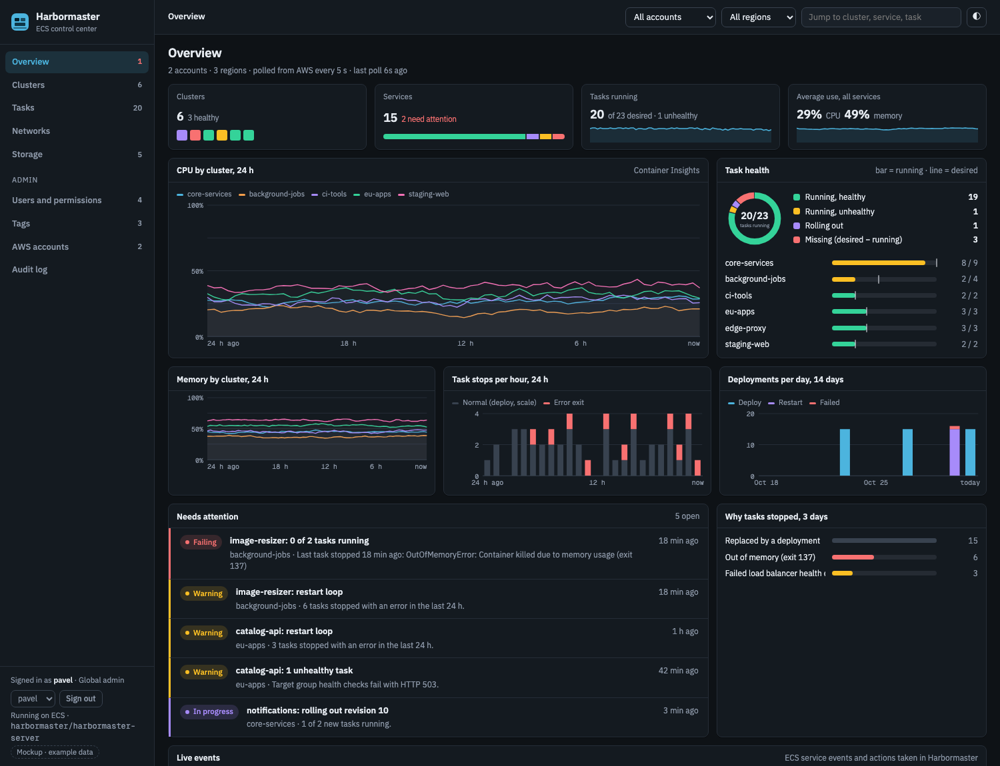

Summary first, detail below:

- **Tiles:** clusters (one status square per cluster), services (status split
  bar), tasks running vs desired (24 h sparkline), average CPU and memory.
- **CPU by cluster, 24 h** (one line per cluster) and **Task health** donut
  (running healthy / unhealthy / rolling out / missing) with running-vs-desired
  bars per cluster.
- **Memory by cluster**, **task stops per hour** (normal vs error exits),
  **deployments per day, 14 days** (deploy / restart / failed).
- **Needs attention:** the alert list (§6.12), worst first.
- **Why tasks stopped:** grouped stop reasons from task history.
- **Live events:** ECS service events and Harbormaster actions, newest first.

### 6.2 Clusters

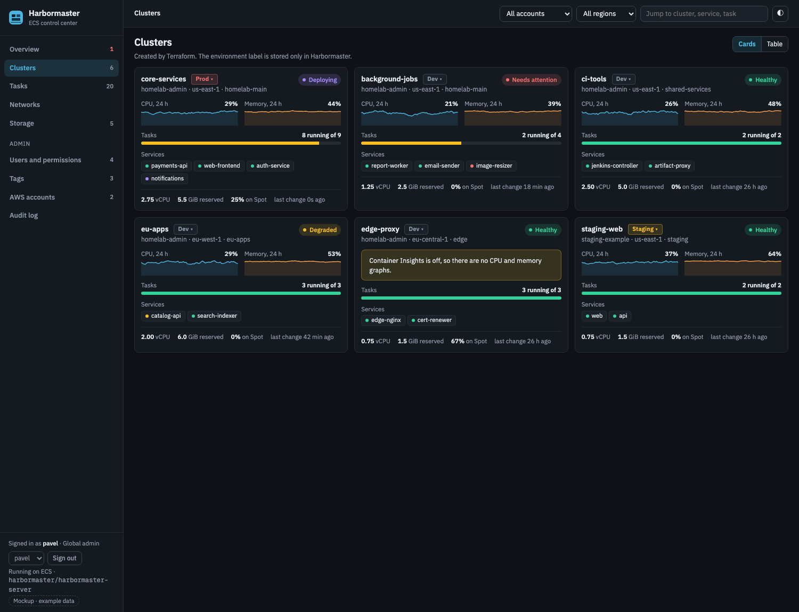

Cards (default) or a table (toggle). Each card shows the cluster name and tag,
account · region · VPC, a status pill, CPU and memory 24 h sparklines, running vs
desired tasks bar, one chip per service coloured by status, reserved vCPU / GiB,
Spot share and time of last change. Clusters with Container Insights off say so
instead of showing empty charts.

### 6.3 Cluster page

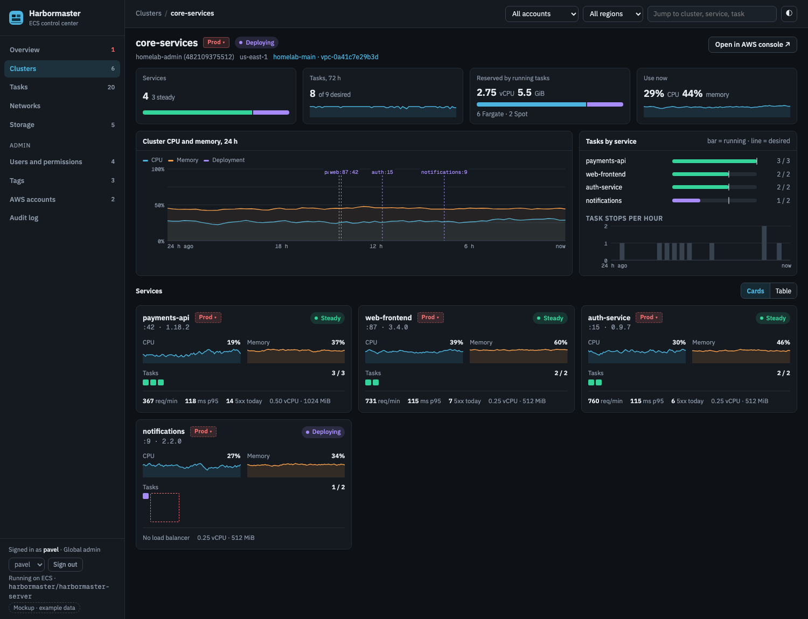

Header with tag, status, account, region, VPC link, "Open in AWS console".
Tiles: services (status split), tasks over 72 h, reserved vCPU/GiB with
Fargate/Spot split, CPU/memory now. Charts: cluster CPU and memory with
deployment markers; tasks by service (running bar vs desired marker); task stops
per hour. Below: service cards (or table) with CPU/memory sparklines, task
slots (one square per desired task: green running, amber unhealthy, violet new
revision rolling out, dashed red missing), and for load-balanced services
req/min, p95 and 5xx today.

### 6.4 Service page

Header: name, tag (dashed when inherited), status pill, cluster link, account,
region, deployed `family:revision`, launch type; actions **Restart (new
deployment)**, **Desired count: N**, **AWS console**. When a registered revision
is newer than the deployed one and nothing is rolling out, a banner offers
"Deploy :N". Tabs: Overview, Metrics, Task definition, **Deploy**, Tasks, Scaling,
Logs, Terminal, Operations log. Only the Deploy label is bold. Tabs the user lacks
permission for show a ⊘ marker and a lock message instead of content.

#### Overview tab

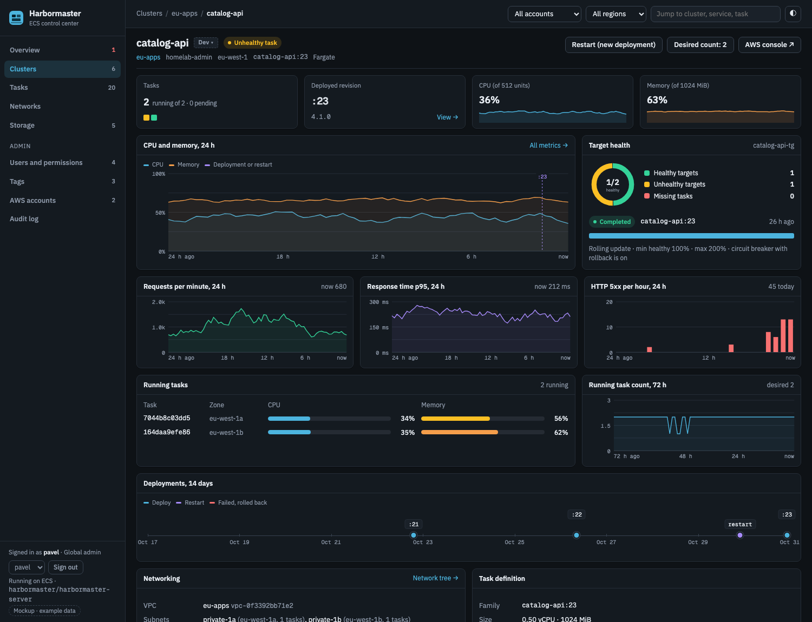

- Tiles: tasks (running / desired / pending + task slots), deployed revision and
  image tag, CPU and memory with 24 h sparklines.
- **CPU and memory, 24 h** with dashed markers for deployments and restarts.
- **Target health** donut (load-balanced) or **task health** donut, plus the
  current deployment: rollout state, progress bar new vs old tasks, failures,
  strategy (rolling, min healthy/max %), circuit breaker.
- Load-balanced services: **requests/min**, **p95 response time**, **HTTP 5xx
  per hour**.
- **Running tasks:** per task CPU and memory meters, zone, Spot flag.
- **Running task count, 72 h.**
- **Deployments, 14 days:** timeline of deploys, restarts and failed rollouts.
- **Networking:** VPC, subnets (with tasks per subnet), security groups, public
  IP, load balancer target group and port, Service Connect name.
- **Task definition:** family:revision, size, containers and images, task role,
  ECS Exec on/off, EFS mounts.
- **Recent events** (last 6) linking to the operations log.

#### Metrics tab

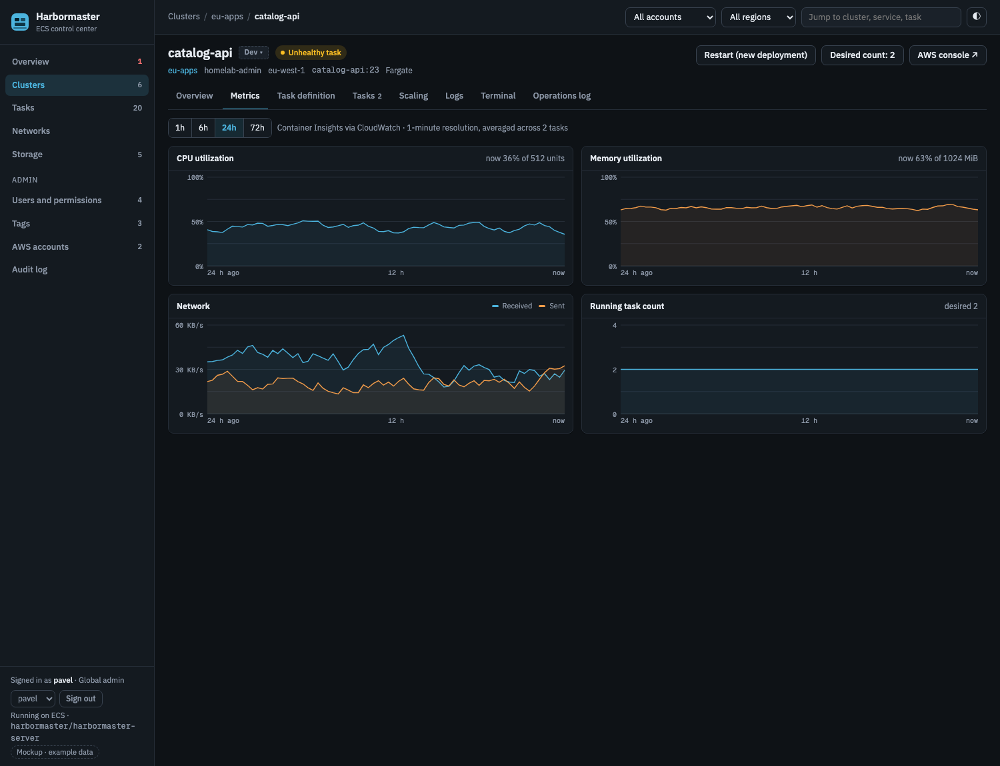

Range 1 h / 6 h / 24 h / 72 h. CPU, memory, network in/out, running task count.
Without Container Insights on the cluster: a banner explaining how to enable it
in Terraform, no empty charts.

#### Task definition tab

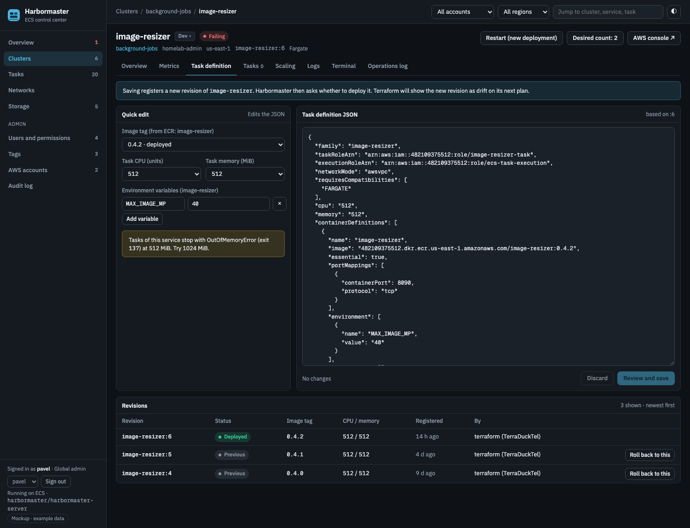

- **Main container** = the container whose name equals the service name; if
  none matches, the first essential container. *(My call.)*
- **JSON editor** with the full task definition in register-ready form (§7.1).
  Invalid JSON shows the parse error and blocks saving.
- **Review and save** opens a diff against the deployed revision, then registers
  the revision only (§7). A toast confirms it. Deploying is a separate step on the
  Deploy tab.
- Container and task size edits (image tag, environment, secrets, CPU, memory) are
  on the Deploy tab (§6.4), not here.
- **Revisions** table: revision, status (Deployed / Rolling out / Not deployed /
  Previous), image tag, CPU/memory, registered when and by whom ("terraform" when
  registered outside Harbormaster, determined by the absence of a Harbormaster
  record), with **Deploy** or **Roll back to this** buttons. Both open the Deploy
  tab at `?revision=N`.
- The pending-revision banner ("Revision payments-api:N is registered but not deployed") also opens the Deploy
  tab at `?revision=N`.
- A permanent notice: saving creates a revision Terraform will see as drift (§7.5).
- Without Edit: read-only JSON, disabled editor, lock banner.

#### Deploy tab

The **Deploy** tab is where a service is changed: containers, task size, service
settings, auto scaling and deploys. It opens with any of Edit, Deploy or Operate; otherwise it shows "You need Edit, Deploy or Operate on <tag>".
Each control is locked by its own permission and names the one it needs:

| Control | Permission |
|---|---|
| Task definition: containers, environment, secrets, command, entry point, health check, task size | Edit |
| Deploy a revision, roll back | Deploy |
| ECS Exec on/off, circuit breaker and rollback, min/max healthy %, health check grace period | Deploy |
| Desired count, force new deployment | Operate |
| Auto scaling: min and max, target tracking, scheduled actions | Operate |

Turning ECS Exec on or off always forces a new deployment, so running tasks are
replaced.

- **Containers:** a container selector (the main container by default) and, per
  container:
  - **Image tag** picker: the last 10 ECR tags with their push time, newest and
    deployed marked. Search covers every tag in the repository. An image outside
    the service account's ECR (cross-account or public) takes a free-text tag.
  - **Environment variables** and **secrets**. Secrets are Secrets Manager or SSM
    references only; values are never read or shown. The task's execution role
    needs `secretsmanager:GetSecretValue`, `ssm:GetParameters` and `kms:Decrypt`
    for them.
  - **Command** and **entry point** as argument lists, and the **container health
    check** (removable).
- **Task size:** Fargate CPU and memory, limited to valid combinations.
- **Service:** desired count, force new deployment, ECS Exec, circuit breaker with
  rollback, min and max healthy percent, and health check grace period (only with
  a load balancer). Rollback needs the circuit breaker on. A warning shows when
  the task definition has no task role, since exec needs one.
- **Auto scaling:** min and max; target-tracking policies on CPU %, memory %, or
  ALB requests per target (needs the service's own target group); cooldowns and
  scale-in disable; scheduled actions with cron, at, or rate schedules and a
  timezone. A scheduled action's min and max may lie outside the target's
  current range, as in AWS (for example max 20 at peak on a 1–4 target).
  Removing the target removes its policies and scheduled actions.
  Step-scaling policies are shown read-only and can be removed.
- **Review:** one review for every change. It shows the task definition JSON diff
  against the deployed revision, service settings before → after, and the scaling
  changes. An optional reason (up to 500 characters) is recorded on the deployment
  history and on every operations log line of the change, which share one
  change-set id.
- **Submit:** one request, `POST /api/services/{id}/changeset` (§13), applies the
  steps in a fixed order: register the revision, then `UpdateService` (one call),
  then Application Auto Scaling. The result reports each step as done, failed or
  skipped. A retry sends only the steps that did not finish and never registers
  the revision again.
- **Stale data is refused before any write:** when the change includes a task
  definition, a changed base revision answers 409 with the deployed revision; a
  changed settings version answers 409 with the fresh settings, and the review
  reopens with them. The settings version leaves out the desired count, which
  auto scaling moves on its own; desired count is last-writer-wins, as in the
  header's desired-count dialog.
- **Edit only:** the review registers the revision and deploys nothing.
- **Progress:** after a deploy, the tab shows the rollout from → to, new and old
  running counts, failed tasks and rollout state. While a rollout runs, each older
  revision offers **Roll back to :N**. It deploys with `interrupt`, after a
  confirmation. It is the only deploy outside the review, and it needs Deploy.
- **Live settings:** read when the tab opens and after each write. The tab does
  not poll.
- While a rollout runs, the review can save only desired count and auto scaling
  changes. A forward deploy, ECS Exec or rollout settings change waits for the
  rollout to finish.

#### Tasks tab

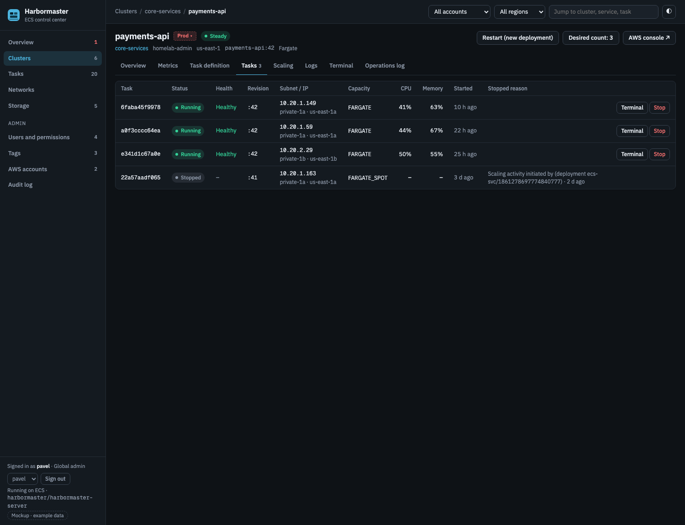

Running and stopped tasks (7-day history): ID, status (exit code for stopped),
health, revision, subnet/IP/AZ, Fargate/Spot, CPU, memory, started, stop reason.
Actions per running task: **Terminal** (with Terminal permission and exec on),
**Stop** (Operate). Rows with error exits get a red stripe, unhealthy rows amber.

#### Scaling tab

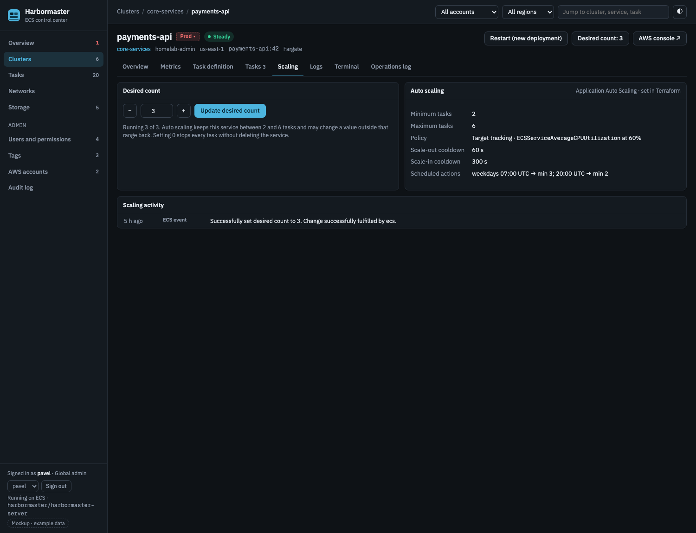

Desired count can be changed here (**Update desired count**, Operate), with a
warning when it is outside the auto scaling min/max. The auto scaling
configuration (min, max, target-tracking policies, cooldowns, scheduled actions)
is a read-only summary, along with recent scaling activities. An **Edit in
Deploy** link opens the Deploy tab (§6.4), where auto scaling is edited.

#### Logs tab

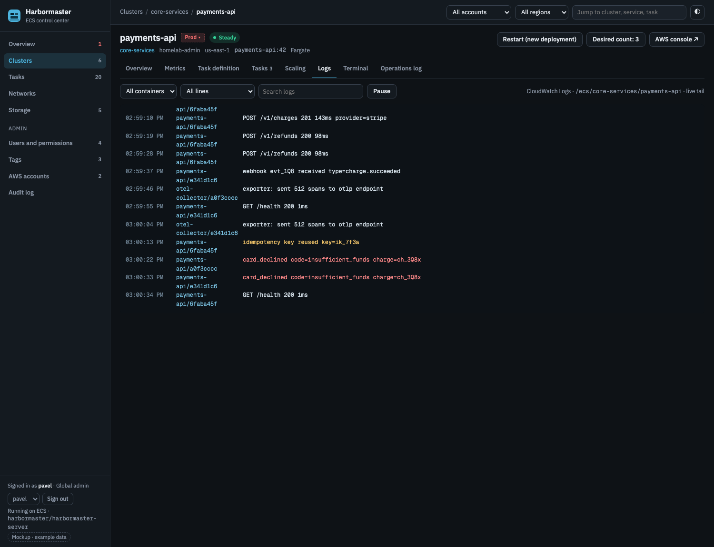

Container filter, "warnings and errors" filter, text search, follow/pause. Shows
the log group and stream prefix. Live tail via CloudWatch `StartLiveTail`;
scrolling back loads history via `FilterLogEvents` (§8). If a container doesn't
use the `awslogs` driver, the tab says where its logs go instead.

#### Terminal tab

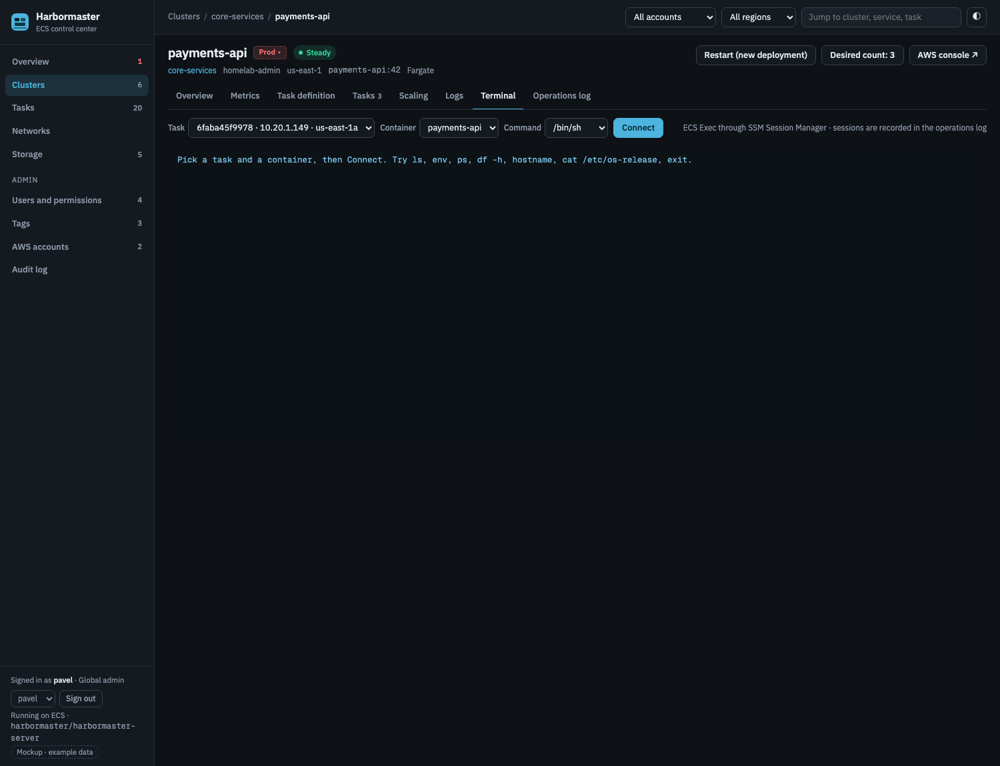

Pick a running task, a container and a command (`/bin/sh` default, `/bin/bash`),
then **Connect**. xterm.js terminal; **Disconnect** ends the session. When ECS
Exec is off for the service: a banner with the exact Terraform setting
(`enable_execute_command = true`) and the SSM permissions the task role needs.
Opening and closing a session is written to the operations log (§9).

#### Operations log tab

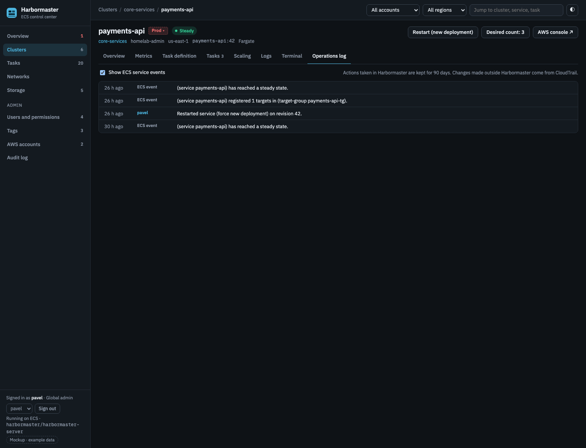

One feed per service, newest first: Harbormaster actions (who, what) and ECS
service events (toggle). A Deploy tab change set writes one line per change class
(deploy, desired count, ECS Exec, rollout settings, scaling), each with the
change-set id and the reason. Retained 90 days. Out-of-band changes (Terraform, the
console) appear as ECS events and as revisions registered by "terraform".

### 6.5 Tasks

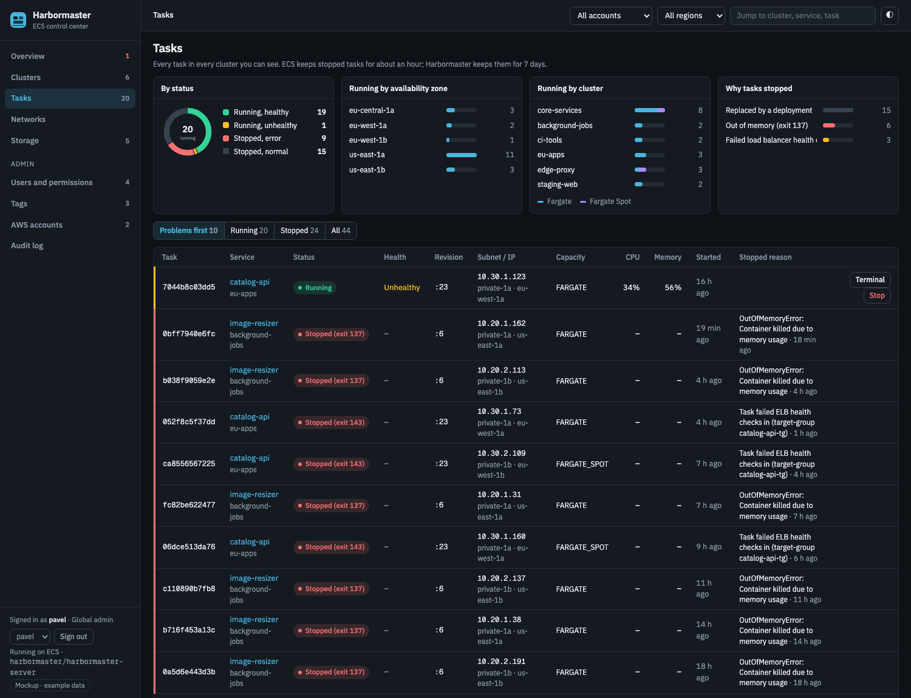

All visible tasks across clusters. Summary charts: by status (donut), running by
availability zone, running by cluster split Fargate/Spot, why tasks stopped.
Filter: Problems first (default) / Running / Stopped / All. Same row actions as
the service Tasks tab.

### 6.6 Networks

Three levels:

1. **Account** ([screen](screens/network-account.png)): per account, one card per
   region: number of active VPCs, clusters, tasks. A VPC is active when at least
   one visible task runs in it. Regions without active VPCs are shown dimmed.
2. **Region** ([screen](screens/network-region.png)): one card per active VPC:
   name, VPC ID, CIDR, subnets, clusters, tasks.
3. **VPC:** a left-to-right **tree** with connector lines:
   VPC ▸ availability zone ▸ subnet ▸ cluster ▸ service ▸ task.

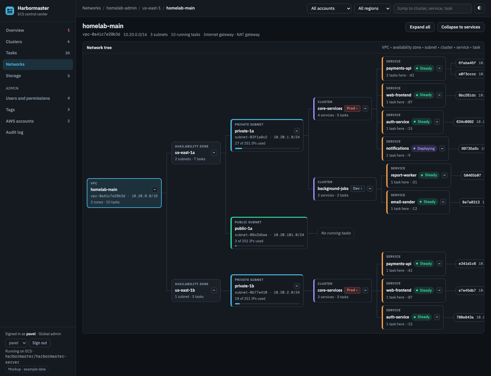

Node contents: VPC (name, ID, CIDR, zones, tasks); AZ (subnets, tasks); subnet
(public/private colour, subnet ID, CIDR, IPs used of available with a bar);
cluster (name, tag, services and tasks in this subnet); service (status, tasks
here, revision); task (short ID, private IP; amber when unhealthy). Every node with
children can collapse; **Expand all** and **Collapse to services** buttons.
Subnets with no visible tasks show "No running tasks". The tree scrolls
horizontally on narrow screens. Clicking a service or task node opens it.

The header also lists edge components found in the VPC (internet gateway, NAT
gateways, VPC endpoints relevant to ECS: `ecr.api`, `ecr.dkr`, `logs`,
`ssmmessages`).

### 6.7 Storage

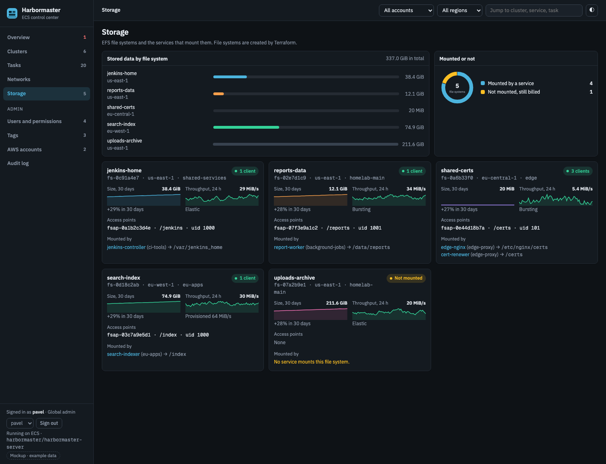

Stored data by file system, mounted vs not mounted, and a card per file system:
name, ID, region, VPC; size over 30 days (EFS `StorageBytes`) and growth;
throughput over 24 h and mode; client connections; access points (ID, path,
POSIX UID); services that mount it with container path and task count. File
systems no visible service mounts are flagged "Not mounted" (admins only see
those).

### 6.8 Users and permissions (global admin)

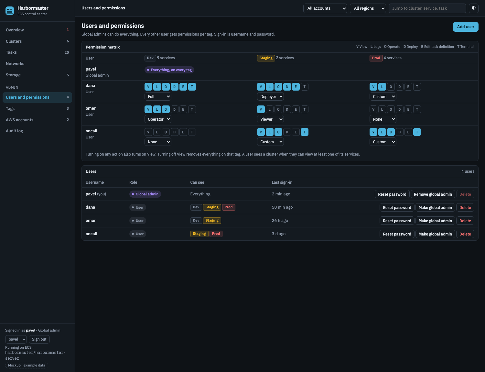

- **Permission matrix:** users down the side, tags across the top. Global admin
  rows read "Everything, on every tag". For other users each cell has six
  toggles (V L O D E T) and a preset menu. Column headers show how many
  services have that effective tag.
- **Users table:** username, role, tags they can see, last sign-in, and **Reset
  password**, **Make / Remove global admin**, **Delete** (not yourself; never
  the last global admin).
- **Add user:** username (2–32 chars: lowercase letters, digits, `.`, `-`, `_`),
  generated temporary password shown once, global admin checkbox. The user must
  set a new password at first sign-in.

Every change is written to the audit log.

### 6.9 Tags (global admin)

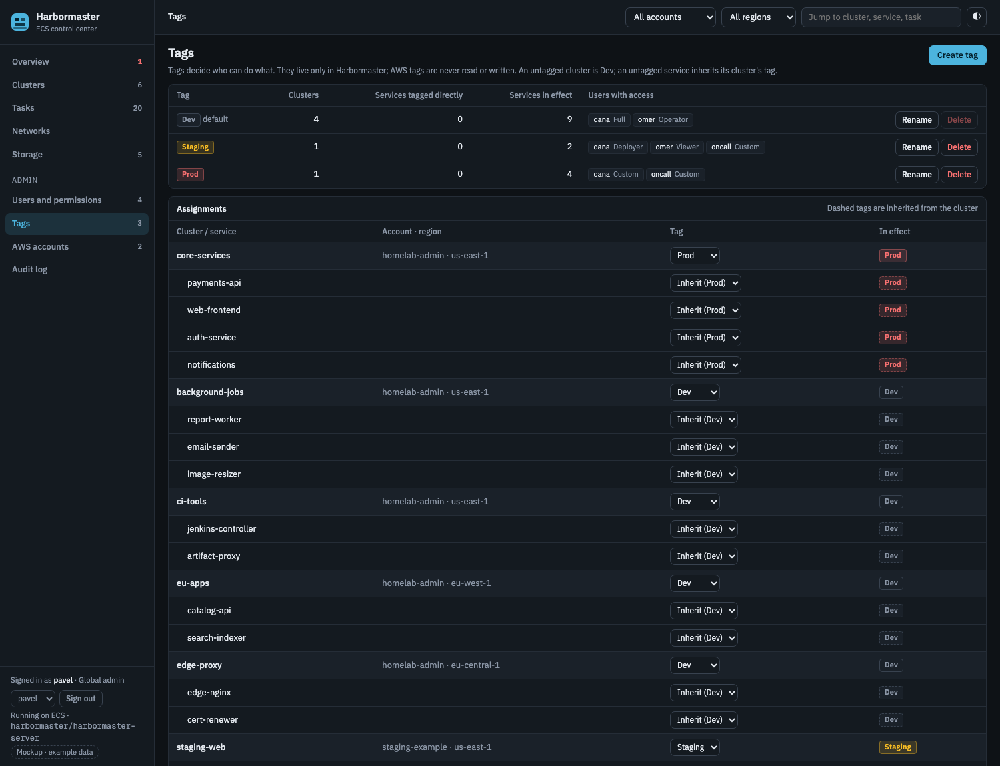

- Tag table: tag (name + colour), clusters with it, services tagged directly,
  services with it in effect, users with access (and their preset), **Rename**,
  **Delete**. `Dev` is built in and cannot be deleted or renamed.
- **Create tag:** name (1–24 chars, starts with a letter, unique
  case-insensitively) and colour (neutral, red, amber, blue, violet, green).
- **Delete** shows the impact before confirming: clusters that become Dev,
  services that go back to inheriting, users who lose permissions on it.
- **Assignments:** every cluster with a tag select, its services underneath with
  "Inherit (*cluster tag*)" or a tag. Inherited tags are drawn with a dashed
  border everywhere in the UI.
- Global admins can also change a tag from any tag chip (cluster card, service
  header, network tree); for everyone else the chip is not clickable.

### 6.10 AWS accounts (global admin)

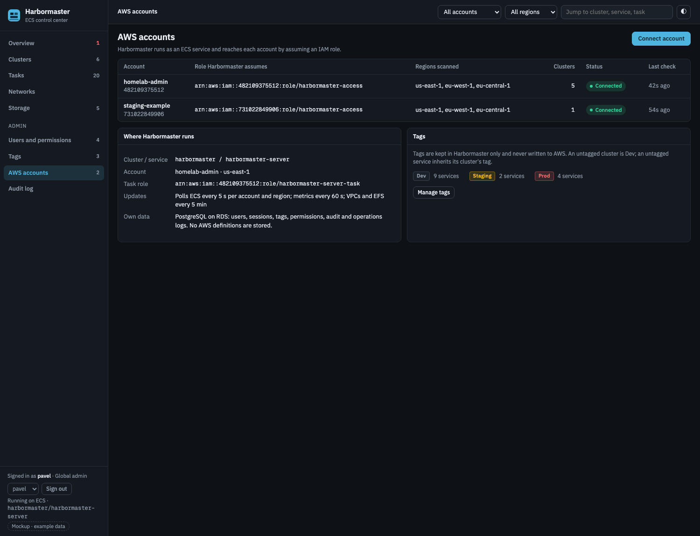

List of connected accounts: display name, account number, role ARN, regions
scanned, clusters found, status, last successful check. **Connect account**:
display name, role ARN, generated external ID (shown so it can be put in the
trust policy), regions to scan; **Test and connect** assumes the role and calls
`ecs:ListClusters` in each region, reporting per-region success or the AWS
error. Accounts can be edited (name, regions) and disconnected. The page also
shows where Harbormaster itself runs and its update intervals.

### 6.11 Audit log, sign-in, My access

- **Audit log** (global admin) ([screen](screens/audit-log.png)): sign-ins,
  failed sign-ins, sign-outs, user/permission/tag/account changes. Kept 1 year.
- **Sign-in page:** username and password, generic error "Wrong username or
  password.", no user enumeration.
- **My access** (non-admin users): the user's own row of the matrix, read-only.
- The sidebar footer shows the signed-in user, role and **Sign out**. (The
  mockup's user switcher next to it is a mockup-only device.)

### 6.12 Service status and alerts

Status of a service, first match wins:

| Status | Condition |
|---|---|
| Deploying | a deployment with `rolloutState = IN_PROGRESS` exists |
| Scaled to 0 | desired = 0 |
| Failing | desired > 0 and running = 0 |
| Degraded | running < desired |
| Unhealthy task | any running task `healthStatus = UNHEALTHY` or target unhealthy |
| Steady | otherwise |

Cluster status: Needs attention if any service Failing; Degraded if any Degraded
or Unhealthy; Deploying if any Deploying; else Healthy.

Alerts (UI only), computed from snapshots:

| Alert | Severity | Condition |
|---|---|---|
| Service failing | danger | Failing, not deploying; text includes the last stop reason and exit code |
| Service degraded | warning | Degraded, not deploying, for > 2 polls |
| Restart loop | warning | ≥ 3 tasks of the service stopped with a non-zero exit code in 24 h |
| Unhealthy task | warning | any running task or target unhealthy |
| Deployment failed | danger | latest deployment `rolloutState = FAILED` (circuit breaker rolled back) in the last 24 h |
| Rollout in progress | info | Deploying |
| Cannot place tasks | danger | service event containing "unable to place a task" in the last 15 min |
| Account unreachable | danger | an account×region loop failing for > 1 min |

---

## 7. Changing task definitions and deploying

### 7.1 From described to register-ready JSON

The editor shows the deployed revision converted to `RegisterTaskDefinition`
input:

- Removed (read-only fields): `taskDefinitionArn`, `revision`, `status`,
  `requiresAttributes`, `compatibilities`, `registeredAt`, `registeredBy`,
  `deregisteredAt`.
- Kept as-is: everything else, including `family`, roles, `networkMode`,
  `requiresCompatibilities`, `cpu`, `memory`, `containerDefinitions`, `volumes`,
  `placementConstraints`, `runtimePlatform`, `ephemeralStorage`, `proxyConfiguration`,
  `pidMode`, `ipcMode`, `inferenceAccelerators`.
- AWS resource tags on the task definition (`ListTagsForResource`) are copied to
  the new revision so Terraform-applied tags survive.
- **Roles are locked for non-admins:** a draft that changes `taskRoleArn` or
  `executionRoleArn` is rejected for anyone but a global admin ("Changing roles
  needs a global admin"), because with a broad `iam:PassRole` pattern a Dev user
  could otherwise point a Dev service at a Prod role and exec into it. Changes to
  `secrets` references are allowed only when the referenced ARN stays in the
  same account and its name keeps the same prefix as an existing reference in
  that task definition; otherwise global admin only. *(My call.)*
- Server-side validation before registering: valid JSON; `family` unchanged
  (changing family is rejected: "Use Terraform to create a new family"); at
  least one essential container; Fargate CPU/memory combination valid. AWS's
  own validation error is shown verbatim if registration fails.

### 7.2 Register flow

1. User edits (form or JSON). The draft lives in the browser only.
2. **Review and save** → diff of deployed revision vs draft (line diff with
   context).
3. Server checks the draft was based on the currently deployed revision. If the
   service moved on (Terraform or someone else deployed), the dialog shows
   "The service moved from :41 to :42 while you were editing" and the diff
   against the new deployed revision.
4. `RegisterTaskDefinition` (+ `TagResource` for copied tags). Requires
   `iam:PassRole` for the task and execution roles.
5. Operations log: "Registered task definition payments-api:43 (image 1.18.3,
   512 CPU / 1024 MiB)." Stored in `revision_records` so the Revisions table can
   say who registered it.
6. Toast: "payments-api:43 is registered. Deploy it from the Deploy tab when you
   are ready." The service page's pending-revision banner offers **Deploy :43**,
   which opens the Deploy tab at `?revision=43` (§6.4). The
   review there shows the deployed → :43 diff, and Prod gets a warning banner.
   Registering from the Deploy tab without Deploy permission toasts "Registered
   :43. Someone with Deploy on Prod can roll it out."

### 7.3 Deploy, restart, roll back

- **Deploy / roll back:** `UpdateService(cluster, service, taskDefinition=family:N)`.
  Same call for rollback to an older revision. Before calling, the server
  re-reads the service; if a deployment is already IN_PROGRESS the request is
  refused with "A rollout is already running".
- **Restart:** `UpdateService(forceNewDeployment=true)`.
- **Desired count:** `UpdateService(desiredCount=N)`, 0–50 (configurable max),
  with an auto scaling range warning.
- **Stop task:** `StopTask(reason="Stopped by <user> via Harbormaster")`.
- **Only the ECS rolling deployment controller is supported for changes in
  v1.** For services whose `deploymentController.type` is `CODE_DEPLOY` or
  `EXTERNAL`, or that use ECS native blue/green, Deploy, Restart and Roll back
  are disabled with the banner "This service is deployed by *CodeDeploy*.
  Harbormaster shows it but can't deploy it yet." Registering revisions and
  desired count still work. *(My call.)*
- The Deploy tab (§6.4) edits the deployment circuit breaker and rollback, min and
  max healthy percent, the health check grace period, ECS Exec on/off, desired
  count and auto scaling, in one change set with the revision. Deployment
  strategy and alarms are whatever Terraform set; Harbormaster shows them and
  does not change them.
- While a rollout is running, the change set can save only desired count and auto
  scaling changes. A forward deploy, ECS Exec or rollout settings change is
  refused. A rollback to an older revision may interrupt the running rollout
  (`interrupt`), so a bad rollout can be undone from the Deploy tab (§7.4).

### 7.4 Watching a rollout

The service page shows the PRIMARY and ACTIVE deployments from the latest
snapshot: revision from → to, new vs old running counts, failed task count,
rollout state and reason. When `rolloutState` becomes COMPLETED or FAILED the
poller writes the outcome to `deployment_history` and the operations log, and
the UI shows a toast to users currently on that service.

### 7.5 Terraform interplay

AWS is the source of truth, and Terraform will see a revision registered here as
drift. The user accepted this. To keep Terraform from reverting a deploy on its
next apply, the recommended Terraform for services managed through
Harbormaster is:

```hcl
resource "aws_ecs_service" "payments_api" {
  # ...
  lifecycle {
    ignore_changes = [
      task_definition,
      desired_count,
      enable_execute_command,
      deployment_circuit_breaker,
      deployment_minimum_healthy_percent,
      deployment_maximum_percent,
      health_check_grace_period_seconds,
    ]
  }
}
```

Auto scaling edited from the Deploy tab (`aws_appautoscaling_target`,
`aws_appautoscaling_policy`, `aws_appautoscaling_scheduled_action`) should be
managed in one place: either Terraform keeps those resources and nobody edits
scaling here, or Terraform drops them.

This goes in the README and on the Task definition tab's notice. Harbormaster
does not check or enforce it.

---

## 8. Logs

- Log configuration is read from the task definition (`awslogs-group`,
  `awslogs-region`, `awslogs-stream-prefix`). Stream names are
  `<prefix>/<container>/<task-id>`.
- **History:** `FilterLogEvents` on the group with `logStreamNamePrefix` per
  container (or all), newest 500 lines first, "load older" pages backwards.
  Text search uses the CloudWatch filter pattern for plain terms.
- **Live:** `StartLiveTail` (SDK event stream) for the group with stream
  prefixes of the service's tasks; the server relays events over a WebSocket.
  The live tail stops when the tab closes or after 30 minutes idle (the user can
  resume), to bound cost. At most 2 concurrent live tails per user.
- Warnings/errors filter: client-side match on level words (`WARN`, `ERROR`,
  `FATAL`, `level=error`, JSON `"level":"error"`), documented as a heuristic.
- Containers not using `awslogs` (FireLens, `splunk`, …): the tab names the
  driver and says Harbormaster cannot show those logs.

---

## 9. Terminal (ECS Exec)

- Preconditions shown in the UI before Connect: service has
  `enableExecuteCommand`, the task's `ExecuteCommandAgent` is RUNNING for that
  container, the user has Terminal on the effective tag.
- Flow: browser opens `wss://…/api/exec` with task, container, command → server
  checks permission → `ecs:ExecuteCommand(interactive=true)` → receives
  `session.streamUrl` + `tokenValue` → server connects to the SSM
  `ssmmessages` WebSocket and speaks the Session Manager data-channel protocol
  (handshake, acknowledgements, sequence numbers, input/output stream messages,
  terminal size updates, channel close) → bridges bytes to the browser
  WebSocket ⇄ xterm.js.
- Implementation: port the needed parts of
  `github.com/aws/session-manager-plugin` (Apache-2.0, written in Go) into
  `internal/execbridge` with attribution, instead of spawning the plugin binary.
  (TypeSafe score: 0.91 for this option over spawning the plugin, 0.86
  confidence.)
- Session limits: idle timeout 20 min, max duration 4 h, max 3 concurrent
  sessions per user. On disconnect the server calls `ssm:TerminateSession`.
- Operations log entries for open and close (user, task, container, command,
  duration). Keystrokes are not recorded by Harbormaster; teams that need that
  configure Session Manager logging to S3/CloudWatch in Terraform.

---

## 10. Authentication

> **Update 2026-11-02:** SAML 2.0 single sign-on (SP-initiated, single IdP, JIT
> users with no permissions, break-glass password accounts) is specified in
> [`docs/superpowers/specs/2026-11-02-saml-sso-design.md`](../superpowers/specs/2026-11-02-saml-sso-design.md)
> and planned in plan 07. Everything below stays true when SSO is not configured.

- Username + password only. Passwords hashed with **argon2id** (memory 64 MiB,
  iterations 3, parallelism 2, 16-byte salt); minimum length 12.
- **First run:** if no users exist, the server logs a one-time setup token on
  start and the UI shows "Create the first global admin", which requires the
  token (Stackstead's model). Alternatively `HM_BOOTSTRAP_ADMIN_PASSWORD_SECRET_ARN`
  can point to a Secrets Manager secret to create user `admin` non-interactively.
- **Sessions:** random 32-byte ID in an `HttpOnly; Secure; SameSite=Lax` cookie,
  stored hashed in Postgres. Idle expiry 12 h, absolute 7 days. Deleting a user,
  resetting their password or removing global admin ends their sessions.
- **CSRF:** mutating requests need an `X-CSRF-Token` header matching a per-session
  token.
- **Brute force:** 5 failed attempts per username per 15 min → that username is
  locked for 15 min; per-IP limit 30 attempts per 15 min. Failed attempts are
  audited. The message never reveals whether the user exists.
- **Temporary passwords** (new user, reset) must be changed at next sign-in.
- Users can change their own password (current password required).

---

## 11. AWS access and deployment of Harbormaster itself

### 11.1 Accounts

Each connected account has: display name, account ID, role ARN, external ID
(generated by Harbormaster, 24 random chars), list of regions. Harbormaster's
task role calls `sts:AssumeRole` with the external ID, session name
`harbormaster`, 1 h duration; credentials are cached per account and refreshed 5
minutes before expiry. The account where Harbormaster runs may also be connected
through a role in the same account.

### 11.2 IAM in each target account (the "harbormaster-access" role)

Trust: the Harbormaster task role ARN, condition `sts:ExternalId`.

Permissions (read):
`ecs:List*`, `ecs:Describe*`, `ecs:ListTagsForResource`,
`ec2:DescribeVpcs`, `ec2:DescribeSubnets`, `ec2:DescribeSecurityGroups`,
`ec2:DescribeNatGateways`, `ec2:DescribeInternetGateways`, `ec2:DescribeVpcEndpoints`,
`ec2:DescribeNetworkInterfaces`,
`elasticfilesystem:DescribeFileSystems`, `elasticfilesystem:DescribeAccessPoints`,
`elasticfilesystem:DescribeMountTargets`,
`elasticloadbalancing:DescribeTargetGroups`, `elasticloadbalancing:DescribeTargetHealth`,
`application-autoscaling:Describe*`,
`cloudwatch:GetMetricData`,
`logs:FilterLogEvents`, `logs:GetLogEvents`, `logs:StartLiveTail`, `logs:StopLiveTail`,
`ecr:DescribeImages`, `ecr:DescribeRepositories`.

Permissions (write):
`ecs:RegisterTaskDefinition`, `ecs:TagResource`, `ecs:UpdateService`,
`ecs:StopTask`, `ecs:ExecuteCommand`, `ssm:TerminateSession`,
`iam:PassRole` restricted to the task and execution roles ECS uses
(e.g. `arn:aws:iam::<acct>:role/*-task` and `.../ecs-task-execution`, with
`iam:PassedToService = ecs-tasks.amazonaws.com`),
auto scaling writes (`application-autoscaling:RegisterScalableTarget`,
`DeregisterScalableTarget`, `PutScalingPolicy`, `DeleteScalingPolicy`,
`PutScheduledAction`, `DeleteScheduledAction`; condition
`application-autoscaling:service-namespace = ecs`),
target-tracking alarms (`cloudwatch:PutMetricAlarm`, `cloudwatch:DeleteAlarms` on
`arn:aws:cloudwatch:*:<acct>:alarm:TargetTracking-service/*`, and
`cloudwatch:DescribeAlarms`), and `iam:CreateServiceLinkedRole` for
`AWSServiceRoleForApplicationAutoScaling_ECSService` (condition
`iam:AWSServiceName = ecs.application-autoscaling.amazonaws.com`).
The module README has the full table. Write permissions are omitted entirely
in read-only mode.

The repo ships a Terraform module `terraform/modules/harbormaster-access` that
creates this role (inputs: Harbormaster task role ARN, external ID, PassRole
patterns).

### 11.3 Running Harbormaster

The repo ships `terraform/modules/harbormaster` (applied through TerraDuckTel):

- ECS cluster `harbormaster`, Fargate service `harbormaster-server`, desired
  count 1, `minimum_healthy_percent = 100`, `maximum_percent = 200`
  (overlap is safe, §4.3), circuit breaker with rollback.
- ALB with HTTPS listener (ACM certificate), health check `GET /healthz`.
  Optionally internal-only.
- RDS PostgreSQL (16.x), `db.t4g.micro` default, encrypted, automated backups 7
  days, in private subnets; security group allowing only the service.
- Secrets Manager: DB credentials, session-signing key.
- Task role: `sts:AssumeRole` on the configured access-role ARNs; nothing else.
- Execution role: pull from ECR, read the secrets, write logs.
- CloudWatch log group `/ecs/harbormaster/harbormaster-server`, 30-day retention.

Container image: multi-stage Dockerfile (Node build stage for the SPA, Go build
stage, distroless/static final stage), pinned base image tags, `HEALTHCHECK`
calling the binary's `healthcheck` subcommand, non-root user.

Configuration via environment variables (`HM_` prefix): listen address, DB DSN
or secret ARN, poll intervals, retention periods, limits, bootstrap secret, base
URL.

---

## 12. Data model (PostgreSQL)

Owned data (must survive):

| Table | Key columns |
|---|---|
| `users` | id, username (unique), password_hash, is_admin, must_change_password, created_at, last_sign_in_at, locked_until |
| `sessions` | id_hash, user_id, csrf_token, created_at, last_seen_at, expires_at, ip, user_agent |
| `tags` | id, name (unique, case-insensitive), color, builtin |
| `cluster_tags` | (account_id, region, cluster_name) PK, tag_id |
| `service_tags` | (account_id, region, cluster_name, service_name) PK, tag_id (absent row = inherit) |
| `permissions` | user_id, tag_id, actions (smallint bitmask: V=1 L=2 O=4 D=8 E=16 T=32), PK (user_id, tag_id) |
| `aws_accounts` | id, name, account_id, role_arn, external_id, regions (text[]), enabled, last_ok_at, last_error |
| `audit_log` | id, ts, actor_user_id, action, target, details (jsonb), ip |
| `operation_log` | id, ts, service_arn, actor_user_id (null for ECS), source (`harbormaster`/`ecs`), text, details (jsonb) |
| `revision_records` | task_definition_arn, registered_by_user_id, registered_at |
| `deployment_history` | service_arn, deployment_id, task_definition_arn, kind (deploy/restart/scale), started_at, finished_at, outcome, started_by_user_id |

Cache (can be dropped and rebuilt by the poller):
`metrics_cache` (60 s TTL), `clusters`, `services`, `service_events`, `tasks` (incl. 7-day stopped
history), `service_counts_history`, `task_definitions`, `scaling`,
`target_health`, `vpcs`, `subnets`, `efs`, `efs_access_points`. Each row has
`account_id`, `region`, ARN, the normalized fields the UI needs, the raw AWS JSON
(`jsonb`) and `polled_at`.

Resources are identified by a **composite key**, not the raw ARN: clusters by
`(account_id, region, cluster_name)`, services by `(account_id, region,
cluster_name, service_name)`. Legacy short-format service ARNs do not contain the
cluster, so keying on the ARN would merge same-named services in different
clusters; a service recreated by Terraform with the same name keeps its tag.
The ARN is stored as a column. *(My call.)* Tags on ARNs that no longer exist are kept for 30 days, then removed, so a
quick destroy/recreate doesn't lose them.

Retention jobs run hourly: stopped tasks 7 d, service events 30 d, counts
history 7 d, operation log 90 d, deployment history 90 d, audit log 1 y,
expired sessions immediately.

Migrations are versioned SQL files applied on start (tool left to the builder).

---

## 13. API sketch

All under `/api`, JSON, session cookie + CSRF header. Every handler resolves the
target service(s) and checks `authz.Can`. Lists are filtered to visible items.

```
POST   /api/auth/login | /api/auth/logout | /api/auth/password
GET    /api/me                                      user, role, permissions
GET    /api/overview?account=&region=
GET    /api/clusters?account=&region=
GET    /api/clusters/{clusterId}
GET    /api/services/{serviceId}                    detail + deployments + events
GET    /api/services/{serviceId}/metrics?range=1h|6h|24h|72h
GET    /api/services/{serviceId}/tasks
GET    /api/services/{serviceId}/scaling
GET    /api/services/{serviceId}/task-definition    deployed, register-ready
GET    /api/services/{serviceId}/revisions/{revision}  one revision's definition
GET    /api/services/{serviceId}/deploy-settings    live settings and version
GET    /api/services/{serviceId}/revisions
GET    /api/services/{serviceId}/image-tags?container=&q=&limit=
POST   /api/services/{serviceId}/revisions          register     (E)
POST   /api/services/{serviceId}/changeset          Deploy tab change set (E, D, O per section)
POST   /api/services/{serviceId}/deploy {revision, interrupt}  deploy/rollback (D)
POST   /api/services/{serviceId}/restart                          (O)
POST   /api/services/{serviceId}/desired-count {n}                (O)
POST   /api/tasks/{taskId}/stop                                   (O)
GET    /api/services/{serviceId}/logs?container=&before=&q=       (L)
WS     /api/services/{serviceId}/logs/tail                        (L)
WS     /api/tasks/{taskId}/exec?container=&command=               (T)
GET    /api/services/{serviceId}/operations
GET    /api/tasks?account=&region=&filter=
GET    /api/networks | /api/networks/{account}/{region} | /api/vpcs/{vpcId}/tree
GET    /api/storage
GET    /api/search?q=
admin: /api/users, /api/users/{id}, /api/permissions, /api/tags, /api/tag-assignments,
       /api/accounts, /api/accounts/test, /api/audit
```

The changeset body has `base_revision`, `base_version`, `reason` (up to 500
characters), and optional `task_definition` (`definition`, or `revision` to retry
without registering again), `service` and `scaling` sections. The response has
`status` (`applied`, `partial` or `registered_only`) and per-step results
(`register`, `service`, `scaling`; `done`, `failed` or `skipped`). Validation
and permission failures return 422 or 403 before any AWS write; stale
`base_revision` or `base_version` returns 409. `deploy` accepts `interrupt`, which
is honoured only for an older revision during a rollout.

`serviceId`/`clusterId`/`taskId` are opaque IDs derived from ARNs (URL-safe
encoding), so URLs are stable and bookmarkable.

---

## 14. Frontend

- React + TypeScript, Vite build, embedded in the Go binary. Routing with real
  paths (`/clusters/:id`, `/services/:id/:tab`, `/networks/...`).
- Data fetching: TanStack Query, 5 s `refetchInterval` on live pages, 60 s on
  metrics, paused when the tab is hidden.
- Visual system taken from the mockup: IBM Plex Sans + Geist Mono, harbour-blue
  accent, semantic colours separate from the accent, light and dark themes,
  compact density, full-width layout (no max width).
- Charts: fixed-height panels (80–220 px), labels in HTML so text never scales,
  1.4 px lines, faint grid, deployment markers. The library is left to the
  builder (uPlot or hand-written SVG as in the mockup); bundle size matters.
- Terminal: xterm.js with the fit addon.
- Brand (§14.1) in the sidebar, sign-in page, favicon and browser title.

### 14.1 Brand assets

Logo files are in [`docs/design/assets/`](assets/):

| File | Use |
|---|---|
| [`main_logo.png`](assets/main_logo.png) (2172×724) | Horizontal lockup, symbol + "Harbormaster" wordmark, for light backgrounds: sign-in page, README |
| [`square-logo.png`](assets/square-logo.png) (1254×1254) | Symbol, navy over green, for light backgrounds: sidebar brand mark (light theme), app icon |
| [`square-logo-dark.png`](assets/square-logo-dark.png) (1254×1254) | Symbol in light blue, for dark backgrounds: sidebar brand mark (dark theme) |


The symbol is an "H" built from stacked shipping containers seen in
perspective: upper blocks in deep navy (≈ `#0B2545`), lower containers in teal
green (≈ `#0B7A66`); the dark-background variant is a single light blue
(≈ `#45B5E3`, close to the UI's dark-theme accent `#4CB4DE`).

My call, which the user can change: the UI keeps the mockup's harbour-blue
accent (`#0B6A8F` light, `#4CB4DE` dark) for interactive elements. The logo's
navy and green are used only in the logo itself, so the green never gets
confused with the "healthy" status colour.

Notes for the builder:

- The files are raster PNGs. Before release, get SVG versions (or trace them)
  for crisp rendering in the sidebar and for the favicon. Check the symbol at 16,
  32 and 64 px; at 16 px the thin container slats will likely need a simplified
  favicon.
- `square-logo-dark.png` has cyan fringe artefacts along the edges and gaps;
  clean or regenerate it before use.
- There is no dark-background version of the horizontal lockup yet; the sign-in
  page in dark theme uses the dark symbol + the wordmark set in the UI font
  until one exists.
- Accessibility: keyboard navigation, visible focus, ARIA on toggles and tabs,
  reduced-motion respected, the tree usable with the keyboard.
- Desktop first; usable on a laptop at 1280 px; on phones the sidebar becomes a
  top strip (as in the mockup), but the network tree and terminal are not
  optimized for phones.

---

## 15. Security notes

- Harbormaster can deploy and exec into production tasks in every connected
  account; treat its task role, its database and global admin accounts as
  highly privileged.
- External ID on every assumed role; least-privilege policy above; `PassRole`
  restricted by name pattern and service.
- Server-side authorization on every endpoint and every WebSocket; list
  endpoints filter by visibility; IDs of invisible resources return 404, not 403.
- Secrets (DB password, signing key) only from Secrets Manager; never logged.
  Environment variable values from task definitions are shown to users with View
  (they are visible in the ECS console to the same people); values from
  `secrets` (SSM/Secrets Manager references) are shown as references only, never
  resolved.
- Security headers: CSP (self + fonts), HSTS, `X-Frame-Options: DENY`.

---

## 16. Testing strategy

- **authz:** table-driven tests for effective-tag resolution and every
  action × preset × inheritance case, visibility of clusters/EFS/VPCs.
- **Status and alerts:** pure functions over snapshot fixtures.
- **Task definition conversion:** fixtures of real `DescribeTaskDefinition`
  output → register input; round-trip and validation cases.
- **Poller:** AWS clients behind small interfaces; fakes that simulate
  pagination, throttling and stopped tasks; tests for back-off and stale banners.
- **execbridge:** protocol tests against recorded SSM message sequences; an
  opt-in integration test against a real task.
- **API:** handler tests with a test Postgres (testcontainers or a local
  instance), covering permission checks per endpoint.
- **Frontend:** component tests (Vitest + Testing Library); Playwright e2e
  against the Go server running with fake AWS clients and seeded data (the
  mockup's example estate is a good seed).

---

## 17. Delivery phases

1. **Foundation, read-only:** Go server, Postgres schema, auth (setup, login,
   sessions), users/tags/permissions/audit, AWS accounts + assume role, ECS core
   poller, Overview/Clusters/Cluster/Service overview/Tasks pages, permission
   filtering everywhere.
2. **Change:** task definition tab (form, JSON, diff, register), deploy /
   roll back, restart, desired count, stop task, operations log, rollout view.
3. **Observe:** metrics (Container Insights, ALB), logs history + live tail,
   scaling tab, charts on all pages, alerts.
4. **Terminal:** ECS Exec bridge.
5. **Networks and storage:** VPC/subnet/EFS pollers, network tree, storage page.
6. **Hardening:** Terraform modules (`harbormaster`, `harbormaster-access`),
   Dockerfile, rate-limit tuning, security headers, docs.

---

## 18. Licence and code reuse

- Harbormaster is released under the **MIT licence** (user decision).
- **No code is copied from Stackstead** (user decision). Stackstead is a
  reference for look, feel and behaviour only. Patterns may be reimplemented
  from scratch.
- Code ported from `aws/session-manager-plugin` is Apache-2.0: keep its licence
  header in the ported files and add a `NOTICE` / third-party licences file.
  Apache-2.0 code may be included in an MIT project with that attribution.
- Fonts (IBM Plex Sans, Geist Mono) are SIL OFL-1.1: ship their licence texts.
- Phase 1 includes building the shell, auth, sessions and design system from
  scratch; size it accordingly.

## 19. Decisions log

| Decision | Choice | Decided by | Notes |
|---|---|---|---|
| Source of truth | AWS; Terraform creates everything | user | Harbormaster never creates infrastructure |
| Stack mapping | cluster = stack, task definition per service = compose file | user | |
| Deploy after save | ask "Deploy now?" | user | |
| Where it runs | ECS service, assumes roles into accounts | user | |
| Tags | internal only, admin-managed, default Dev, service inherits cluster | user | |
| Permissions | global admin + per-tag matrix of 6 actions with presets | user (actions, matrix); my call (checkboxes + presets) | |
| Login | username/password only for now | user | |
| Backend / frontend | Go / React | user | |
| Database | PostgreSQL on RDS | user | TypeSafe had leaned to SQLite on EFS (0.64, confidence 0.46); overridden |
| Updates | poll every 5 s, no EventBridge/SQS | user | TypeSafe had leaned to EventBridge→SQS (0.75, confidence 0.50); overridden |
| Exec | SSM protocol in Go | my call | TypeSafe 0.91, confidence 0.86 |
| Network view | left-to-right tree | user | |
| UI density | compact, professional | user | |
| Name | Harbormaster | user | |
| Licence | MIT; no Stackstead code | user | |
| ECR location | same account as the services | user | |
| Target scale | 4–5 accounts × 3–4 regions × ~20 clusters × ~15 services × ~3 tasks | user | drives the tiered poller (§5.3) |
| Standalone tasks | use the cluster's tag | my call | |
| Role changes in task definitions | global admin only | my call | security |
| CodeDeploy / external controllers | view-only deploys in v1 | my call | |
| Metrics | on demand, 60 s shared cache | my call | |
| Resource keys | account + region + cluster + service name | my call | legacy ARNs |

## 20. Left to the builder

- Go HTTP router, migration tool, Postgres driver (pgx recommended), logging
  library (slog recommended).
- Chart library, component structure, CSS approach (CSS modules as in
  Stackstead recommended).
- Exact table/column names beyond the shapes in §12.
- Exact retention defaults beyond those stated, as long as they are configurable.
- Pagination sizes and cache TTLs within the stated bounds.
