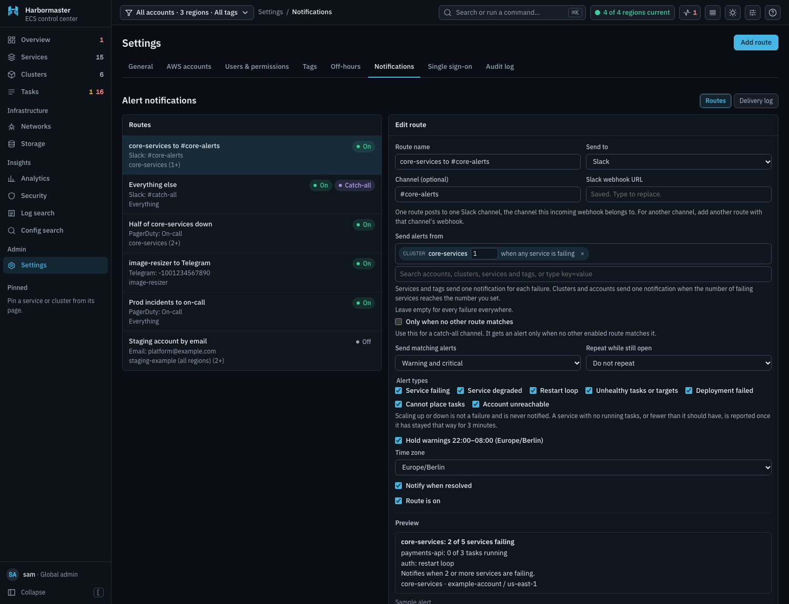

# Alert notifications

How to send the failure alerts Harbormaster already shows on the Overview to Slack, Telegram, PagerDuty, a webhook or email. For global admins who set up on-call routing.

Notifications are under **Settings > Notifications** (`/settings/notifications`, global admin only). Alert derivation is unchanged: notifications read the same alerts as the Overview.

## What is sent and when

| Message | When |
| --- | --- |
| Opened | A failure alert opens. |
| Update | For a cluster or account entry, when more services fail or the severity rises. Nothing is sent when it gets better. |
| Repeat | While it stays open, at the route's repeat interval (`Do not repeat`, `Every 30 minutes` or `Every 2 hours`). A repeat lists the current services. |
| Resolved | It has been gone for 2 minutes (a shorter flap is one incident), if the route has **Notify when resolved** and its opened message was delivered. |

A route can choose from seven alert types: service failing, service degraded, restart loop, unhealthy tasks or targets, deployment failed, cannot place tasks, and account unreachable. `info` alerts are never sent.

## Destinations

One route is one channel. For two Slack channels or two Telegram chats, add two routes.

- **Slack**: paste an incoming webhook URL (`https://hooks.slack.com/...`). It posts to the channel the webhook belongs to. The optional **Channel** field is only a label.
- **Telegram**: create a bot with BotFather, add the bot to the chat (for a channel, make it an administrator), then enter the **Bot token** and **Chat ID** (a number, negative for groups and channels, or `@channelname`). For a group topic, enter the **Topic ID**. To find a chat ID, send the bot a message and open `https://api.telegram.org/bot<token>/getUpdates`.
- **PagerDuty**: paste an Events API v2 **integration key** and choose the US or EU region. Opened and updates trigger an incident, resolved resolves it, and the dedup key keeps one incident per alert.
- **Webhook**: Harbormaster POSTs one JSON object per notification with `event`, `scope`, `severity`, `title`, `text`, `service`, `cluster`, `account_id`, `region` and `url`. Cluster and account entries add `threshold`, `failing`, `total` and `services`. An optional **Signing secret** adds `X-Harbormaster-Signature: sha256=<HMAC of the body>`. `X-Harbormaster-Delivery` is a stable id per delivery.
- **Email**: needs `HM_SMTP_HOST` and `HM_SMTP_FROM` (and usually `HM_SMTP_USERNAME` and `HM_SMTP_PASSWORD`) on the server. STARTTLS is required unless `HM_SMTP_TLS=implicit`. Without `HM_SMTP_HOST` the Email option is disabled. Enter up to 10 addresses.

## Scope

**Send alerts from** is a list of entries. An alert goes to the route when any entry takes it. An empty list means every failure, everywhere.

- **Service and tag entries** (an AWS tag `key=value` or a Harbormaster tag) send one notification for each failure alert of those services.
- **Cluster and account entries** (an account for all regions, or one region) carry a number N (default 1) and send one aggregated notification when N or more of their services are failing. It lists up to 10 failing services with their most severe alert. A service counts once however many alerts it has. An unreachable account opens an account entry whatever N is.

Routes are independent. With cluster A holding three services where only service 2 fails, a route on cluster A with N=1 plus a route on service 2 send two notifications. With N=2 on the cluster, only the service route sends one until a second service fails.

An entry for a cluster, service or account that no longer exists is marked `No longer exists` and matches nothing. A route whose entries are all gone shows `Matches nothing`.

**Catch-all.** **Only when no other route matches** makes a route a safety net. It gets an alert only when no other enabled, non-catch-all route notifies about it.

## Scaling is not a failure

A service scaled up from zero is `failing`, and a scale-out is `degraded`, until the new tasks run. The [off-hours](scaling-and-off-hours.md) wake does this every morning. `HM_NOTIFY_SETTLE` (default 3 minutes) makes `service_failing` and `service_degraded` wait that long before they are notified or counted toward a threshold. Restart loops, failed deployments and the other types notify at once. The trade-off: a service that is simply down is reported up to 3 minutes late through those two types. Set it to `0` to notify immediately. A deployment in progress, a service scaled to zero and scaling in raise no alert.

## Quiet hours, delivery log and retries

- **Hold warnings 22:00–08:00** holds warnings in the route's time zone and sends them at 08:00 if the alert is still open. Critical alerts are never held. A warning that resolves overnight is never sent.
- **Send matching alerts** can be `Warning and critical` or `Critical only`.
- The **Delivery log** records every delivery for 30 days (`HM_RETENTION_NOTIFICATION_LOG`). Each is tried three times (at once, after 30 seconds, after 2 minutes, honouring `Retry-After`), then marked `Failed`. You can retry a failed delivery from the log.
- **Send test** sends one message from the task serving the request. Save the route first.
- A route whose last three deliveries all failed shows a warning on Settings.

## Step by step: send failures to Slack

Before you begin: you are a global admin, `HM_SESSION_KEY` is set on the server (the editor says so if not), and the server can reach the internet on 443.

1. In Slack, create an app with an incoming webhook for the channel you want and copy the URL.
2. In Harbormaster open **Settings > Notifications** and select **Add route**.
3. Enter a **Route name**. Set **Send to** to Slack and paste the **Slack webhook URL**. Optionally enter the **Channel** as a label, such as `#alerts`.
4. Under **Send alerts from**, add the clusters, services or tags you care about, or leave it empty for everything.
5. Choose **Send matching alerts**, **Repeat while still open**, the **Alert types**, and **Notify when resolved**.
6. Select **Save route**. A new route is added off; turn on **Route is on** and save again.
7. Select **Send test**.

Check it worked: the test message arrives in Slack and the **Delivery log** shows it as delivered. The editor's message preview shows what real alerts will look like.

## Security and limits

- Secrets (webhook and Slack URLs, routing keys, bot tokens, signing secrets) are sealed in the database under `HM_SESSION_KEY` and are write-only: never returned by the API or written to logs, audit rows or delivery notes. If you rotate `HM_SESSION_KEY`, routes show `Enter the destination again.` and their deliveries fail until you do.
- Destinations must be `https` and are checked when connecting: public addresses only. Loopback, link-local (including the metadata endpoint) and other special ranges are never allowed, redirects are not followed and no proxy is used. To reach an internal receiver, list its private range in `HM_NOTIFY_ALLOWED_PRIVATE_CIDRS`.
- Delivery is at-least-once, so a crash can send one message twice. PagerDuty dedupes by key and webhook receivers can dedupe on `X-Harbormaster-Delivery`.
- At most 50 routes, 100 scope entries per route and 10 email addresses per route.
- Alerts follow the poller's schedule. With idle mode (`HM_POLL_IDLE_INTERVAL`, 5 minutes by default) a night-time alert can be up to that late. `HM_POLL_IDLE_AFTER=0` turns idle mode off.
- With `make run` (fake AWS), demo routes deliver to an in-process receiver at `/fake-notify/received`.

## Next steps

- [Configuration reference](../reference/configuration.md)
- [Overview and clusters](overview-and-clusters.md)
- [Audit log](audit-log.md)
