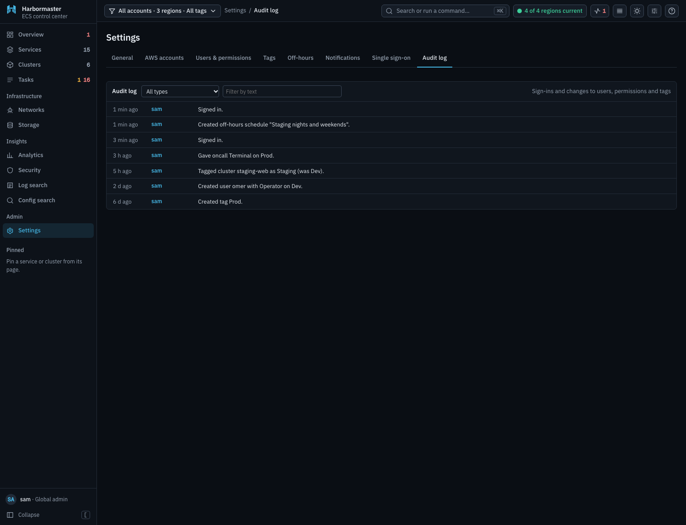
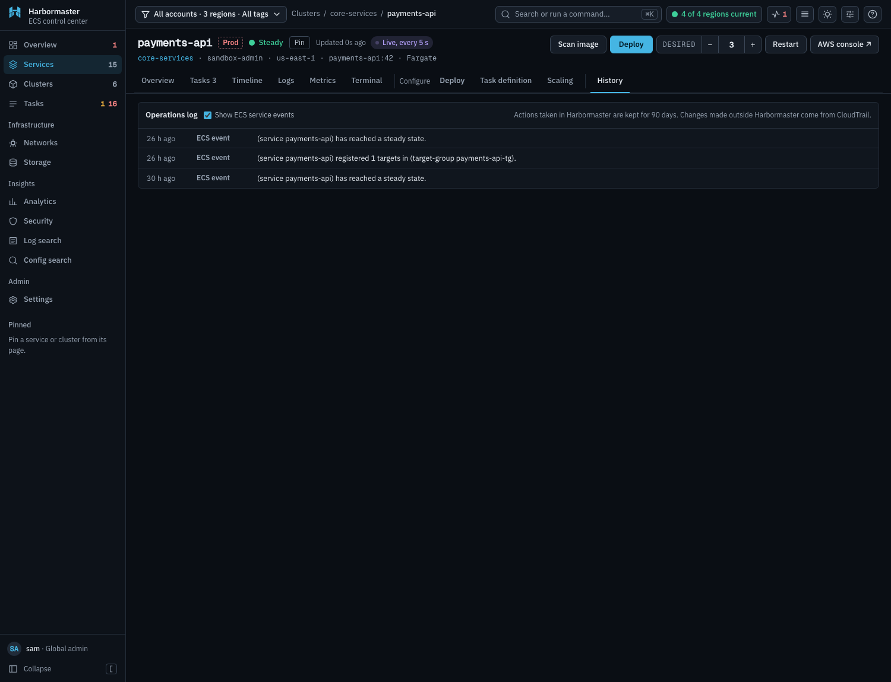

# Audit log

What Harbormaster records about sign-ins and changes, and where to read it. For admins and anyone investigating who changed what.

There are two logs. The **Audit log** covers sign-ins and administrative changes across Harbormaster. Each service also has an **Operations log** for actions on that service.

## Audit log

Open **Settings > Audit log**. Only global admins can see it.

Entries are newest first. Each has a time, the actor, an action, a target, a summary, optional details and the client IP. Use **Type** to filter by the first part of the action name (for example `tag`, `security` or `token`), and **Filter by text** to match the summary, actor, target or action. Select **Load more** for older pages. The filters are kept in the address.

The service actions are in each service's operations log, not here, apart from the ones listed below.

### What is recorded

| Area | Actions |
| --- | --- |
| Sign-in | `sign_in`, `sign_in_failed`, `sign_out`, `password_change`, `setup_complete` |
| Users | `user_create`, `user_delete`, `password_reset`, `admin_grant`, `admin_revoke`, `break_glass_grant`, `break_glass_revoke`, `permission_set` |
| Tags | `tag_create`, `tag_update`, `tag_delete`, `tag_assign` |
| AWS accounts | `account_connect`, `account_update`, `account_disconnect` |
| Single sign-on | `sso_config_update`, `sso_enabled`, `sso_disabled`, `sso_key_rotated`, `sso_metadata_import`, `sso_unlinked`, `sso_link_pending_set`, `sso_link_pending_cleared` |
| Tokens and apps | `token_create`, `token_revoke`, `oauth_grant`, `oauth_revoke`, and from the CLI `tokens_revoke_all`, `tokens_revoke_user` |
| Off-hours | `offhours_schedule_create`, `offhours_schedule_update`, `offhours_schedule_delete`, `offhours_sleep`, `offhours_wake` |
| Notifications | `notification_route_create`, `notification_route_update`, `notification_route_delete`, `notification_delivery_retry` |
| Image security | `security.setting`, `security.rescan`, `security.accept`, `security.accept_package`, `security.revoke`, `security.base_image`, `security.deploy_anyway` |
| Other | `settings_update`, `log_search` (who searched which services, over what range) |

Entries never contain secrets: token names and ids are logged, never the token. Entries are kept for `HM_RETENTION_AUDIT_LOG` (8760 hours, one year, by default). See [Data retention](../operations/data-retention.md).

## Service operations log

On a service, open the **Operations** tab. It shows who changed or opened what on that service and when: deploys and rollbacks, desired count changes, off-hours sleep and wake, and changes to the image scan setting. Each entry shows the time, actor and text, and a change set's reason is included. Tick **Show ECS service events** to merge in ECS's own service events. Entries are kept for `HM_RETENTION_OPERATION_LOG` (2160 hours, 90 days).

You need View on the service's tag to read its operations log. See also [Timeline](timeline.md), which puts these changes on one time axis with task stops and alerts.

## Check it worked

Make a harmless change, such as creating a tag, then open **Settings > Audit log** and filter **Type** to `tag`. The entry appears with your username and IP.

## Next steps

- [Data retention](../operations/data-retention.md)
- [Security model](../security/security-model.md)
- [Users, tags and permissions](users-tags-permissions.md)
