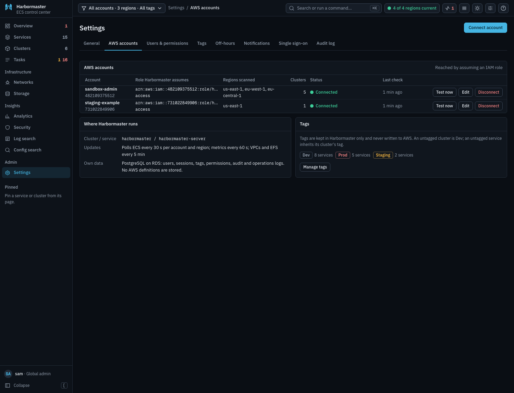

# AWS accounts

How to read the **AWS accounts** page, check an account's connection, and change its regions. For global admins. Setting up the AWS side of a connection is covered in [Connect AWS accounts](../install/connect-aws-accounts.md).

Open **Settings > AWS accounts**. Harbormaster reaches each account by assuming an IAM role in it; no long-lived keys are stored.

## Read the page

| Column | Meaning |
| --- | --- |
| Account | The display name and AWS account ID. |
| Role Harbormaster assumes | The role ARN entered when connecting. |
| Regions scanned | The regions Harbormaster polls for this account. |
| Clusters | How many clusters were found. |
| Status | **Connected**, **Error** or **Disabled**. |
| Last check | When the account was last checked. |

Status notes appear under the status:

- `Data is <n> min old` or `Data is unavailable` for a region whose polling is failing.
- `Slowed by AWS throttling` when AWS is throttling Harbormaster's calls.
- **Show AWS error** expands the raw error for the account and each failing region, plus the results of the last test.

The page also has **Where Harbormaster runs** (its own task, and the polling intervals) and a **Tags** note: tags are kept in Harbormaster only and never written to AWS.

## Connect an account

1. Select **Connect account**. Enter a **Display name**, choose the regions to scan and copy the generated **External ID**.
2. Apply the `harbormaster-access` module in the target account with that external ID. See [Connect AWS accounts](../install/connect-aws-accounts.md).
3. Paste the **Role ARN** and select **Test and connect**.

Harbormaster tests every selected region first and connects only if all pass. On failure it lists each region's error; fix the role and test again.

## Test a connection

Open the row's actions and select **Test now**. Harbormaster assumes the role and lists clusters in each region. The result shows per region as `<region> · <n> clusters` or the AWS error, under **Show AWS error**.

Check it worked: status is **Connected** and the clusters appear on [Overview and clusters](overview-and-clusters.md).

## Edit or disconnect

- **Edit** changes the **Display name** and the regions to scan.
- **Disconnect** removes the account's clusters, services and tasks from Harbormaster. Tags and permissions are kept for 30 days, as the confirmation dialog says. <!-- TODO(docs): verify the setting behind the 30 days and that reconnecting restores them --> Disable or delete [off-hours schedules](scaling-and-off-hours.md) first, or their scheduled actions keep running in AWS.

All changes are written to the [audit log](audit-log.md) (`account_connect`, `account_update`, `account_disconnect`).

## If the status is Error

Open **Show AWS error**. Common causes are a role that no longer trusts Harbormaster's task role, a wrong external ID, or a region where the role is blocked. Roles created before newer permissions were added may need `harbormaster-access` re-applied; Harbormaster shows a per-account message for those features. See [Troubleshooting](../operations/troubleshooting.md).

## Next steps

- [Connect AWS accounts](../install/connect-aws-accounts.md)
- [IAM and AWS access](../security/iam-and-aws-access.md)
- [Throttling and limits](../operations/throttling-and-limits.md)
