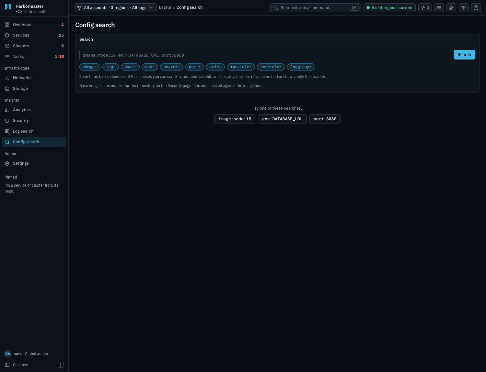

# Search service configuration

This guide shows how to find services by what their task definitions contain: which services still run `node:18`, which expose port 8080, which use a given secret name or log group. It is for engineers and security reviewers who need to answer fleet-wide questions without opening each service.

## Before you begin

- You need **View** on a service's tag for it to be searched. A service you cannot see is never searched, listed, counted or exported.
- The search reads task definitions that Harbormaster has already stored. It makes no AWS call and adds no polling, so results can lag slightly behind AWS. A service whose task definition is not stored yet is counted and not searched.

## Run a search

Open **Config search** under **Insights** in the sidebar (under **More** on a phone). You can also type in the search palette (`Ctrl` or `Cmd` + `K`) and choose **Search config for ...**.

1. Type a query in **Config search query**, for example `image:node:18 env:DATABASE_URL`.
2. Click **Search**. The query is added to the page URL as `?q=`, so you can share the link and the recipient sees the same results.
3. Under the box, click a field chip such as `env:` to add that prefix to your query.

With an empty box, the page offers three example searches: `image:node:18`, `env:DATABASE_URL` and `port:8080`.

The account, region and tag filters under **Scope** in the top bar narrow the search. They never widen it beyond what you can see. The results line says how many services were searched, for example `Searched 87 services you can see.`

## Query syntax

A query is a list of terms separated by spaces. A service matches only when it satisfies all of them.

| Term | Matches |
|---|---|
| `image:` | the whole image string, including registry and tag. A digest reference is found with `image:sha256:...`. |
| `tag:` | the image tag |
| `base:` | the repository's configured base image (see the base image note below) |
| `env:` | environment variable names |
| `secret:` (or `secrets:`) | secret names |
| `port:` (or `ports:`) | a container port, exactly (1 to 65535) |
| `role:` | either the task role or the execution role ARN |
| `taskrole:` (or `task-role:`) | the task role ARN |
| `execrole:` (or `exec-role:`, `executionrole:`) | the execution role ARN |
| `loggroup:` (or `log:`, `log-group:`) | the `awslogs` log group |
| text with no field | any of the above. A number matches a port exactly. It never matches a service, cluster or container name. |

Rules:

- A value matches as a case-insensitive substring. Wrap it in double quotes to match the whole value exactly: `env:"PORT"`.
- Start a term with `-` to exclude: `-secret:API_KEY`.
- Text such as `node:18` is free text, because an unknown prefix is never an error.
- A query can have up to 500 characters and 10 terms. Free text needs at least 2 characters.

Examples:

| Question | Query |
|---|---|
| Which services run Node 18? | `image:node:18` |
| Which services still use the `latest` tag? | `tag:latest` |
| Which services set `DATABASE_URL` but have no `DB_SECRET` secret? | `env:DATABASE_URL -secret:DB_SECRET` |
| Which services listen on 8080? | `port:8080` |
| Which services use one execution role? | `execrole:ecs-task-execution` |
| Which services log to a given group? | `loggroup:/ecs/core` |

## Read the results

On a desktop screen the results are a table with **Service**, **Cluster**, **Account and region**, **Revision**, **Image** and **Matched** (what matched, as chips). On a phone each result is a card. Click **Details** (the disclosure on the row) to see:

- **Image** and **Base image**
- **Ports**
- **Environment** (variable names only)
- **Secrets** (names only)
- **Log group**
- **Task role** and **Execution role**

Click a service name to open its **Task definition** tab.

Things to know:

- **Environment variable and secret values are never searched, shown, returned or exported.** Only names are. Names from environment files are not known, because only the task definition is read.
- **Rollouts.** A service in the middle of a rollout is also matched on the revision that still has running tasks. Its row says `Previous revision :N is still running`.
- **Base image.** The base image is the one set for the repository on the **Security** page. It is empty for images outside ECR and for repositories with no base set. It is not checked against the image.
- **Limits.** Only services are searched, not standalone tasks. At most 2,000 rows are returned, and the page says `Showing the first 2,000 of N matching services. Narrow the search to see the rest.` when there are more. The page also reports `N services have no task definition loaded yet and were not searched.`

## Export and reuse results

Tick rows to select them (or tick the header box to select all). Without a selection, the buttons apply to every row.

- **Export CSV** builds a file in your browser, one line per container, with the columns `service`, `cluster`, `account_id`, `account_name`, `region`, `permission_tag`, `family`, `revision`, `matched_revision`, `previous_revision`, `container`, `image`, `image_tag`, `base_image`, `ports`, `env_names`, `secret_names`, `task_role`, `execution_role`, `log_group`, `matched` and `service_id`. A cell that starts with `=`, `+`, `-` or `@` gets a leading apostrophe so a spreadsheet does not run it as a formula.
- **Copy service IDs** copies the stable service IDs, one per line. Use them with scripts or the API.

The same search is available to scripts as `GET /api/config-search?q=`. It returns stable service IDs and is evaluated with the caller's permissions on every call. Nothing is stored. See the [API reference](../reference/api.md).

## Check it worked

- A query for a value you know exists (for example a service's own image tag) returns that service.
- The count in the results header matches the number of rows, unless the 2,000-row notice is shown.
- Opening **Details** on a row shows the term you searched for.

## Next steps

- [Image security](image-security.md): the base image and scan findings that Config search refers to.
- [Log search](log-search.md): search log content instead of configuration.
- [AI access (MCP)](ai-access-mcp.md): the MCP gateway exposes this search as a `search_config` tool.
