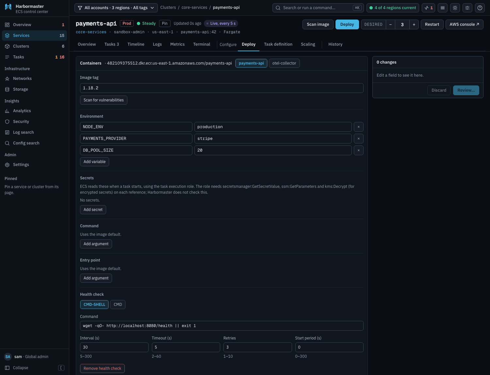

# Deploy a change

This guide shows how to change a running ECS service from the Deploy tab: container image and settings, task size, service settings and auto scaling. All edits are reviewed as one change set, applied in one step and followed live. It is for engineers who deploy and operate services.



## Before you begin

The Deploy tab opens with any one of **Edit**, **Deploy** or **Operate** on the service's tag. Each control is locked by its own permission and its tooltip names the one it needs.

| What you change | Permission |
|---|---|
| Containers: image tag, environment variables, secrets, command, entry point, health check. Task size (CPU, memory, architecture). | Edit |
| Deploy an existing revision, roll back. ECS Exec on or off. Circuit breaker and rollback, minimum healthy percent, maximum percent, health check grace period. Capacity (Fargate and Spot) strategy. The image scan setting. | Deploy |
| Desired count. Force new deployment. Auto scaling: minimum and maximum, policies, scheduled actions. | Operate |

How these combine in one change set:

- A new task definition (Edit) deploys only if you also have Deploy. With Edit alone, the review registers the revision and stops. The primary button reads **Register :N**, and the toast says `Someone with Deploy on <tag> can roll it out.`
- Any change set that mixes a task definition change with service or scaling changes needs Deploy as well as the permissions of each part.

Also:

- The service must use the ECS rolling deployment controller. For other controllers the tab is read-only and a banner explains why.
- Some changes need a **global admin**. See [What needs a global admin](#what-needs-a-global-admin).
- The service's account must be connected with write access. An account set up with `read_only = true` in the `harbormaster-access` module omits the write policy, so changes there fail at AWS. See [Connect AWS accounts](../install/connect-aws-accounts.md).

!!! warning "Terraform will see drift"
    A revision registered here is drift for Terraform. See [Terraform and Harbormaster](#terraform-and-harbormaster) before you start using the Deploy tab on a Terraform-managed service.

## Open the Deploy tab

Open it with any of these:

- Click **Deploy** in the service header.
- Click **Deploy :N** in the pending-revision banner.
- On the Task definition tab, click **Deploy** or **Roll back to this** beside a revision. The tab opens with that revision loaded.
- Follow a link from Analytics (a task size or capacity suggestion from the Cost tab) or from a timeline rollback. These open the tab with the suggestion filled in.

The tab reads the service's live settings when it opens and after each write. It does not poll while you edit.

## Edit the service

The form has four panels. The **Pending changes** box beside the form (a bar at the bottom on a phone) lists each edited field as `label: before -> after`. Nothing reaches AWS until you confirm in the review step.

### Containers

1. Pick a container with the container switcher. The main container is selected first.
2. **Image tag:** search or pick a tag. The picker lists recent ECR tags with push time, and marks the deployed tag. An image that is not in the service account's ECR takes a free-text tag.
3. **Environment:** add, change or remove variables.
4. **Secrets:** reference Secrets Manager secrets or SSM parameters. You set references, never values: Harbormaster does not read or show secret values. The task's execution role needs permission to read them.
5. **Command**, **Entry point** and **Health check** (type, command, interval, timeout, retries and start period). The health check can be removed.

For anything the form does not cover (volumes, log configuration, extra containers), edit the JSON on the **Task definition** tab. That needs Edit and registers a revision that you then deploy from here.

### Task size

Choose **Task CPU (units)** and **Task memory (MiB)**. The memory list follows the CPU, because Fargate allows only certain pairs. For Fargate tasks (not Windows) you can also choose **CPU architecture** (`X86_64` or `ARM64`); every image must have a build for the one you choose. If the service recently stopped tasks with `OutOfMemoryError`, the panel suggests a larger memory size.

### Service

- **Desired count** stepper (Operate). The range is 0 up to the configured maximum.
- **ECS Exec** (Deploy). Turning it on or off replaces the service's tasks. The task role needs the `ssmmessages` permissions listed in the panel. A warning shows when the task definition has no task role. See [Terminal](terminal.md).
- **Rollout safety** (Deploy): **Circuit breaker**, **Roll back on failure** (needs the circuit breaker), **Minimum healthy percent** (0 to 100), **Maximum percent** (100 to 200) and **Health check grace period (seconds)** (only for services behind a load balancer).
- **Capacity** (Deploy): **On-demand tasks kept (base)**, **On-demand weight** and **Spot weight** for Fargate and Fargate Spot. The base stays on demand; the weights split the tasks above it. A Spot weight of 0 means on demand only. The Spot weight is locked, with a note, when the cluster does not have the Fargate Spot capacity provider.
- **Force new deployment** (Operate): replaces every running task with a fresh one from the same task definition.
- **Scan Image for Vulnerabilities Before Deploy** (Deploy): a per-service switch. It saves at once and is not part of the change set. See [Image security](image-security.md).

### Auto scaling

Needs Operate. If the service has no scalable target, choose **Add auto scaling target**.

- **Minimum** and **Maximum** task counts.
- **Policies:** target tracking on CPU, memory or load balancer requests per target. Set the target value, scale-out and scale-in cooldowns, and whether scale-in is disabled. Step-scaling policies are shown but cannot be edited; you can remove them.
- **Scheduled actions:** a name, a `cron`, `at` or `rate` schedule, a timezone, and the minimum and maximum to apply.
- Removing the scalable target removes its policies and scheduled actions.

Keep one owner for auto scaling. If Terraform manages the same policies, its next apply reverts your edits. See [Terraform and Harbormaster](#terraform-and-harbormaster) and [Scaling and off-hours](scaling-and-off-hours.md).

## Review, add a reason and apply

1. Click **Review...** in the Pending changes box. The review dialog opens. Use **Discard** first if you want to throw the draft away.
2. Read the review:
    - **Task definition:** a diff of the deployed revision against the new one, or `:old -> :new` for an existing revision.
    - **Service:** each setting, before and after.
    - **Auto scaling:** one line per change.
    - A banner reads `This is a Prod service.` when the service's tag is named Prod.
3. Enter a **Reason** (optional, up to 500 characters). It is saved on the deployment history and on every operations log line of this change.
4. Click the primary button. Its label says what happens: **Deploy :N**, **Register and deploy :N**, **Register :N** or **Apply changes**. Use **Keep editing** to go back.

Harbormaster applies the steps in a fixed order: register the revision, update the service in one call, then update Application Auto Scaling. A toast confirms the result: `Deploying <service> to :N.` or `Applied the changes to <service>.`

### If something is stale or fails

- **The service moved while you edited.** If someone else deployed, or Terraform did, the review shows `The service moved from :A to :B while you were editing`. Check the diff against the new deployed revision before you apply.
- **Settings changed while you edited.** The review shows `Settings changed while you were editing` and reopens with the current values on the left. Check them.
- **Partial result.** If one step fails after another succeeded, the dialog lists each step as **Done**, **Failed** or **Skipped**. Click **Retry remaining steps** to send only what did not finish. The revision is never registered twice.
- **Image scan gate.** With the scan setting on, a change that sets a new image pauses while the image is checked. The dialog shows the result and offers **Deploy anyway** or **Cancel**. See [Image security](image-security.md).

## Watch the rollout

After you apply a deploy, a **Rollout progress** panel appears at the top of the tab, and the Overview tab shows the same card.

- A pill shows **Rollout in progress**, **Completed** or **Failed**.
- `:from -> :to` and a bar show new tasks against old tasks. The line under it gives the counts (`N new tasks on :to, M old on :from`) and any `failed to start` tasks.
- On failure, the reason from ECS is shown. With the circuit breaker and rollback on, ECS reverts on its own.
- The final state stays visible for a minute after completion. You also get a toast if you are on the page when the rollout ends.
- With Deploy, **Roll back to :N** appears while the rollout runs or after it fails. See [Roll back](roll-back.md).

While a rollout runs, the review can save only desired count and auto scaling changes. A new deploy, an ECS Exec change, a rollout settings change or a restart waits until the rollout finishes, and says `A rollout is already running`.

## What needs a global admin

A user who is not a global admin cannot register or deploy a task definition that does any of the following. The error names the rule, for example `Changing where a container's logs go needs a global admin`.

- **Change where a container's logs go.** This covers a new or changed log destination, changing the log driver, adding a logging sidecar, and renaming a container that logs to CloudWatch. Logs are read by container name and stream prefix, so a rename moves the destination. Keeping or removing the existing logging setup is allowed.
- Change the task role or execution role.
- Add secret references outside the account and name prefixes already used in the task definition.
- Change environment files, FSx credentials, the FireLens config file or credential specs.
- Host-level settings: privileged mode, added Linux capabilities, host devices, host process or IPC namespace, host networking, host volume mounts, Docker volume configuration, system controls and Docker security options.

The same rule applies when you deploy or roll back to an existing revision whose log destinations differ from the running one. See [Roll back](roll-back.md#restrictions).

## Terraform and Harbormaster

AWS is the source of truth. Terraform sees a revision registered or deployed here as drift. To stop Terraform from reverting a deploy on its next apply, ignore the fields Harbormaster owns:

```hcl
resource "aws_ecs_service" "payments_api" {
  # ...
  lifecycle {
    ignore_changes = [task_definition, desired_count]
  }
}
```

The Deploy tab also changes `enable_execute_command`, `deployment_configuration` and `health_check_grace_period_seconds`. Add them to `ignore_changes` if Harbormaster should own them.

For auto scaling, pick one place. Either keep `aws_appautoscaling_target`, `aws_appautoscaling_policy` and `aws_appautoscaling_scheduled_action` in Terraform and do not edit them here, or remove them from Terraform and let the Deploy tab own them. Harbormaster does not check or enforce any of this. See [Scaling and off-hours](scaling-and-off-hours.md) for off-hours schedules and Terraform.

## Check it worked

- The rollout panel reaches **Completed**, and the service header shows the new `family:revision`.
- The History tab has one line per kind of change, each with the same change-set ID and your reason.
- On the Task definition tab, the new revision's status is **Deployed**.

## Next steps

- [Roll back](roll-back.md)
- [Timeline](timeline.md): see the change next to task stops and alerts.
- [Image security](image-security.md)
- [Users, tags and permissions](users-tags-permissions.md)
