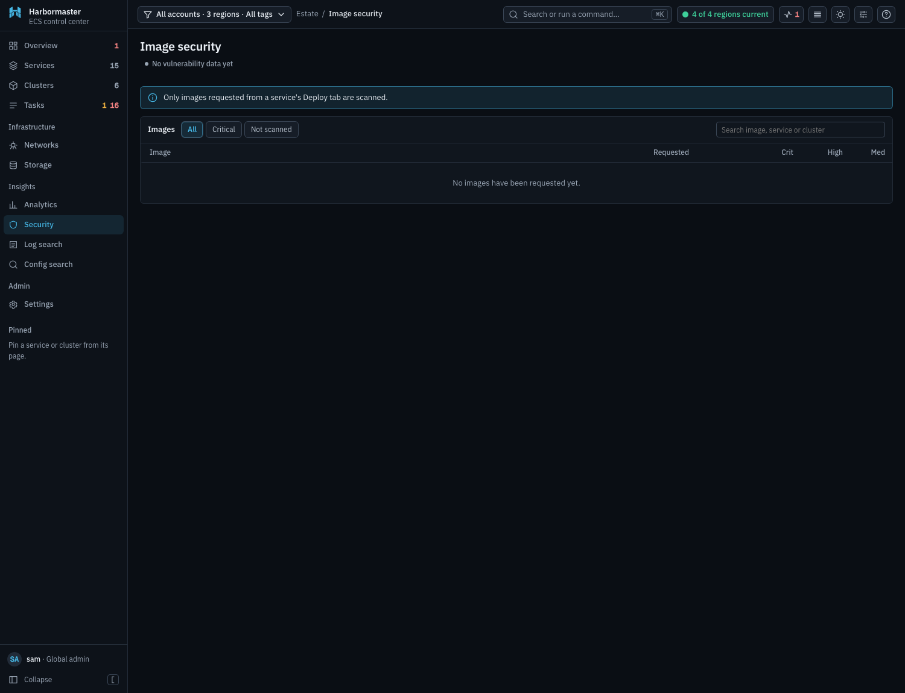

# Image security

How to scan container images for known vulnerabilities, use the deploy gate, read findings and accept risk. For engineers who deploy services and for admins who enable scanning.

Harbormaster scans with Syft and Grype in a separate ECS task that it starts on demand. Nothing is scanned automatically: there is no discovery, no schedule and no re-matching of old images. A scan happens only when someone asks for one.

## Ask for a scan

Before you begin: scanning is enabled on your install (see [Enable scanning](#enable-scanning)), and you have **Deploy** on the service.

There are two ways to ask.

**The button.** On the service's Deploy tab, select **Scan for vulnerabilities**. It scans the selected container's selected tag, whether or not the setting below is on.

**The setting.** In the Service panel of the Deploy tab, turn on **Scan Image for Vulnerabilities Before Deploy**. It is off for every service until someone turns it on. With it on, a change that sets a new image on a container is scanned first. Changing the setting needs Deploy on the service (or global admin) and is written to the operations log and the [audit log](audit-log.md).

The setting is stored in Harbormaster's database, keyed by account, region, cluster and service name. A Terraform deploy cannot change it, and a service deleted and recreated with the same name keeps it.

## The deploy gate

When the setting is on, applying a change set or registering a revision whose container has a new or changed image pauses while Harbormaster checks the image. It resolves each changed image to the digest its tag points at, and only a scan of that digest counts. The outcomes:

| Outcome | Meaning |
| --- | --- |
| Pass | No open critical finding for this service. The change goes ahead. |
| Waiting | The scan is queued, running or waiting for a vulnerability data refresh. The Review dialog shows progress. |
| Critical | The scan found open critical findings. The dialog links to them. |
| Problem | The image is not on ECR private, the registry account is not connected, the scan failed or timed out, or the vulnerability data is too old. |

In every state the dialog offers **Deploy anyway**. The gate never blocks outright, and an ECR, S3 or scanner failure is a gate state, not an error. **Deploy anyway** applies the change and is recorded in the operations log and the audit log as `security.deploy_anyway`. The server enforces the gate, so the API and the Task definition tab are held to it too.

A deploy by revision is gated when some container's image differs from the running deployment's and Harbormaster has no record of that revision ever running on this service. Rollbacks and redeploys of a revision that ran before are instant. Restart, desired count, scaling-only and settings-only changes are never gated. See [Roll back](roll-back.md).

!!! warning "Use immutable tags"
    ECS registers the tag, not the digest. A push to the tag between the gate and ECS pulling the image can run a different digest from the one scanned. Use immutable ECR tags to close the gap.

## Read the results

Open **Security** (`/security`). It lists only the images that were requested, limited to what you may see. An image you cannot see is not listed and its address answers 404. The page shows open findings by severity, how fresh the vulnerability data is, and acceptances. Scan states are Queued, Scanning, Scanned and Failed. While the database refreshes the page says `Updating vulnerability data`.

Select an image to see its findings: vulnerability, severity, package, installed version and the version that fixes it (`No fix yet` when there is none). Packages are grouped as OS packages or app dependencies. You can set a **Base image** (the `FROM` image of the Dockerfile) on an image detail. It applies to every tag of that repository, queues a rescan, and lets Harbormaster say how many layers come from the base image.

## Accept a risk

Before you begin: you need the **Accept risk** permission on the service's tag, or global admin. It is in no permission preset, **Full** included; grant it on its own.

1. Open the image detail on **Security** and select **Accept risk** on a finding, or **Accept package risk** on a package.
2. Enter a reason and the number of days (1 to 30).
3. Choose the services it applies to and confirm.

An acceptance hides the finding for those services only, for up to 30 days. It covers one vulnerability and package version on one exact digest. Another service using the same digest still counts the finding until someone with Accept risk on that service accepts it there. It returns when it expires or is revoked. Use **Revoke** to end it early: the person who made it, an admin, or a holder of Accept risk on that service can do so. Acceptances are audit-logged.

## Enable scanning

Scanning is off until `HM_SCAN_ENABLED=true`. With the Terraform module, set the variables below and the module sets the launch variables for you.

1. Build and push the scanner image (see [The scanner image](#the-scanner-image)) and note its digest.
2. In the `harbormaster` module set `enable_image_scanning = true` and `scanner_image = "...@sha256:<digest>"`. Read the `scanner_task_role_arn` output.
3. In every account you want to scan, apply `harbormaster-access` with `scanner_task_role_arn` set. This creates the `harbormaster-scan` role. Keep the external ID the account already uses.

Permissions in short: the server task role starts and stops the scanner task and reads and writes the scan bucket. In each connected account, the `harbormaster-scan` role lets only the scanner task role pull images from ECR. The scanner reaches ECR, S3 and STS over 443 through NAT. Harbormaster reaches `grype.anchore.io` only for an on-demand vulnerability data refresh. Terraform details are in [Terraform: Harbormaster](../reference/terraform-harbormaster.md) and [Terraform: access](../reference/terraform-access.md); the settings are in the [configuration reference](../reference/configuration.md).

## The scanner image

The scanner task runs its own image, built from `Dockerfile.scanner`: the `harbormaster-scanner` binary plus Syft and Grype. Build it with `make scanner-image` and verify it with `make check-scanner-image`; see [Build and push the image](../install/build-image.md). Its commands are `run`, `healthcheck` and `version`.

## Limits and retention

- Amazon ECR private images only. Other registries, including ECR Public, are refused with the reason.
- One scanner task at a time by default (`HM_SCAN_MAX_TASKS`), 30 minutes per task (`HM_SCAN_TASK_TIMEOUT`), 10 minutes per image, three attempts, and images up to `HM_SCAN_MAX_IMAGE_MB` (4096).
- A scan result is kept for `HM_RETENTION_SCAN_IMAGES` (168 hours) after the image was last requested. An image with an active acceptance is kept until its acceptances end.
- The vulnerability database refreshes on demand before a scan when older than `HM_SCAN_DB_REFRESH` (24 hours). Past `HM_SCAN_DB_MAX_AGE` (120 hours) scans wait and a gate shows the reason with **Deploy anyway**.

## Next steps

- [Deploy a change](deploy-a-change.md)
- [Users, tags and permissions](users-tags-permissions.md)
- [Data retention](../operations/data-retention.md)
