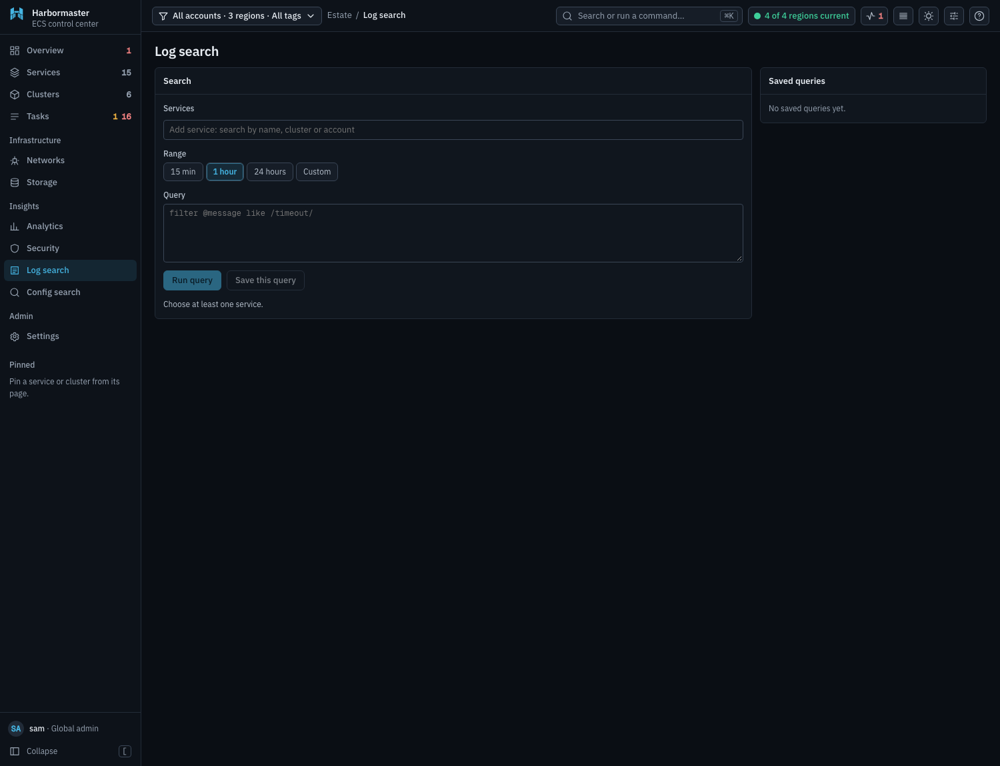

# Search logs across services

This guide shows how to run one CloudWatch Logs Insights query over the logs of up to 20 services, read the results and save a query. It is for engineers who need to find a message, an error or a request ID without opening each service. To read one service's logs, see [Logs](logs.md).



## Before you begin

- You need **Logs** on the tag of every service you search. The service picker lists only services you can read logs of. If you have none, the page says `You have no services you can read logs of.`
- A service must have a container that logs to CloudWatch with the `awslogs` driver. Otherwise the results say `<service> has no container that logs to CloudWatch.`
- The `harbormaster-access` role in each account needs `logs:StartQuery`, `logs:GetQueryResults`, `logs:StopQuery` and `logs:DescribeLogGroups`. The current [access module](../reference/terraform-access.md) grants them, also when `read_only = true`. For an account whose role is older, the page shows `The harbormaster-access role in <account> cannot run Logs Insights queries. Update the access module to the latest version.` for that account only.
- Logs Insights charges per GB scanned. Read [What a search costs](#what-a-search-costs) first.

## Run a search

Open **Log search** under **Insights** in the sidebar (under **More** on a phone).

1. In **Search**, click the service box and type a service name, cluster or account, then pick a service. Repeat for up to 20 services.
2. Choose a **Range**: **15 min**, **1 hour** (the default), **24 hours** or **Custom**. For **Custom**, set **From** and **To**. A custom range can be at most 7 days, must end now or earlier, and must start before it ends. Times use your browser's time zone.
3. Type a **Query**. It can be empty to return the newest lines, or use the commands below. A query can be up to 4,000 characters.
4. Click **Run query**.

While a search runs, the button becomes **Cancel**.

A search URL fills in the form (services, range and query) but never runs it, so you can share a link safely.

### What the query can contain

The query is a Logs Insights query with the log groups chosen for you. Supported commands:

| Command | Example |
|---|---|
| `fields` | `fields @timestamp, @message` |
| `filter` | `filter @message like /timeout/` |
| `parse` | `parse @message "user=* " as user` |
| `dedup` | `dedup @message` |
| `sort` | `sort @timestamp desc` |
| `limit` | `limit 200` |

Chain them with `|`. For example:

```text
filter @message like /timeout/ | filter @message not like /healthcheck/
```

These are refused:

- `SOURCE`, because log groups always come from the services you picked.
- Aggregates and other commands such as `stats` and `display`. Each result line must carry its log group and stream so Harbormaster can show which service it came from and hide streams you may not read.
- Renaming a field to a name that starts with `@`.
- A few ambiguous quoting forms, so that Harbormaster and AWS agree on where a string or regular expression ends: an escaped quote of the same type as the enclosing quotes (use the other quote type), a backslash inside backticks, and a `/` division followed later by another `/` with a quote, backtick or `|` between them.

A refused query shows a message such as `Log search does not support the stats command. Use fields, filter, parse, dedup, sort and limit.`

## Read the results

The header gives the number of matching lines, the data scanned, the time taken and the cost: for example `1,204 matching lines`, `0.8 GB scanned in 6.2 s`.

- **Hits over time:** a histogram of matching lines. For a custom range, the bucket size adapts to the range.
- **Hits by service:** how many lines each service contributed.
- **Lines:** the matching lines, with time and service. Select a line to open that service's **Logs** tab at that second. The tab shows `Showing logs up to <time>` and does not follow the tail.

Notices above the results explain anything that makes a result incomplete:

- `Stopped at the <size> scan limit. These results are partial...`: choose a shorter range or fewer services.
- `Showing the newest N of M matching lines.`: more lines matched than the page shows. The histogram and hits by service cover the lines shown.
- A notice naming an account and region when the search there failed, for example on throttling or missing permissions. Other accounts' results still show.

## Save a query

1. Run or fill in a query. The **Save this query** button is enabled when the form is valid.
2. Click **Save this query**, give it a name (up to 80 characters) and click **Save**.
3. To reuse it, find it in **Saved queries** (on a phone, click **Saved**) and click **Load**. **Delete** removes it.

Saved queries are kept per user, on the server. You can keep up to 50. A saved query remembers its services, range (including a custom range) and query text. If you can no longer see one of its services, that service is left out. Loading one fills the form; click **Run query** to run it.

## What a search costs

Logs Insights charges $0.005 per GB scanned (GB = 2^30 bytes).

- Before you run, the page shows a rough guide: `The selected log groups store about X GB (about $Y if all of it were scanned)`. It is the stored size of the selected log groups, counted once per group. It is not a bound. It covers everything the groups retain, not only your time range, but it is the compressed size, while Insights bills uncompressed bytes. Groups whose size cannot be read are listed as not counted.
- While a search runs, Harbormaster stops every query once the whole search has scanned more than the scan limit, and returns the rows found so far, marked as partial. The default limit is 10 GB, shared across all accounts and regions in one search. A search may scan somewhat more than the limit, because CloudWatch reports progress about once a second. If the guide is already above the limit, the page warns you before you run.
- After each run, the header shows the bytes scanned and the cost.

Start with 15 minutes or 1 hour and few services, then widen.

## Limits and permissions

| Limit | Default | Setting |
|---|---|---|
| Services per search | 20 | `HM_LOG_SEARCH_MAX_SERVICES` |
| Longest range | 7 days | `HM_LOG_SEARCH_MAX_RANGE` |
| Time before a search is abandoned | 60 seconds | `HM_LOG_SEARCH_TIMEOUT` |
| Scan limit per search | 10 GB (0 means no limit) | `HM_LOG_SEARCH_MAX_GB` |

Each user can run 6 searches in a burst, then 1 every 10 seconds. A faster search is refused with `You are searching too fast. Try again in a few seconds.` Each user can run one search at a time. With more than one Harbormaster task, both limits are counted across tasks only when a shared store is configured. See [Throttling and limits](../operations/throttling-and-limits.md) and the [configuration reference](../reference/configuration.md).

Access rules: a service you cannot see is never listed, and a request that includes one is answered as not found for the whole request. A service you can see but lack Logs on is refused. Streams you may not read are hidden from the results.

Every run is written to the [audit log](audit-log.md) as `log_search`, with the query text. It does not appear in a service's operations log. Query text can contain identifiers, so it is kept as long as the audit log is.

## Check it worked

- A query such as `filter @message like /error/` returns lines whose service names match your selection.
- The cost in the header is close to `GB scanned x $0.005`.
- Selecting a line opens the right service's Logs tab at that time.

## Next steps

- [Logs](logs.md)
- [Timeline](timeline.md)
- [Throttling and limits](../operations/throttling-and-limits.md)
