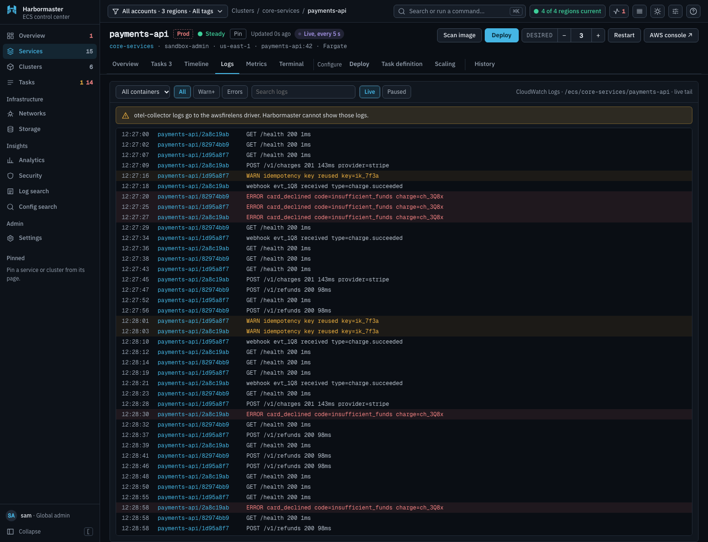

# Read service logs

This guide shows how to read a service's container logs in the web app: history, search, the level filter and the live tail. It is for engineers who debug a running or failing service. To search the logs of many services at once, see [Log search](log-search.md).

## Before you begin

- You need **Logs** on the service's tag. Without it the **Logs** tab shows a lock message that names the permission.
- Harbormaster reads logs from CloudWatch Logs, so a container must use the `awslogs` log driver. For a container that uses another driver, or sends logs to a different log group than the rest of the service, the tab shows a banner such as `<container> logs go to the <driver> driver. Harbormaster cannot show those logs.` That container is greyed out in the container list.
- The `harbormaster-access` role in the account needs the CloudWatch Logs read actions that the [access module](../reference/terraform-access.md) grants.
- Each user can hold 2 live tails at once. See [Limits](#limits).

## Open the Logs tab

Open the service, then choose **Logs**. You can also reach it from a task row (**Logs**), from the Timeline (**Open logs at this time**) and from a Log search result.

The toolbar has four controls:

| Control | What it does |
|---|---|
| Container list | **All containers**, or one container. Containers whose logs Harbormaster cannot read are disabled. |
| **Level** | **All**, **Warn+** or **Errors**. |
| **Search logs** | Free-text filter. |
| **Tail** | **Live** or **Paused**. |

A status line shows `CloudWatch Logs`, the log group and the state: `live tail`, `paused`, `connecting` or `tail stopped`.

## Read history

When you open the tab, Harbormaster loads the newest lines and then follows new ones. Each line shows the time, the container and the first characters of the task ID, and the message. Long messages are cut with an ellipsis, and the full text is in the tooltip. Lines are coloured by level.

1. Scroll up to read older lines. Scrolling up pauses the tail so the view does not jump.
2. Click **Load older** at the top to fetch earlier lines. Each load returns up to 500 lines.
3. Click **Live**, or **Back to latest** when it is shown, to return to the newest lines.

On a phone, tap a line to open **Log line**, which shows its level, time, log group, log stream, task and container.

### Jump to a time

A link from the Timeline or from Log search opens the tab at one moment. The tab then shows the banner `Showing logs up to <time>` and does not follow the tail. Click **Back to latest** to return to the live view. Times are in your browser's time zone.

## Filter by level

Harbormaster guesses the level of each line from its text:

- `level=error`, `"level":"warn"` and similar key-value forms,
- the words `WARN`, `WARNING`, `ERROR`, `FATAL`, `PANIC` and `CRITICAL`,
- bracketed levels such as `[warn]` and `[error]`.

When a line has both, the error class wins. **Warn+** shows warnings and errors. **Errors** shows only errors. Lines in a format Harbormaster cannot recognise count as no level and are hidden by both filters. Use **All** to see them.

The level filter applies to the lines already loaded and to new ones.

## Search

Type in **Search logs**. After a short pause the search runs against both the history and the live tail.

- Every word you type must appear in the line. Words are matched literally, so characters such as `[`, `{`, `?` and `*` have no special meaning.
- Matching follows CloudWatch Logs filter rules, which are case-sensitive.
- For field-based queries, regular expressions or several services at once, use [Log search](log-search.md).

## Follow the live tail

The tail is on when the **Tail** switch reads **Live**. New lines appear at the bottom as they arrive.

- Scroll up, or choose **Paused**, to stop following. The connection closes and frees its slot.
- Choose **Live** to resume. Lines already shown stay on screen. The browser keeps the newest 5,000 live lines.
- The tail stops after 30 minutes without activity in the tab. A banner reads `Live tail stopped after 30 minutes idle.` Click **Resume** to continue. Scrolling, clicking, typing and touching the tab count as activity.
- If you already have the maximum number of tails open, a banner explains it. Close another Logs tab and click **Resume**.
- If the connection drops, the banner shows `Live tail disconnected.` with **Resume**.
- If your session changed (for example you signed in again in another tab), reload the page.

## Limits

| Limit | Default | Setting |
|---|---|---|
| Live tails per user | 2 | `HM_LOG_TAILS_PER_USER` |
| Idle time before a tail closes | 30 minutes | `HM_LOG_TAIL_IDLE` |
| Lines returned by one history query | 500 | `HM_LOG_HISTORY_LIMIT` |

An admin can change these. See the [configuration reference](../reference/configuration.md). CloudWatch Logs Live Tail is billed per session-minute, so close tails you do not need. See [AWS costs](../operations/aws-costs.md).

## Check it worked

- The status line reads `live tail` and new lines appear within a few seconds of the container writing them.
- Typing a word that appears in recent output leaves only matching lines.

## Troubleshooting

- **`No log lines.`** The container wrote nothing in the time looked at, or the filter hides everything. Set **Level** to **All** and clear the search.
- **A container is disabled.** It does not use `awslogs`, or its log group differs. Read its logs where they go, or ask a global admin to change the logging setup.
- **The tab says you need Logs.** Ask a global admin for the permission. See [Users, tags and permissions](users-tags-permissions.md).

## Next steps

- [Log search](log-search.md): one query across many services.
- [Timeline](timeline.md): see log error spikes next to deploys and task stops.
- [Terminal](terminal.md): open a shell in a running task.
