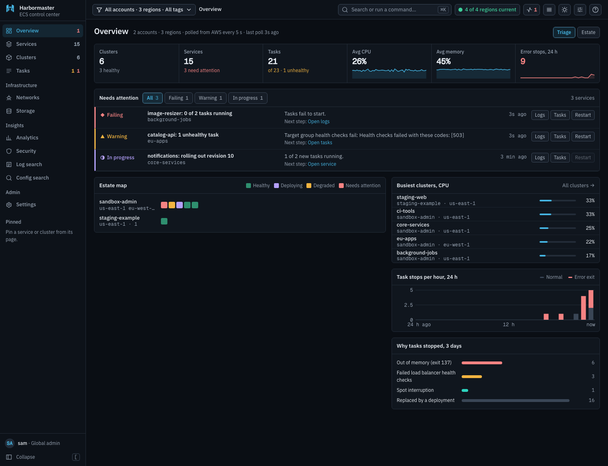

# Navigating the web app

This page explains how the Harbormaster web app is laid out: the sidebar, the top bar, search, scope filters, keyboard shortcuts, the theme and the phone layout. It is for anyone who signs in to Harbormaster for the first time.

## Before you begin

- Sign in with your username and password, or with single sign-on if your admin set it up. See [Single sign-on](../install/single-sign-on.md).
- What you see depends on your permissions. You only see clusters, services and tasks whose tag you have at least View on. See [Users, tags and permissions](users-tags-permissions.md).

## The layout

On a desktop screen the app has three areas.

- **Sidebar** on the left. It holds the main navigation, your pinned services and clusters, and your account menu.
- **Top bar** across the top. It holds the breadcrumb, the search box, the scope control and the data freshness control, and a few buttons.
- **Page** in the middle. It shows the page you chose.

### Sidebar pages

| Section | Page | What it is |
|---|---|---|
| Main | **Overview** | Estate-wide health: what needs attention, key figures, cluster usage. The badge counts failing alerts. See [Overview and clusters](overview-and-clusters.md). |
| Main | **Services** | Every service you can see, across accounts and regions. The badge is the service count. Click a name to open the [service page](services.md). |
| Main | **Clusters** | Every cluster you can see. See [Overview and clusters](overview-and-clusters.md). |
| Main | **Tasks** | Tasks across the estate. Badges show unhealthy tasks and tasks that stopped with errors. See [Overview and clusters](overview-and-clusters.md#tasks-page). |
| Infrastructure | **Networks** | VPCs, subnets and what runs in them. See [Network and storage](network-and-storage.md). |
| Infrastructure | **Storage** | EFS file systems, access points and mount targets. See [Network and storage](network-and-storage.md). |
| Insights | **Analytics** | Tabs for Delivery, Reliability, Capacity, Operations and Cost. |
| Insights | **Security** | Scanned images, open findings and risk acceptances. See [Image security](image-security.md). |
| Insights | **Log search** | One CloudWatch Logs Insights query over several services. See [Log search](log-search.md). |
| Insights | **Config search** | Find services by image, environment variable name, port, role or log group. See [Config search](config-search.md). |
| Admin | **Settings** | Global admins only. Tabs: General, AWS accounts, Users & permissions, Tags, Off-hours, Notifications, Single sign-on and Audit log. |
| Account | **My access** | Everyone else. A read-only view of your own permissions and your access tokens. See [Access tokens](access-tokens.md). |

A global admin sees **Admin** and **Settings**. Other users see **Account** and **My access**.

### Pinned services and clusters

Pin a service or a cluster from its page and it appears under **Pinned** in the sidebar, with a status dot that follows its live status. To reorder pins, drag them, or focus one and press `Alt` + `Up` or `Alt` + `Down`. A pin whose target no longer exists is marked as missing and has a remove button. Pins are kept per user, in your browser.

### Account menu

Click your name at the bottom of the sidebar. The menu has **My access**, **Change password** (only if you have a password), **Link SSO account** (when SSO is on and your account is not linked yet) and **Sign out**.

To collapse the sidebar to icons, use the **Collapse** button at the bottom or press `[`.

## Top bar

- **Breadcrumb.** Shows where you are, for example `Clusters > payments-prod`.
- **Search or run a command.** Opens the command palette. See below.
- **Scope.** Narrows every list in the app. See below.
- **Data freshness.** Shows how old the data from each account and region is. It warns you when AWS throttling or an unreachable account is slowing updates, and can show the AWS error.
- **Activity.** Opens the activity rail: current problems and recent changes, with filters **Problems**, **Changes** and **All**. A count shows the number of current problems.
- **Row density.** Switches tables between comfortable and compact rows.
- **Theme.** Switches between light and dark.
- **UI scale.** Choose **Auto**, 100 %, 125 %, 150 % or 200 %.
- **Keyboard shortcuts.** Shows the shortcut list.

## Search

Press `Ctrl` + `K` (or `Cmd` + `K` on a Mac), or click **Search or run a command**. Type part of a name to jump to a service, a cluster or a task. Task results appear once you type a few characters. The palette also:

- lists services with problems before you type anything;
- offers actions such as **Show problem tasks**, **Toggle theme**, **Toggle sidebar** and **Toggle activity**;
- offers **Search config for ...** with what you typed, which opens [Config search](config-search.md);
- lists pages to go to.

Use the arrow keys and `Enter` to pick a result, and `Esc` to close.

## Scope: account, region and tag filters

The **Scope** button in the top bar holds the account, region and tag filters. They narrow the lists, counts and charts in the app, and they never widen what you are allowed to see. You can save the current combination under a name with **Save current**, and switch to it later from **Saved scopes**. Saved scopes are kept per user in your browser.

## Keyboard shortcuts

| Keys | Action |
|---|---|
| `Ctrl` + `K` / `Cmd` + `K` | Search or run a command |
| `[` | Collapse or expand the sidebar |
| `g` then `o` | Go to Overview |
| `g` then `s` | Go to Services |
| `g` then `c` | Go to Clusters |
| `g` then `t` | Go to Tasks |
| `g` then `n` | Go to Networks |
| `g` then `a` | Go to Analytics |
| `/` | Focus the filter box of the current page |
| `?` | Show the shortcut list |
| `Esc` | Close a drawer, popover or dialog |

Shortcuts are ignored while you type in a field or while a dialog is open.

## Theme

Click the theme button in the top bar to switch between light and dark. Until you choose, the app follows your operating system. Your choice is stored in your browser.

## On a phone

On a narrow screen the sidebar and top bar are replaced by a bottom tab bar with five tabs: **Overview**, **Services**, **Clusters**, **Tasks** and **More**. The badges show the same counts as on the desktop.

**More** holds everything else: your account, **Activity**, **Networks**, **Storage**, **Analytics**, **Log search**, **Config search**, the admin pages (global admins), your pinned items, the theme switch and **Sign out**. Pages are laid out as cards and sheets instead of wide tables. Row actions move into a **...** menu on each row.

## Check it worked

- Press `?`. The shortcut list opens.
- Press `g` then `s`. You land on the Services page.
- Open the Scope control, pick an account, and check that the sidebar counts change.

## Next steps

- [Overview and clusters](overview-and-clusters.md)
- [Services](services.md)
- [Users, tags and permissions](users-tags-permissions.md)
