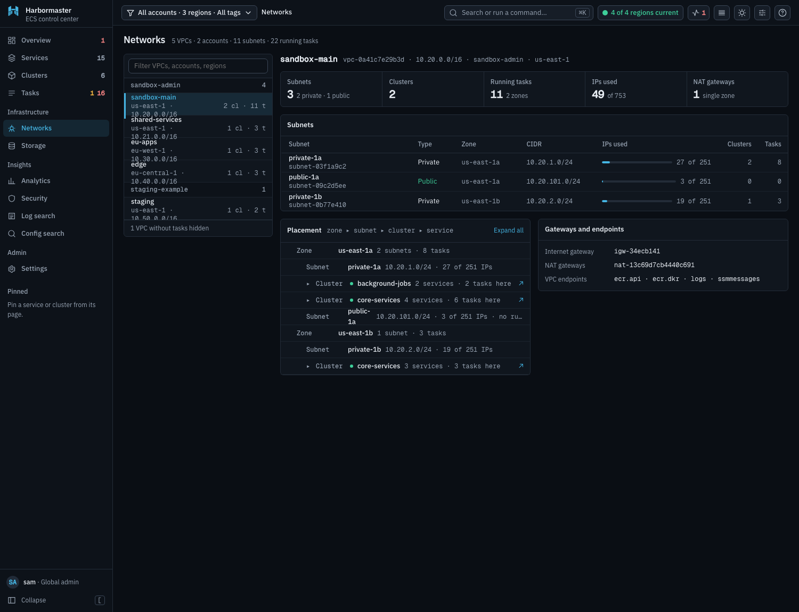
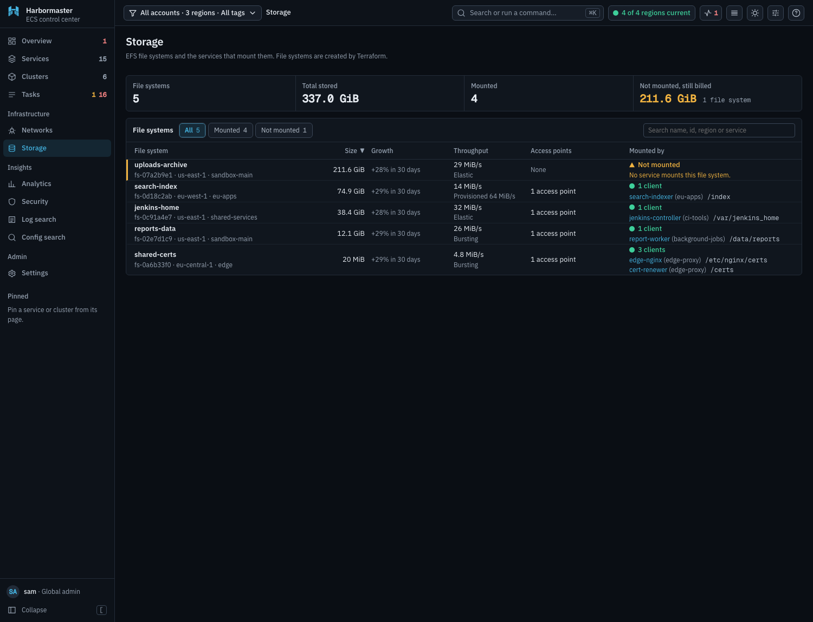

# Network and storage

How to read the **Networks** and **Storage** pages: where your tasks sit in each VPC, and which EFS file systems your services mount. For engineers debugging placement, IP exhaustion or unused file systems.

Both pages are read-only and follow your permissions. VPCs and file systems are polled every 5 minutes by default (`HM_POLL_NETWORK`, `HM_POLL_STORAGE`).

## Networks

Open **Networks** (`/networks`). The page lists active VPCs grouped by AWS account. A VPC is active when ECS tasks run in it. If none do, the page says so.

1. Use **Filter VPCs, accounts, regions** to narrow the list. The filter is kept in the address (`?q=`).
2. Select a VPC. Its address is kept in `?vpc=<account>/<region>/<vpc-id>`, so you can share it. Old links of the form `/networks/<account>/<region>` open the list filtered to that region.

The VPC detail shows:

- A summary: subnets (private and public), clusters, running tasks and zones, IPs used out of the total, and NAT gateways.
- **Gateways and endpoints**: internet gateway, NAT gateways and VPC endpoints.
- **Subnets**: type (Public or Private), zone, CIDR, IPs used, and the clusters and tasks in each. IP counts exclude the five addresses AWS reserves per subnet.
- **Placement**: the outline zone, subnet, cluster, service. Clusters start closed; open one or use **Expand all** and **Collapse to clusters**. Rows link to the cluster or service.

You only see running tasks you may view. A VPC with tasks you cannot see shows `No running tasks you can see in this VPC.`

Check it worked: the subnet IP counts match what the AWS console shows for available addresses. If they look old, check the page's data-age banner and see [Health and metrics](../operations/health-and-metrics.md).

## Storage

Open **Storage** (`/storage`). It lists EFS file systems and the services that mount them. File systems are created by Terraform; Harbormaster does not change them.

The summary shows file systems, total stored, how many are mounted, and **Not mounted, still billed**. Below, the **File systems** table has columns **File system**, **Size**, **Growth**, **Throughput**, **Access points** and **Mounted by**. Filter by **All**, **Mounted** or **Not mounted**, or search by name, id, region or service. Select a row to open its details: id, region, VPC, access points (path and uid) and mounting services with container paths.

"Mounted by" comes from the services' task definitions. A file system no service mounts is `Not mounted`, which is the quickest way to find storage you pay for and do not use.

Visibility: global admins see every file system. Other users see only the file systems mounted by a service they can view.

## Next steps

- [Overview and clusters](overview-and-clusters.md)
- [AWS costs](../operations/aws-costs.md)
- [Users, tags and permissions](users-tags-permissions.md)
