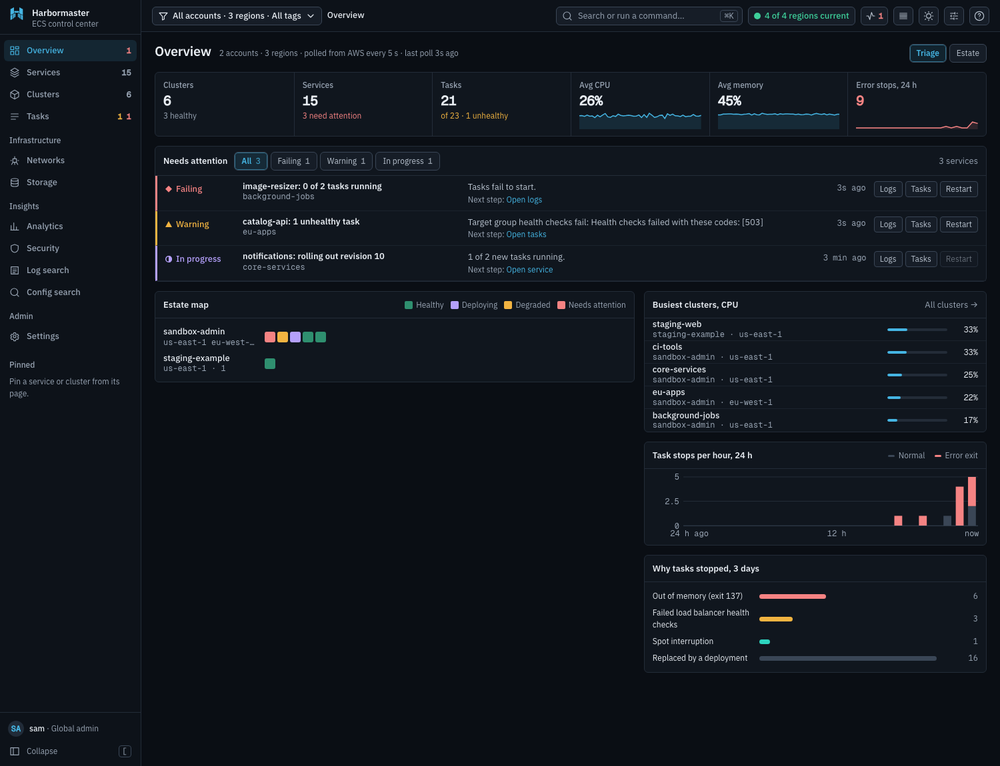
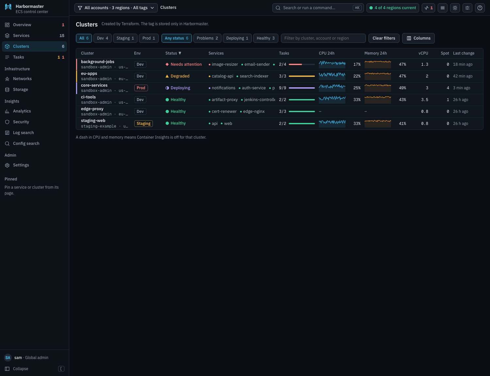
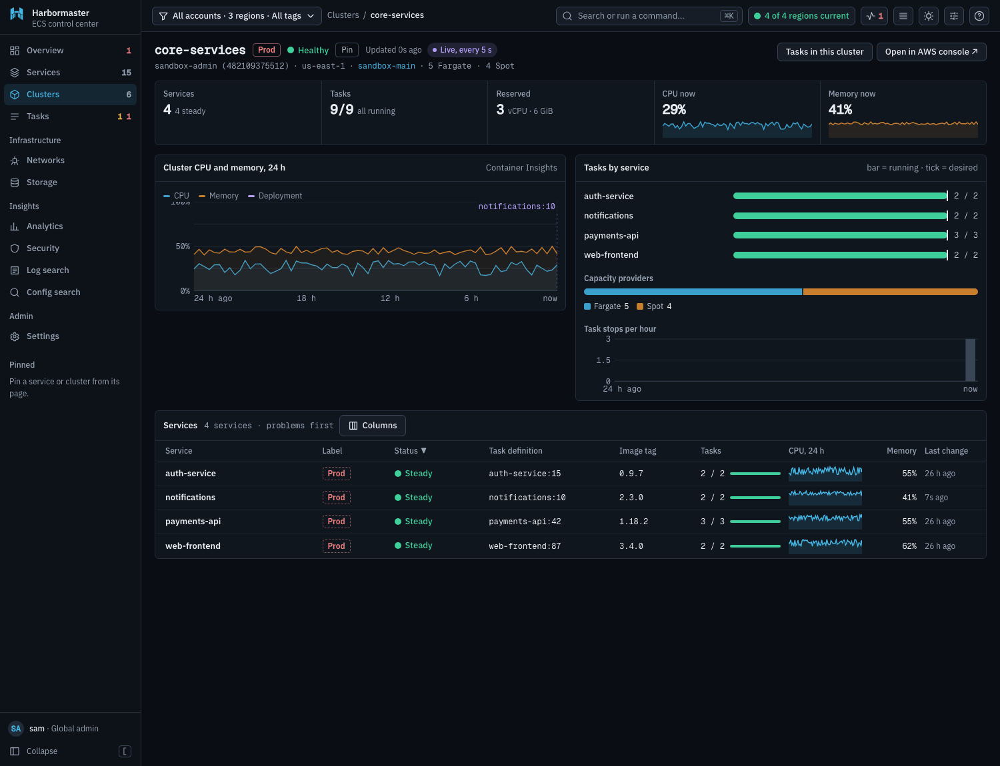
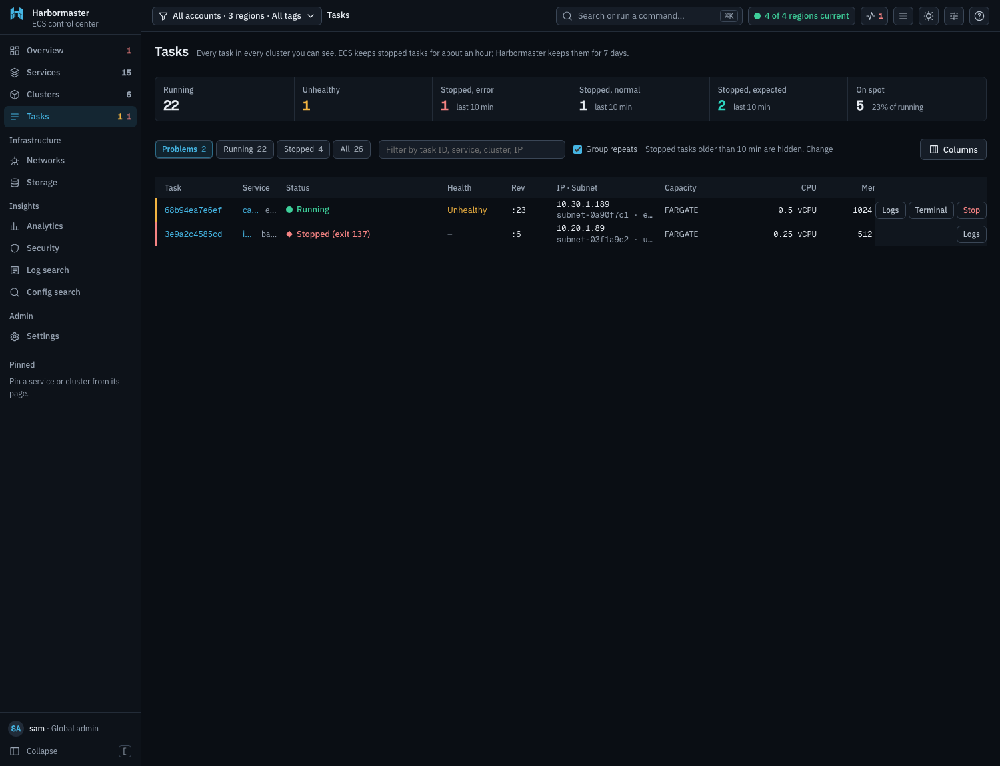

# Overview, clusters and tasks

This page explains the estate-level pages of the web app: Overview, Clusters, a single cluster, and the Tasks page. Use them to find what is unhealthy and to jump to the service that needs you. It is for anyone who watches ECS services day to day.

## Before you begin

- You need View on at least one tag. Every page below lists only what you can see. See [Users, tags and permissions](users-tags-permissions.md).
- Pages that show CPU and memory need Container Insights on the cluster. Without it those figures show a dash and the page says `Container Insights is off`. See [Metrics](services.md#metrics-tab).
- For layout and shortcuts, see [Navigating the web app](navigating.md).

## Overview

Open **Overview** from the sidebar (or press `g` then `o`). The header line shows how many accounts and regions are connected and when the data was last polled.

### Key figures

The strip at the top shows **Clusters**, **Services**, **Tasks**, **Avg CPU**, **Avg memory** and **Error stops, 24 h**. CPU and memory come from Container Insights.

### Triage and Estate layouts

The **Layout** switch at the top right has two views.

**Triage** (the default) answers "what is wrong right now?"

- **Needs attention** lists current alerts, worst first. Each row has a severity (**Failing**, **Warning** or **In progress**), the service, the cluster, the cause and a suggested next step as a link. When a change happened just before the problem, the row says `Just before: ...`. Use the **All**, **Failing**, **Warning** and **In progress** filter to narrow the list. Account-level alerts (for example an unreachable account) appear in the same list. Global admins get an **Open accounts** action on them.
- **Estate map** draws one cell per cluster, coloured by status.
- **Busiest clusters, CPU** ranks clusters by CPU, with a link to **All clusters**.
- **Task stops per hour, 24 h** and **Why tasks stopped, 3 days** show how often tasks stop and the main reasons.

**Estate** is a grouped table of every service. Use **Group by** (**Cluster** or **Account**), the **Problems only** switch, and the filter box (`/` focuses it) to find a service. Healthy groups are hidden while **Problems only** is on, and a note tells you how many.

How Harbormaster decides a service is failing, degraded or unhealthy is described in [Services](services.md#how-status-is-decided).

## Clusters

Open **Clusters** (or press `g` then `c`). Each row is one cluster with its tag (shown in the **Env** column), status, number of services and tasks, CPU and memory use, Spot tasks and when it last changed.

1. Filter by tag with the tag selector, and by status with **Any status**, **Problems**, **Deploying** or **Healthy**. The counts next to each option update as you filter.
2. Type in the filter box to match a cluster name, account or region.
3. Click a cluster name to open it. Choose columns with the column picker.

On a phone the same filters appear as chips, and each cluster is a card.

## A cluster page

The header shows the cluster name, its tag, a status dot, the account and region, the VPC (a link to [Networks](network-and-storage.md)) and the Fargate and Spot task split. Two buttons sit on the right: **Tasks in this cluster** opens the Tasks page filtered to this cluster, and **Open in AWS console** opens the cluster in the AWS console. Use the pin button to pin the cluster to the sidebar. Global admins can click the tag chip to change the cluster's tag.

Below the header:

- A summary strip with **Services**, **Tasks**, **Reserved** (vCPU and GiB), **CPU now** and **Memory now**.
- A cluster CPU and memory chart. It needs Container Insights.
- **Tasks by service**: one bar per service, where the bar is the running count and the tick is the desired count. A bar short of its tick means missing tasks.
- **Capacity providers**: Fargate against Spot tasks. **Task stops per hour** for the last 24 hours, split into normal stops and stops with an error.
- **Services**: a table of the cluster's services, problems first. Columns are **Service**, **Label**, **Status**, **Task definition**, **Image tag**, **Tasks**, CPU, **Memory** and **Last change**. Click a service to open its [service page](services.md).

On a phone, the **Section** chips (**Services**, **Tasks**, **Capacity**) scroll to each block.

## Tasks page

Open **Tasks** (or press `g` then `t`) to see tasks across every cluster you can see.

### Summary

The strip shows **Running**, **Unhealthy**, **Stopped, error**, **Stopped, normal**, **Stopped, expected** and **On spot**. The stopped figures cover only a recent window.

- **Stopped, error**: the workload failed, for example a non-zero exit of an essential container.
- **Stopped, expected**: the platform or an operator stopped the task, for example Spot reclaim, maintenance, a deployment replacing it, scale-in or a user stop.
- **Stopped, normal**: any other clean stop.

### Find tasks

1. Pick a segment: **Problems** (the default), **Running**, **Stopped** or **All**.
2. Type a task ID, service, cluster or IP in the filter box.
3. Turn on **Group repeats** to collapse tasks that stopped the same way into one row with the count and the time of the first and last stop.
4. Open **Filters** to narrow by service, cluster, status, capacity or stop cause. Use the column picker to show or hide columns.

A note under the filter says `Stopped tasks older than N min are hidden.` Global admins get a **Change** link to **Settings > General**.

### Task row and actions

Each row shows the task, service, status, health, revision, IP and subnet, capacity (Fargate or Spot), CPU, memory, start time and the stop reason. Rows that stopped with an error get a red stripe.

Click a task ID to open the task drawer with its identity, containers and stop reason. Row actions depend on your permissions:

| Action | Needs | Notes |
|---|---|---|
| **Logs** | Logs on the service's tag | Opens the service's [Logs tab](logs.md). |
| **Terminal** | Terminal on the tag | Greyed out with `ECS Exec is off for this task` when ECS Exec is not enabled. See [Terminal](terminal.md). |
| **Stop** | Operate on the tag | Stops one running task. ECS replaces it if the service wants more tasks. |

Standalone tasks (not part of a service) appear here too. They have a **Terminal** action but no **Logs** link.

## Check it worked

- On Overview, the **Needs attention** count matches the red badge next to **Overview** in the sidebar.
- On a cluster page, the sum of **Tasks by service** bars equals the **Tasks** figure in the summary strip.
- On Tasks, switching the segment to **Running** shows the same number as **Running** in the strip.

## Next steps

- [Services](services.md): the tabs of a service page.
- [Logs](logs.md) and [Timeline](timeline.md): find out why something is failing.
- [Alert notifications](alert-notifications.md): get told about failures.
