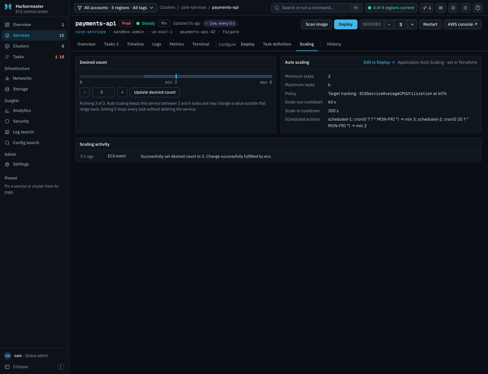

# Scaling and off-hours

How to change a service's desired count, read its auto scaling settings, and put groups of services to sleep on a weekly schedule. For platform engineers who run ECS services with Harbormaster.

## Set the desired count

Before you begin: you need **Operate** on the service's tag (see [Users, tags and permissions](users-tags-permissions.md)).

1. Open the service and select the **Scaling** tab. The header of the service page also has a count stepper.
2. In **Desired count**, type a number or use **Fewer tasks** and **More tasks**.
3. Select **Update desired count** and confirm. Setting `0` stops every task. The service and its task definition stay.

A value above the service's maximum is not accepted. If auto scaling is set up, the panel shows its range and warns when your value is outside it, because auto scaling may change it back.

Check it worked: a toast says `Desired count set to <n>.` and the panel shows `Running <x> of <n>`.

## Read the auto scaling settings

The **Auto scaling** panel on the Scaling tab is read-only. It shows the minimum and maximum tasks, the scaling policies with their cooldowns, scheduled actions and the last 7 days of **Scaling activity**. Auto scaling itself is defined in Terraform (Application Auto Scaling). If you have Operate, **Edit in Deploy** opens the Deploy tab, where a scaling change is reviewed as part of a change set. See [Deploy a change](deploy-a-change.md).

A service with no scalable target shows `This service has no scalable target registered.`

## Off-hours schedules

An off-hours schedule puts ECS services to sleep on a weekly grid and wakes them again, so a dev or staging estate does not pay for idle tasks at night. Creating and editing schedules is for global admins. Anyone with **Operate** on a service can wake it temporarily.

### How it works

- At sleep time Harbormaster sets the minimum and maximum capacity of the service's Application Auto Scaling scalable target to 0, through scheduled actions in the schedule's time zone. At wake time the scheduled action restores the values Harbormaster saved. Scaling policies stay in place.
- If the service has no scalable target, Harbormaster registers one and logs it.
- Harbormaster only creates, changes and deletes scheduled actions whose names start with `harbormaster-offhours-`. Other scheduled actions are never touched.
- The coordinator checks every enrolled service every `HM_OFFHOURS_INTERVAL` (60 seconds by default) and repairs a skipped or doubled action, for example around a daylight saving change. Changes within 5 minutes of a grid edge are left alone.
- A schedule saves money only on Fargate services it can price. The saving shown is a list-price estimate, not your bill.

### Set up a schedule

Before you begin: you are a global admin, and the services you want to sleep have an AWS service tag, or a Harbormaster tag, you can select. The account must not be connected `read_only`; services in such an account show as blocked.

1. Open **Settings > Off-hours** and select **New schedule**.
2. Enter a **Name** and pick the **Timezone**.
3. Under **Services tagged**, choose one or more tags. The picker offers **AWS tags** (type `key=value` to add one) and **Harbormaster tags**. A service matches when it has any of the tags.
4. Optionally add services to **Exclude services**. They are left alone even when a tag matches.
5. Set the awake hours on the weekly grid, or start from a preset: `Weekdays 07–20`, `Weekdays 08–18` or `Always on`. Blue hours are awake.
6. Read the preview. It lists the matched services, how many will go to sleep when you save, the saving a month, and warns when a service looks like production.
7. Select **Save**. Keep **Enabled** on.

Saving during sleep hours puts the services to sleep straight away. A service can belong to one schedule only; saving a schedule that overlaps another is refused with a 409. A service whose auto scaling minimum is already 0 is `Not managed`, because it could not wake on its own.

Check it worked: the schedule's services table lists each service with its tasks, state and cost, and the service's Overview shows an **Off-hours** card.

### Wake a service early

From the services table in the schedule, or the **Off-hours** card on the service Overview, select **Wake for 2 hours**. Select **Put back to sleep** to end it sooner. The wake survives a Harbormaster restart. Both actions are written to the operations log and the [audit log](audit-log.md).

### Things to know

- A scaling change on the Deploy tab that would delete the schedule's scheduled actions, or set the desired count of a sleeping service, is refused with 409.
- Disabling or deleting a schedule gives its services their saved capacity back.
- Disable or delete schedules before you disable an AWS account in Harbormaster. Services in a disabled account are left as they are and their scheduled actions keep running.
- Off-hours wake looks like a failure for a few minutes. Alert notifications wait for that; see [Alert notifications](alert-notifications.md#scaling-is-not-a-failure).

## Next steps

- [Alert notifications](alert-notifications.md)
- [AWS costs](../operations/aws-costs.md)
- [Configuration reference](../reference/configuration.md)
