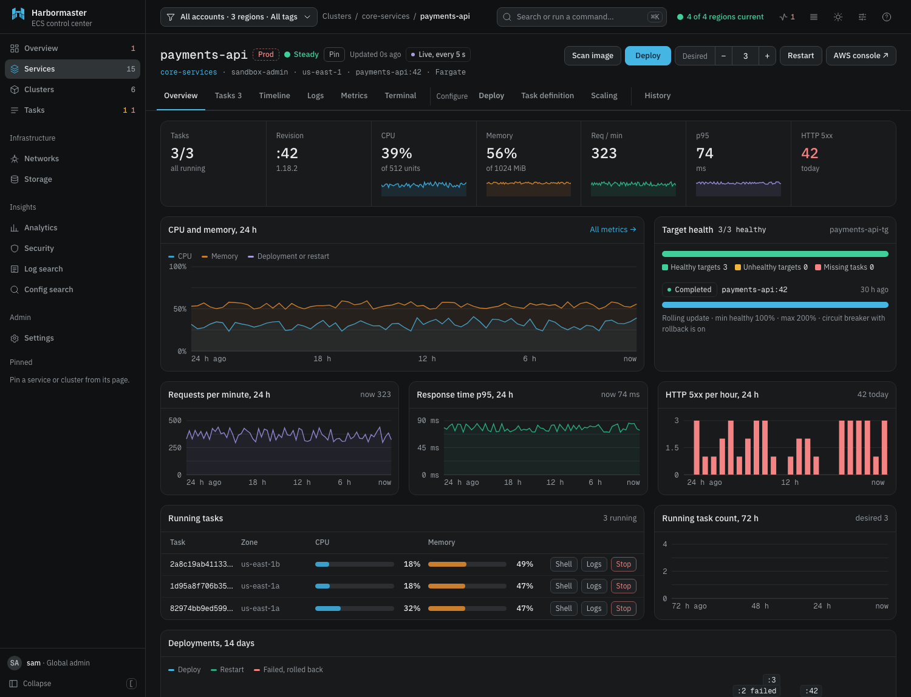
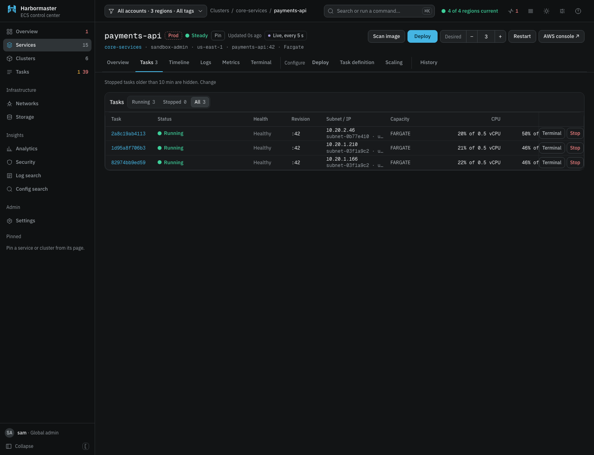
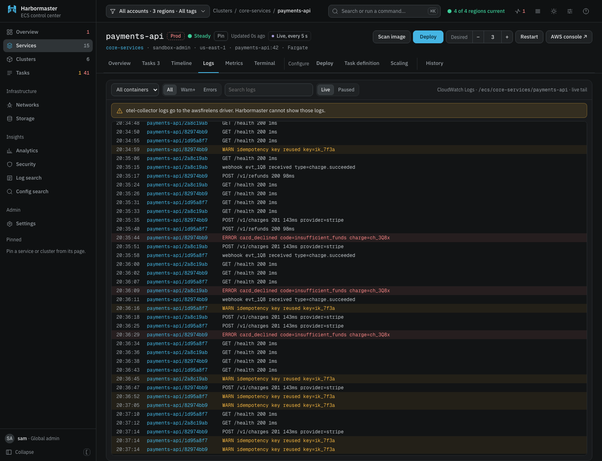
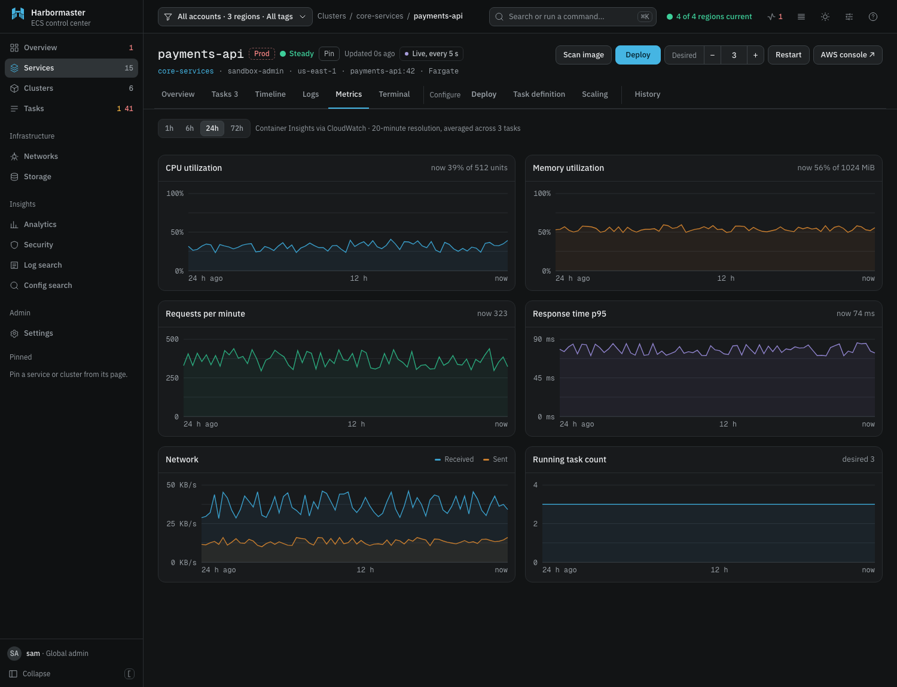
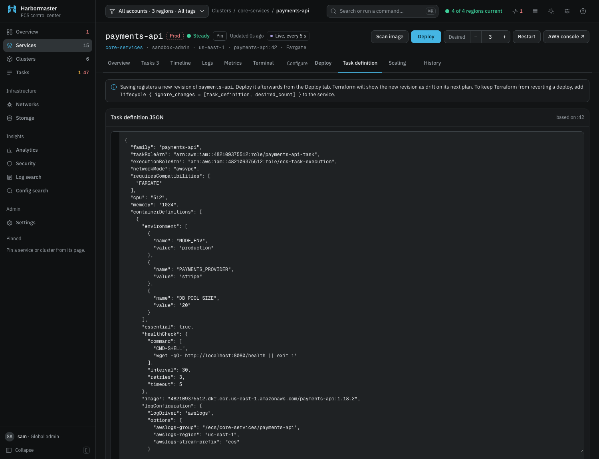
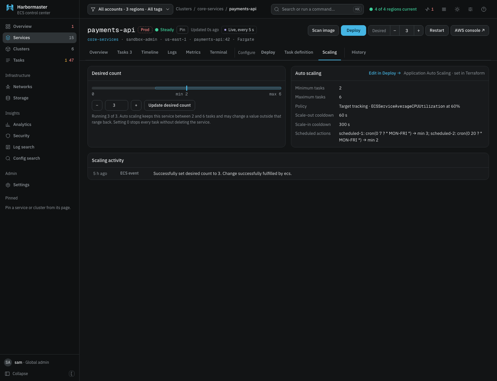
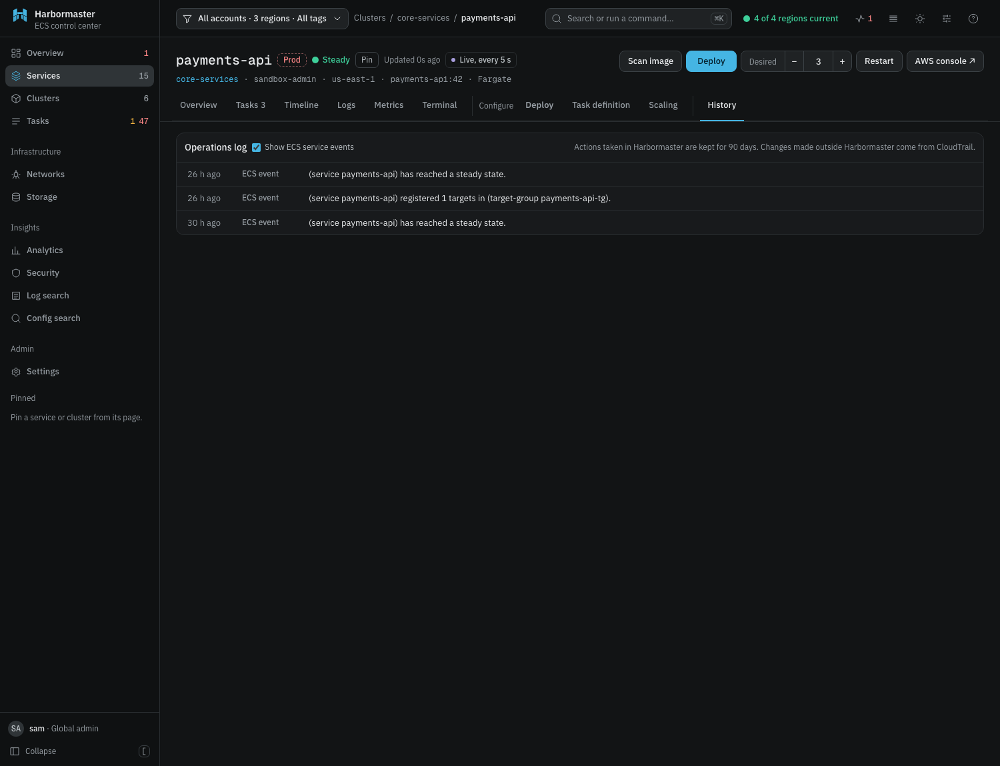

# The service page

This page explains the tabs of a service page and how to read each one. It is for engineers who open a service to see how it runs, why it is unhealthy, or what changed. To change a service, see [Deploy a change](deploy-a-change.md).

## Before you begin

- You need View on the service's tag to open the page. Some tabs need more. Tabs you lack permission for show a lock message that names the permission.
- Open a service from the Services page, from a cluster page, from the search palette (`Ctrl` or `Cmd` + `K`), or from a pin in the sidebar.

| Tab | Needs |
|---|---|
| Overview, Tasks, Timeline, Metrics, Task definition, Scaling, History | View |
| Logs | Logs |
| Terminal | Terminal |
| Deploy | Edit, Deploy or Operate (any one) |

The Timeline tab shows its **Log errors** lane only with Logs. See [Users, tags and permissions](users-tags-permissions.md) and the [permissions reference](../reference/permissions.md).

## The header

The header shows the service name, its tag (dashed when inherited from the cluster), a status dot, the pin button and a live refresh indicator. Under the name are the cluster (a link), the account, the region, the deployed `family:revision` and the launch type.

Buttons on the right:

- **Deploy** opens the Deploy tab. It is greyed out without Edit, Deploy or Operate.
- **Scan for vulnerabilities** scans the images the service runs now. See [Image security](image-security.md).
- A **Desired** stepper changes the desired count. It needs Operate and asks for confirmation. A warning appears when the new count is outside the auto scaling range.
- **Restart** starts a new deployment of the same revision. It needs Operate. It is disabled while a rollout runs.
- **AWS console** opens the service in the AWS console.

On a phone the header is one compact row with a **...** menu for the other actions.

### Banners

- **Pending revision.** When a registered revision is newer than the deployed one and nothing is rolling out, a banner offers **Deploy :N**. It opens the Deploy tab with that revision loaded.
- **Unsupported deployment controller.** Harbormaster changes only services that use the ECS rolling deployment controller. For CodeDeploy, external and ECS native blue/green services, Deploy, Restart and roll back are disabled and a banner says so. You can still register revisions and set the desired count.

### How status is decided

The first matching rule wins.

| Status | Condition |
|---|---|
| Deploying | A deployment has rollout state `IN_PROGRESS`. |
| Scaled to 0 | Desired count is 0. |
| Failing | Desired is above 0 and no task runs. |
| Degraded | Fewer tasks run than desired. |
| Unhealthy task | A running task or a load balancer target is unhealthy. |
| Steady | None of the above. |

## Overview tab

The tab answers "is this service healthy, and what is it doing?"

- **Summary strip:** tasks (running of desired), deployed revision with image tag, CPU and memory with 24-hour sparklines, and for load-balanced services requests per minute, p95 response time and HTTP 5xx.
- **Rollout card:** the latest deployment. While a rollout runs it shows `:from -> :to`, a bar of new against old tasks, failed starts and whether the circuit breaker is on. A failed rollout shows the reason ECS gave. A completed one shows the strategy.
- **CPU and memory, 24 h** with markers for deployments and restarts.
- **Target health** (load-balanced) or **Task health**: healthy, unhealthy and missing tasks.
- **Requests per minute, 24 h**, **Response time p95, 24 h** and **HTTP 5xx per hour, 24 h** for services behind an application load balancer.
- **Running tasks:** CPU and memory per task, zone, Spot flag and per-task actions.
- **Running task count, 72 h** against the desired count.
- **Deployments, 14 days:** deploys, restarts and failed (rolled back) rollouts on a time axis.
- **Networking:** VPC, subnets, security groups, public IP, load balancer and Service Connect.
- **Task definition:** family, size, containers and images, task role, whether ECS Exec is on, and EFS mounts.
- **Off-hours:** the service's sleep schedule and a wake button. See [Scaling and off-hours](scaling-and-off-hours.md).
- **Recent events:** the last events, linking to the History tab.

CPU, memory and load balancer charts show a dash with a `Container Insights off` note when the data is not available.

## Tasks tab

Running and stopped tasks of this service. Filter with **Running**, **Stopped** or **All**. Columns include the task ID, status (with exit code for stopped tasks), health, revision, subnet and IP, capacity (Fargate or Spot), CPU, memory, start time and stop reason.

- Rows with error exits have a red stripe and unhealthy rows an amber one.
- Click a task ID to open its details.
- Row actions: **Terminal** (needs Terminal, and ECS Exec on), **Stop** (needs Operate).
- Stopped tasks older than the hidden-task window are not listed. The note above the table gives the window. Stopped tasks are kept for 7 days by default; see [Data retention](../operations/data-retention.md).

Use the stop reason to tell causes apart. `Essential container in task exited` with exit code 137 usually means the task ran out of memory. A reason like `Scaling activity initiated by deployment` is an expected stop.

## Timeline tab

One time axis for changes, task stops, alerts, log errors and terminal sessions, with the likely trigger of a failure. See [Timeline](timeline.md).

## Logs tab

CloudWatch log history and a live tail for the service's containers. See [Logs](logs.md).

## Metrics tab

Charts from Container Insights for the service over the last **1h**, **6h**, **24h** or **72h**. Pick the range at the top. The line under the toolbar states the CloudWatch resolution (for example 1-minute) and that values are averaged across the running tasks.

Charts: **CPU utilization**, **Memory utilization**, **Network** (received and sent), **Running task count** against the desired count, and for load-balanced services **Requests per minute** and **Response time p95**.

If Container Insights is off for the cluster, the tab shows a warning instead of empty charts, with the Terraform setting that turns it on (`containerInsights` set to `enhanced` on the cluster). Charts that cannot be read show `stale` or an error and keep the last known data.

## Terminal tab

An interactive shell in a running task through ECS Exec. See [Terminal](terminal.md).

## Deploy tab

The one place to change a service: containers, task size, service settings and auto scaling, reviewed as a single change set. See [Deploy a change](deploy-a-change.md).

## Task definition tab

- **Task definition JSON:** the deployed revision in register-ready form. With Edit you can change it and choose **Review and save**. This registers a new revision only; it deploys nothing. Invalid JSON shows the parse error and blocks saving. Without Edit the editor is read-only.
- **Revisions:** every revision of the family with **Status** (**Deployed**, **Rolling out**, **Not deployed** or **Previous**), image tag, CPU and memory, when it was registered, and by whom. A revision registered outside Harbormaster shows `terraform`. The action button is **Deploy** for a not-deployed revision and **Roll back to this** for a previous one. Both open the Deploy tab at that revision. See [Roll back](roll-back.md).

Registering a revision outside Terraform shows up as drift in your next `terraform plan`. The tab reminds you of this. See [Terraform and Harbormaster deploys](deploy-a-change.md#terraform-and-harbormaster).

## Scaling tab

- **Desired count:** a stepper and **Update desired count** (needs Operate). A range bar shows the auto scaling minimum and maximum with the desired count marked. Setting 0 stops every task without deleting the service. A warning shows when the value is outside the auto scaling range or above the configured maximum.
- **Auto scaling:** a read-only summary of minimum, maximum, policies (with targets and cooldowns) and scheduled actions. An **Edit in Deploy** link opens the Deploy tab, where auto scaling is edited.
- **Scaling activity:** recent scaling activities from the last 7 days, newest first.

## History tab

The service's operations log, newest first. It lists what people did in Harbormaster (restarts, deploys, rollbacks, desired count changes, terminal sessions, scaling edits) with who and when, and, when **Show ECS service events** is on, the events ECS recorded for the service. A change set from the Deploy tab writes one line per kind of change, all with the same change-set ID and the reason you entered. Use **Load more** at the end of the list for older entries.

Harbormaster keeps its own operations log for 90 days by default. See [Data retention](../operations/data-retention.md). The account-wide log of sign-ins and admin changes is separate: see [Audit log](audit-log.md).

## Check it worked

- The header revision matches the **Deployed** row in the Revisions table on the Task definition tab.
- The task count in the Overview strip matches the number of **Running** tasks on the Tasks tab.

## Next steps

- [Deploy a change](deploy-a-change.md)
- [Roll back](roll-back.md)
- [Logs](logs.md), [Timeline](timeline.md), [Terminal](terminal.md)
