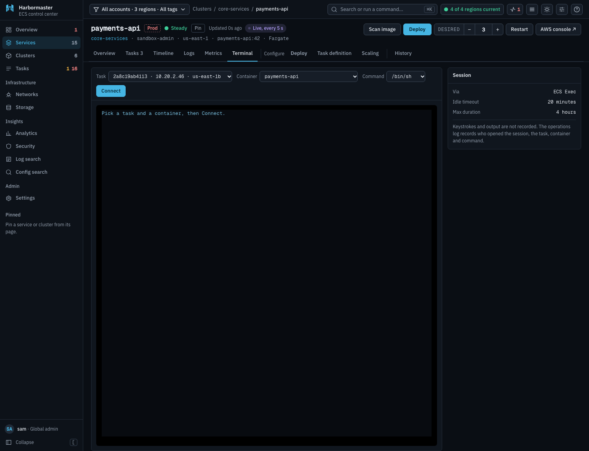

# Open a terminal in a running task

This guide shows how to open an interactive shell in a running ECS task from the web app, what the target account must have in place, and what Harbormaster records. It is for engineers who debug live containers and for admins who set up and audit that access.

The terminal uses ECS Exec: the `ecs:ExecuteCommand` API and the AWS Systems Manager Session Manager data channel. Harbormaster connects a browser terminal to that channel.

## Before you begin

### Your permission

You need **Terminal** on the tag of the service or cluster. The **Full** preset includes it. Other presets do not. Harbormaster checks it before it opens a session. Without it the Terminal tab shows a lock message that names the permission. See [Users, tags and permissions](users-tags-permissions.md).

### What the target account needs

| Where | Requirement |
|---|---|
| The service | ECS Exec is on. Set `enable_execute_command = true` on the `aws_ecs_service` in Terraform, or switch **ECS Exec** on in the **Service** panel of the Deploy tab (needs Deploy). Turning it on from the Deploy tab replaces the service's running tasks. |
| The task | A task that started after ECS Exec was turned on. Older tasks have no ExecuteCommand agent. A container whose agent is not running appears greyed out as `<name> · agent <state>`. |
| The task role | The task's own role needs `ssmmessages:CreateControlChannel`, `ssmmessages:CreateDataChannel`, `ssmmessages:OpenControlChannel` and `ssmmessages:OpenDataChannel`. Turning exec on does not grant them. Without them a session cannot open even with exec on. The Deploy tab warns when the task definition has no task role. |
| The `harbormaster-access` role | `ecs:ExecuteCommand` and `ssm:TerminateSession`. The [access module](../reference/terraform-access.md) grants them in its write policy, so an account connected with `read_only = true` cannot open terminals. |

If ECS Exec is off, the Terminal tab shows a banner that names the Terraform setting and the `ssmmessages` permissions. For a standalone task started without ECS Exec, the page says so and shows the `--enable-execute-command` flag to start it with.

See [Connect AWS accounts](../install/connect-aws-accounts.md) and [IAM and AWS access](../security/iam-and-aws-access.md).

## Open a terminal

1. Open the service and choose the **Terminal** tab. You can also click **Terminal** on a task row or in a task's details. That opens the tab with the task already picked. For a standalone task, use **Terminal** on the Tasks page.
2. Choose the **Task** (running tasks only), the **Container** and the **Command**. The commands offered are `/bin/sh` (the default) and `/bin/bash`. The container must have a shell at that path.
3. Click **Connect**. The terminal prints `Starting session...` and then `Starting session with SessionId: <id>`.
4. Work in the shell. The window resizes with the page.
5. Click **Disconnect** when you are done.

The side panel (**Session** on desktop, the info button on a phone) shows the connection method (ECS Exec) and the idle and maximum durations.

On a phone, tap the target line at the top to change task, container or command in a sheet. While you are connected, a key row adds `esc`, `tab`, `^C` and the arrow keys.

## Limits

| Limit | Default | Setting |
|---|---|---|
| Idle timeout. Only keystrokes and resizes count, output does not. | 20 minutes | `HM_EXEC_IDLE_TIMEOUT` |
| Maximum session length | 4 hours | `HM_EXEC_MAX_DURATION` |
| Concurrent sessions per user | 3 | `HM_EXEC_MAX_SESSIONS_PER_USER` |

When a limit ends a session, the terminal says so, for example `Session reached the 4 hour limit.` At the session limit, Harbormaster refuses the new one with `You already have 3 open terminal sessions.` With more than one Harbormaster task, the per-user count is shared across tasks only when a shared store is configured. See the [configuration reference](../reference/configuration.md) and [Throttling and limits](../operations/throttling-and-limits.md).

!!! note "The Session panel shows fixed values"
    The Session panel always shows 20 minutes and 4 hours, even when an admin changed `HM_EXEC_IDLE_TIMEOUT` or `HM_EXEC_MAX_DURATION`. The configured value is what applies.

Harbormaster calls `ssm:TerminateSession` whenever a session ends, for any reason.

## Auditing

Harbormaster records that a session happened. It does not record what was typed or printed.

- **Operations log.** Opening a session writes `Opened terminal session on task <id> (<container>, <command>).` Closing it writes `Closed terminal session on task <id> (<container>) after <duration>.` Each row names the user and carries the task, container, command, session ID and the reason it closed. Read them in the service's **History** tab. See [Services](services.md#history-tab).
- **Timeline.** The **Terminal** lane of the [Timeline](timeline.md) shows sessions next to deploys and task stops.
- **Keystrokes and output.** Not recorded. For a full transcript, turn on Session Manager logging to S3 or CloudWatch Logs in your account's Terraform. KMS-encrypted Session Manager preferences are not supported.

Sign-ins and admin changes are in the [audit log](audit-log.md).

## Check it worked

- The terminal shows a prompt, and `whoami` or `hostname` answers.
- The service's History tab has an `Opened terminal session` line with your name, and after you disconnect, a `Closed terminal session` line.

## Troubleshooting

| Message | Cause and fix |
|---|---|
| `You need Terminal on <tag> to open a terminal.` | Ask a global admin for Terminal on that tag. |
| `ECS Exec is off for <service>.` | Turn ECS Exec on (see the table above), then wait for new tasks. |
| `The ExecuteCommandAgent is not running in container <name>.` | The task started before exec was on, or the agent failed. Replace the task, for example with **Restart**. |
| `Command must be /bin/sh or /bin/bash.` | Pick one of the offered commands. |
| `You already have 3 open terminal sessions.` | Close another terminal, or wait for it to time out. |
| An AWS error right after Connect | Usually missing `ssmmessages` permissions on the task role, or `ecs:ExecuteCommand` on the access role. |

## Next steps

- [Deploy a change](deploy-a-change.md): turn ECS Exec on.
- [Users, tags and permissions](users-tags-permissions.md): grant Terminal.
- [Security model](../security/security-model.md)
