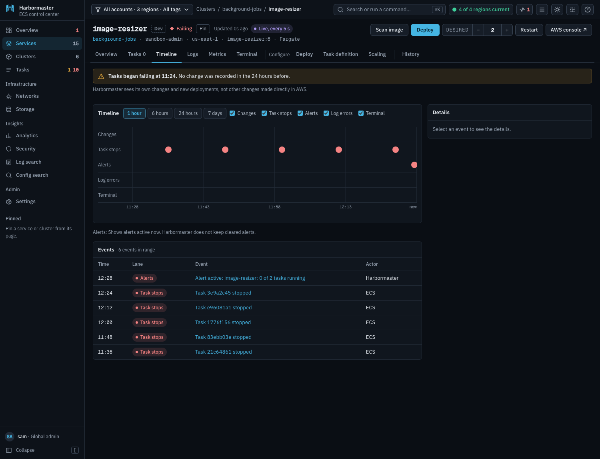

# Use the timeline to find what changed

This guide shows how to read a service's Timeline tab: changes, task stops, alerts, log errors and terminal sessions on one time axis, plus the banner that names the likely cause of a failure. It is for engineers who ask "what changed before this broke?"

## Before you begin

- You need **View** on the service's tag to open the tab.
- The **Log errors** lane needs **Logs** on the tag. Without it the lane's switch is disabled and the tab says `You need Logs on <tag>`. **Open logs at this time** needs Logs too.
- **Roll back to revision N** needs **Deploy**. See [Roll back](roll-back.md).
- The timeline is built from what Harbormaster recorded: its own changes and the deployments, task stops and alerts that its poller saw. Harbormaster does not see other changes made directly in AWS, apart from the deployments they cause. A note under the banner says so.

## Open the timeline

Open the service and choose **Timeline**.

1. Pick a **Range**: **1 hour** (the default), **6 hours**, **24 hours** or **7 days**.
2. Use the lane switches to show or hide lanes. At least one lane must be on.
3. Click a marker on the axis, or a row in the **Events** table below it. The **Details** panel shows the event.

The page URL keeps the range and the selected event (`?range=` and `?event=`), so you can share a link to an event.

## The lanes

| Lane | What a marker is |
|---|---|
| **Changes** | Something changed the service: a deploy, rollback, restart, desired count change, ECS Exec or rollout settings change, scaling change, or a registered revision. A Deploy tab change set shows as one event, `Change set applied: revision N`, with its reason and a before and after list. A deployment that Harbormaster did not start (from Terraform or CI, for example) is shown too, and so is a failed deployment. |
| **Task stops** | A task stopped. Stops with an error are red and show the stop reason and exit code. Other stops are grey and show the cause, for example Spot reclaim or a deployment replacing the task. |
| **Alerts** | An alert that is active now, such as `Service failing` or `Unhealthy task`. An alert's time is its latest evidence, not its start. When that is older than the range, the marker sits at the start of the range and the details say `Evidence from <time>`. |
| **Log errors** | How many lines in the service's logs look like errors, in each time bucket. Needs Logs. The details show the most frequent message and how it compares with the usual rate. |
| **Terminal** | A terminal session: who opened it, on which task, and how long it lasted. See [Terminal](terminal.md). |

Markers that fall close together on the axis merge into one marker. Click it to see the first event.

Log error buckets are about 5 minutes for 1 hour, 30 minutes for 6 hours, 2 hours for 24 hours and 12 hours for 7 days. A bucket marked `At least N` hit a counting cap. If CloudWatch cannot be read, the lane shows `Log errors could not be read.` with a retry, and the rest of the timeline is unaffected. If no container logs to CloudWatch, the lane says so.

Some lanes cannot reach back over the whole range because their data is pruned sooner. A note under the axis then names the lane and how long its data is kept. See [Data retention](../operations/data-retention.md).

## Read the incident banner

When tasks are failing, a banner appears above the timeline. Harbormaster groups recent task failures into a burst, where failures less than an hour apart belong together. It looks at the newest burst in the last 7 days. It then names the last change in the 24 hours before the burst's first failure as the likely trigger. The banner is shown only when the burst's last failure falls inside the selected range.

It has four forms:

- **A trigger was found:** `Tasks began failing 4 minutes after revision 43.` It adds what changed (for example the image tag) and the most common stop reason: `5 of 7 failures since then: <reason>.` Click **Show the change** to select the trigger event, turn on its lane and widen the range if needed.
- **Someone already rolled back:** `Rollback to revision N started by <user>, <time>.`
- **No change explains it:** `Tasks began failing at <time>. No change was recorded in the 24 hours before.`
- **Too many failures to tell:** `Tasks have been failing for a long time. Harbormaster holds too many recent failures to tell what started it. No rollback offered.`

Only changes that can alter behaviour count as triggers: deploys, rollbacks, restarts, desired count changes, ECS Exec and rollout settings changes, and scaling changes. Registering a revision alone does not, because nothing runs it until something deploys it. Stopping a task does not either.

Treat the trigger as a lead, not a verdict. A deploy that precedes a failure may be unrelated to it.

## Read an event

The **Details** panel shows the event title, its lane, the time and the actor (a user, `ECS` or `Harbormaster`), a **Likely trigger** tag when it is the banner's trigger, and the **Reason** that the deployer entered, when there is one. For a change, it lists what changed, before and after, and a revision diff.

Actions:

- **Open logs at this time** opens the [Logs tab](logs.md) at that moment, so you read the lines just before the event.
- **Open task** (task stops) opens the stopped task's details.
- **Roll back to revision N** (on the likely trigger, when offered) opens the Deploy tab with that revision loaded and the review open. See [Roll back](roll-back.md#roll-back-from-the-timeline).

## Check it worked

- After you deploy, the **Changes** lane shows a marker for it shortly afterwards, with your name and reason.
- Select a task stop: the details show the exit code and stop reason you see on the Tasks tab.

## Next steps

- [Roll back](roll-back.md)
- [Logs](logs.md)
- [Alert notifications](alert-notifications.md): get told when tasks start failing.
