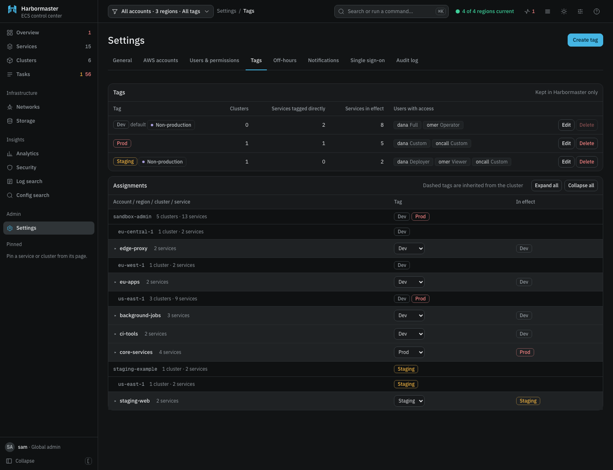
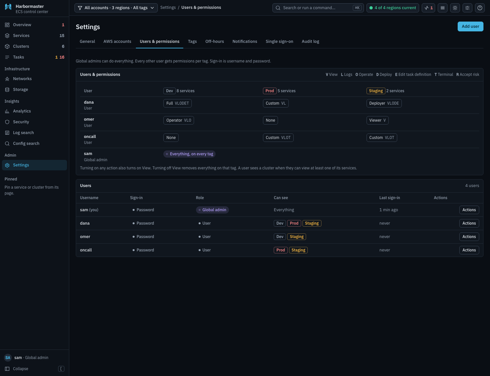

# Users, tags and permissions

How Harbormaster decides who can see and do what, and how to create users, tag your estate and grant access. For global admins.

All of this is under **Settings**: **Users & permissions** and **Tags**. Only global admins see those tabs.

## How permissions work

Permissions are granted per user, per **tag**. A tag is a label that lives only in Harbormaster; AWS tags are never read or written for this.

- Every cluster has at most one tag. An untagged cluster is **Dev**, the built-in default tag.
- A service has its own tag if one was assigned, otherwise it inherits its cluster's tag.
- A task uses its service's tag, or its cluster's tag when it is standalone.
- A **global admin** can do everything on every tag and manage users, tags and AWS accounts.
- Everyone else can do only what the matrix grants on the tags they hold. A user with no grants sees nothing.

Each tag grants a set of actions:

| Action | Letter | Allows |
| --- | --- | --- |
| View | V | See the tag's clusters, services and tasks. Every other action implies it. |
| Logs | L | Read logs and search them. |
| Operate | O | Restart, change the desired count, wake or sleep off-hours services. |
| Deploy | D | Deploy changes and roll back. |
| Edit task definition | E | Edit task definitions. |
| Terminal | T | Open a shell in a task. |
| Accept risk | R | Accept vulnerability findings. In no preset. |

Presets: **None**, **Viewer** (View), **Operator** (View, Logs, Operate), **Deployer** (Operator plus Deploy and Edit task definition) and **Full** (everything except Accept risk). Any other combination shows as **Custom**. Turning an action on turns View on; turning View off clears everything. The full table is in the [permissions reference](../reference/permissions.md).

## Create a tag

1. Open **Settings > Tags** and select the add button, then enter a **Name** and **Color**.
2. Optionally mark it non-production, which lets Harbormaster suggest its services for Fargate Spot.
3. Save with **Create tag**.

The table shows each tag's clusters, services tagged directly, services in effect and users with access. **Dev** cannot be deleted. Deleting another tag turns its clusters into Dev and sends its services back to inheriting their cluster's tag; the dialog shows how many before you confirm.

## Assign tags to clusters and services

In the **Assignments** panel of **Settings > Tags**, expand a cluster and choose a tag for it or for a service in it. Dashed tags are inherited from the cluster. Use **Expand all** and **Collapse all** to move around.

Check it worked: the **Services in effect** count on the tag changes.

## Create a user

1. Open **Settings > Users & permissions** and select **Add user**.
2. Enter a **Username**. Tick **Global admin** only if they need everything.
3. Select **Add user**. Harbormaster shows a temporary password once; hand it over securely. They choose a new password at first sign-in.

If single sign-on is on, see [single sign-on](../install/single-sign-on.md) for linking users and break-glass accounts.

## Grant access

1. In **Settings > Users & permissions**, select **Edit permissions** on the user.
2. In the matrix, pick a preset for each tag, or toggle single actions.
3. Save.

The user's **Can see** column and their **My access** page now list those tags. Users see their own grants on **My access** and are told to ask a global admin to change them.

Other row actions: **Reset password**, **Make global admin** or **Remove global admin**, **Make break-glass**, **Link SSO**, **Unlink SSO** and **Delete**. You cannot delete yourself. Changing a user's password or admin flag ends their sessions and access tokens; see [Access tokens](access-tokens.md).

## Global admin

A global admin can do everything on every tag, including accept risk, and is the only role that manages users, tags, AWS accounts, off-hours schedules and notification routes. Grant it sparingly. An admin's access tokens are limited to 7 days.

## AI chat

When the AI agent is switched on, each user has an **AI chat** setting. It is off for new users. Turn it on for a user from their menu in **Settings > Users** (**Turn on AI chat**); turn it off the same way. Global admins can chat without it. The setting does not widen what the user can see: the chat acts with the user's own read-only access. Each change is audited as `user_ai_chat`. See [AI chat](ai-agent-chat.md).

## The agent identity

When the AI agent is switched on, a built-in user called `harbormaster-agent` exists. It is not a person: it does not appear in the Users list, cannot sign in, and cannot be edited or deleted here. Automatic AI investigations and scheduled AI reviews read your estate as this user, so what it may read is a permission decision like any other.

Set its access in **Settings > AI agent**, under **Agent identity**: for each tag choose **No access**, **View** or **View and logs**, then **Save access**. It starts with no access, and with no access every investigation and every review is skipped as `not_visible`. A review never reads logs, so it needs no Logs. It can never hold more than View and Logs. A change is audited as `agent_identity_update`.

Deleting a tag removes the identity's access to it too, and the tag impact view lists the identity among those who lose access. See [Automatic AI investigations](ai-agent-investigator.md), [Scheduled AI reviews](ai-agent-reviews.md) and the [Permissions reference](../reference/permissions.md#the-agent-identity).

You cannot create a user whose name starts with `harbormaster-agent`: that prefix is reserved.

## Next steps

- [Access tokens](access-tokens.md)
- [Permissions reference](../reference/permissions.md)
- [Audit log](audit-log.md)
- [AI chat](ai-agent-chat.md)
- [Automatic AI investigations](ai-agent-investigator.md)
- [Scheduled AI reviews](ai-agent-reviews.md)
