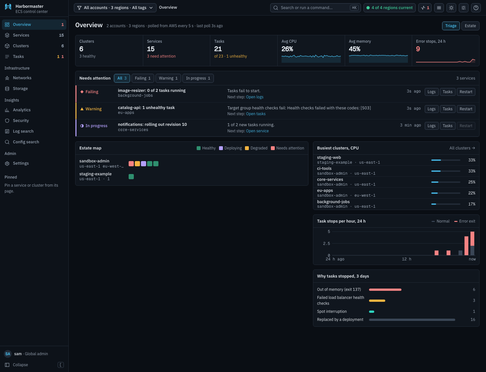

# Harbormaster documentation

Harbormaster is a web control center for AWS ECS. It gives a DevOps team one place to see what runs across their AWS accounts and regions, how it behaves, and to change it safely: clusters, services and tasks, task definitions, ECR images, EFS, VPCs, CloudWatch logs and metrics.

## Start here

| If you want to… | Read |
|---|---|
| Understand what Harbormaster is and whether it fits | [What is Harbormaster](getting-started/what-is-harbormaster.md) |
| Try it on your laptop with fake AWS data, no credentials | [Quickstart (local)](getting-started/quickstart-local.md) |
| Run it in your AWS estate | [Quickstart (AWS)](getting-started/quickstart-aws.md), then [Install](install/prerequisites.md) |
| Use the web app day to day | [User guides](guides/navigating.md) |
| Run it in production | [Operations](operations/health-and-metrics.md) and the [hardening checklist](security/hardening.md) |
| Look up a setting, flag, endpoint or Terraform input | [Reference](reference/configuration.md) |
| Contribute code or docs | [Contributing](community/contributing.md) and [Development environment](development/dev-environment.md) |
| Report a security issue | [Reporting vulnerabilities](security/reporting-vulnerabilities.md) |

## How the docs are organised

- **Getting started**: what Harbormaster is, the ideas behind it, its architecture and two quickstarts.
- **Install**: building the image, deploying with Terraform, connecting AWS accounts, single sign-on, split services and the MCP gateway.
- **User guides**: task-by-task how-tos for the web app, from deploying a change to sending failure alerts to Slack.
- **Operations**: health, high availability, throttling, costs, retention, backups, troubleshooting and runbooks.
- **Reference**: exact, complete tables for configuration, the command line, the HTTP API, permissions, metrics and the Terraform modules.
- **Security**: the security model, the IAM permissions Harbormaster uses, a hardening checklist and the vulnerability reporting policy.
- **Development**: setting up a dev environment, the repository layout, testing, conventions and releasing.
- **Community**: how to contribute, the code of conduct, governance, support, licence and changelog.

## Licence

Harbormaster is open source under the [MIT licence](community/license.md).
